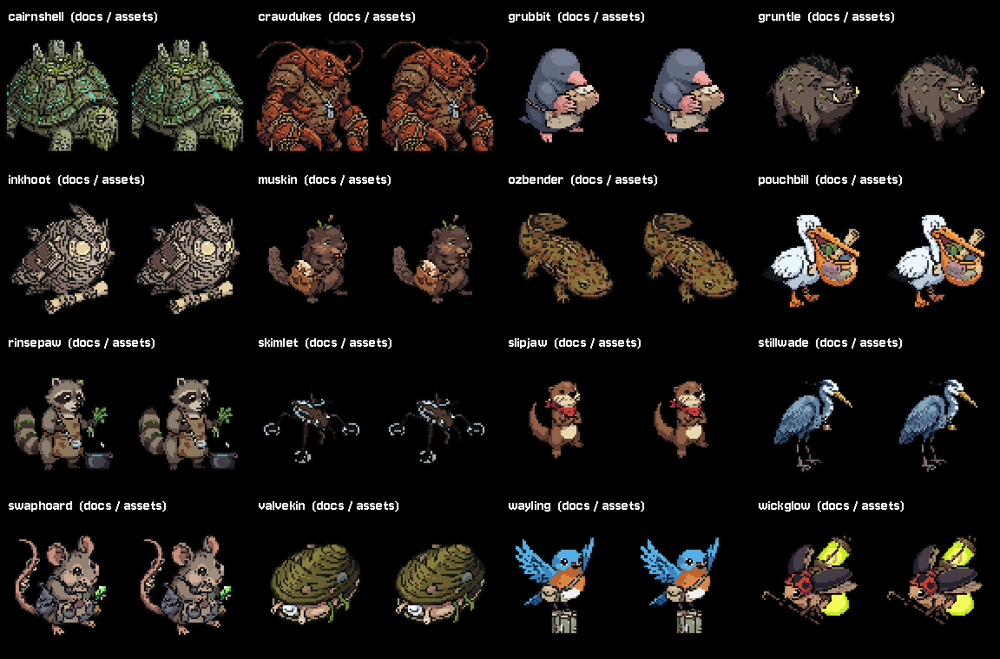

# C22 arena fronts in assets, October 26, 2026

COMPLETE/INSTALLED. All16 existing `*_arena_front_chosen.png` images have byte-identical runtime copies at:

`res://assets/sprites/arena/<form>/front_chosen.png`

Example: `res://assets/sprites/arena/gruntle/front_chosen.png`. The runtime image names are role-based inside their existing creature folders, so palette/recolour/cleanup tools that walk each form's folder also include these fronts. No maintenance-tool code changed.

`board_scene.gd` now reads that path for its existing stand-in fallback. Its only edits are the path literal and the obsolete C22 comment. Claude's current Tower dialogue and `Layout.way_to` routing, primary town/dungeon-set preference,66px sizing, shader, facing and all scene behaviour are exact to the fresh dirty-file snapshot. No story rewrite. The final filenames/path are already wired; Claude does not need to repoint them again.

## Files and provenance

The16 chosen fronts total121,988 PNG bytes. [Manifest](manifest.json) lists every original/destination, size, file SHA and RGBA SHA. Forms: cairnshell, crawdukes, grubbit, gruntle, inkhoot, muskin, ozbender, pouchbill, rinsepaw, skimlet, slipjaw, stillwade, swaphoard, valvekin, wayling and wickglow.

Originals, alternate takes, rotations, generation receipts and research remain in `docs/creatures/arena-starters-2026-10-07/forms`. Existing tools still read that working history, so it was not deleted. All486 original files were hash-checked unchanged. Only selected `_chosen` fronts were promoted; no raw/rejected take was made a runtime selection. This is a runtime relocation using verified copies, not an art revision.

With the former board reference gone, no literal `res://docs/` reference remains in scripts/scenes/data/dialogue. The export preset now excludes **docs/** entirely, replacing its four archived-code-only exclusions. Runtime fronts no longer depend on documentation images. Raw art originals and this evidence stay available to development tools on disk.

## Verification

- **52/52 native**, clean log, Compatibility/Dummy/fixed30. All16 old/new images match dimensions/RGBA; the actual board factory creates nonempty66x66 fallback textures matching the old textures exactly. The test copies alter only town/dungeon lookup prefixes to force the fallback for every form, rather than letting existing directional sets bypass it. A small disposable host places the sprites for the comparison gallery. It is not a claim to have played the whole story in that gallery. Real gruntle/mirekit/whinet directional sets remain available and a private save SHA is unchanged. [Fixture](native_check.gd), [mock host](mock_town.gd), [results](native-result.json), [log](native.log), [command/profile](native-command.json).
- **49/49 asset-only PCK assertions**, clean import/export/run. All16 resolve as imported textures, return exact original RGBA through a byte-identical copy of the current `UI.res_image` method, and have **no raw PNG** inside the pack. A docs-source sentinel is also absent. It runs from an empty directory. [Pack fixture/driver](pack_check.py), [tested image-reader method](tested-res-image.gd.txt), [runtime log](run-pack.log), [commands](pack-commands.json), [result](pack-result.json), [asset-only PCK](arena-fronts-probe.pck), [fixture project](asset-pack-per-form-probe/). Import defaults match the live project. This proves the relocated images' imported path, not the full Windows game export.
- Maintained **board_scene PASS**, exit0: crew present, parcel taken, partner down/up, crew departure, met flag and no repeat meeting. [Runner result](runner-result.md), [raw log](runner/board_scene_check.log). Its existing raw exit warning4 ObjectDB/2 resources remains; not a clean headless teardown claim.
- [Preservation report](verification.json), [source diff](source.diff), [owned hashes](installed-files.json), [original form hashes](original-forms-hashes.json), [original source snapshots](originals/). Two integration files changed: board path/comment and export exclusion. Project settings, menus, shared image reader, town/scene toolkit, creature rules and Claude's other board edits preserved.

The final per-form layout replaced an initial shared-folder placement so the existing per-form art maintenance tools naturally cover the assets. All checks above were rerun for the final paths. The initial pack fixture used an unsupported byte-array hash shorthand; [parse diagnostic](pack-fixture-parse-attempt.log) is retained and the fixture now uses HashingContext. No production art or loader repair was required.

## Handoff and remaining work

Source issues for Claude: Mirekit and Whinet had no `_arena_front_chosen.png` in the original docs, and no new front selection/alias was invented. Both have usable current directional sets, verified natively; this preserves their existing behaviour. A fallback front for either would be a separate art-selection task. Existing primary directional sets continue to take precedence for all forms.

C22 path integration is complete and the final URI is above; no cross-chat message was sent. Full Windows executable/exported street, Home desk, board, Hollow and second-launch cache QA still waits on the export templates, as in C11. The asset-only PCK does not close that review or enable town_room's exported worker-art path.

Next actionable queue item is **FX-01**, the empty Sail Slash/Mark Glyph attack-effect frames. C6 remains OFF; town/exterior art stays on HOLD pending named slots. No new art generation, paid call, real save, rules, Route1 edit or commit. Native images reviewed by Codex, Preston approval not claimed. [Team handoff](../../team/CODEX_HANDOFF_2026-10-26_arena_fronts.md).
