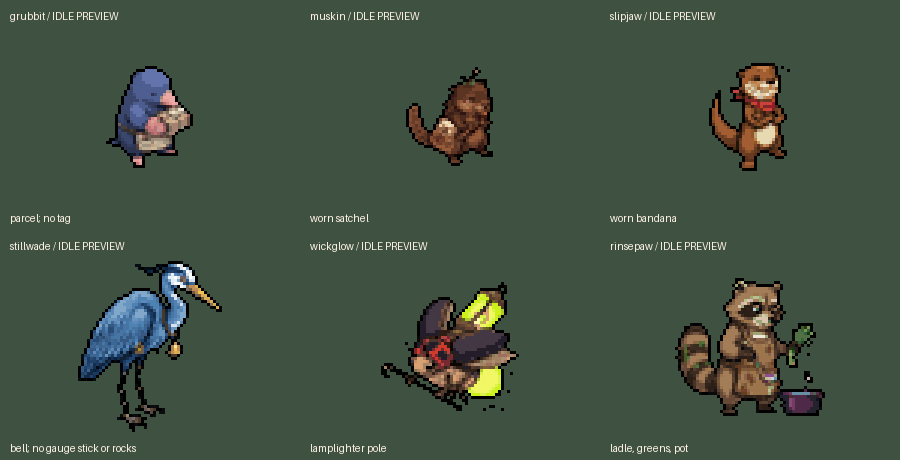

# Six crew idle stills, October 11, 2026

Task 2 of Claude's [master queue](../../team/CODEX_TASKS_2026-10-11.md): prepared and installed six new `assets/sprites/arena/<form>/town/idle_s.png` files. **Assets are ready for Claude's standing swap. Production wiring is still pending and was not changed here.**

| Creature | Town canvas | South baseline (zero-based y) | Retained objects/gear |
|---|---|---:|---|
| Grubbit | 53 x 53 | 41 | parcel; no tag |
| Muskin | 55 x 55 | 43 | worn satchel |
| Slipjaw | 72 x 72 | 51 | worn bandana |
| Stillwade | 89 x 89 | 73 | bell; no gauge stick or rocks |
| Wickglow | 70 x 70 | 51 | lamplighter pole |
| Rinsepaw | 72 x 72 | 59 | ladle, greens, pot |

## Preparation

Each idle comes from its current chosen front in `docs/creatures/arena-starters-2026-10-07/forms/`. Those references were not included in Claude's recolour tool's file list, so the new copies receive each form's existing `recolor_creature.SCHEMES` rule, including Stillwade's current accent. No new colour scheme or generated artwork. Chosen source PNGs remain byte-exact.

Used the project's palette-locked `downscale.resample`, with the existing full-size/town canvas ratio. Held objects do not enter a new mass calculation that would shrink the creature. Hard binary alpha, the same black edge rule as task 1, centered whole silhouettes and exact current south baselines. Every solid resampled pixel fits with transparent padding; no job object is cropped. Native shared shader remains unchanged.

Grubbit's removed tag, Stillwade's removed stick/rocks and the worn-gear/held-object distinctions are preserved from the chosen sources. Muskin and Slipjaw have nothing new in their hands. Rinsepaw retains the pot, greens, ladle and steam; Wickglow retains the pole.

## Verification

**Godot 4.7.2, OpenGL compatibility: 31/31 staging and 31/31 live.** [Live log](live-verify.log), [fixture](verify.gd), [install audit](install-audit.json). All six ResourceLoader imports match prepared RGBA and exact town dimensions; south baselines and padded GPU output pass. Previewed on the real town room NPC sprite holders with the real shared shader. All 384 existing crew walk frame selections still work at the same anchors, and the preview returns to idle after walking.

The [whole Hall preview](review/live/hall-idle-preview.png) is a private fixture demonstration: each NPC's south still is replaced in memory for that check, and Grubbit is added temporarily to the lower Hall. This is not a production post/facing change. The normal game still uses Claude's current standing logic. No claim of automatic live switching until Claude wires it.

All 927 protected files remained exact, covering 918 existing crew/source PNGs plus the size/recolour tools, room/crew/scene-kit scripts, shader files and project settings. [Fresh snapshots](originals/), [manifest](manifest.json) and [protected hashes](protected.json). Only six new PNGs, their six import metadata files/derived caches and handoff evidence added. Existing walks, stills, chosen fronts, task 1 outlines, recolour backups and prior art remain intact. No generation, paid call, commit, reset, stash or revert. The final live native run has no errors or leaks; staging has the existing third-party UID fallback and sandbox certificate message.

## Claude integration contract

- File convention: `res://assets/sprites/arena/<form>/town/idle_s.png` for all six crew.
- Exact same canvas as `town/s.png`; no new sprite scale/offset needed.
- Use only while standing and facing south. Retain the current walk dictionary and other facing stills.
- Private preview assigns the idle to `e.still.s`, then calls the existing `room._place`. Current `room._process` selects the walk texture during movement and `still[facing]` on completion. Claude owns the production hook.
- Grubbit's normal post faces west and Slipjaw's east; this asset preparation does not change their post facings or invent extra idle angles.

Next Codex asset task: task 3, Hall fixtures on Claude's current corrected perspectives and solids. Tasks 3 through 6 remain pending. Re-read the master queue and current live source before work. Private preparation/native drivers: `D:/dev/hollowtide-crew-idles-20261011/`. Do not rerun the guarded snapshot/install over newer assets.
