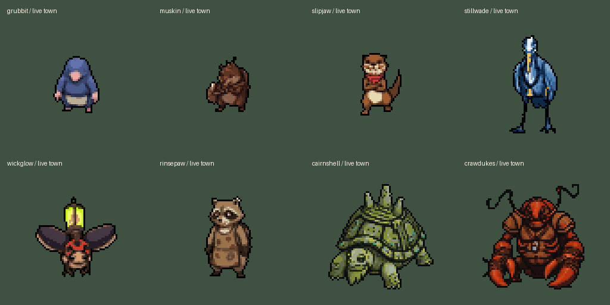

# Eight-creature outline pass, October 11, 2026

Task 1 of Claude's [master queue](../../team/CODEX_TASKS_2026-10-11.md) is installed. Grubbit, Muskin, Slipjaw, Stillwade, Wickglow, Rinsepaw, Cairnshell and Crawdukes use the same deterministic black sel-out rule as `tools/arena/selout.py --black`.

## Installed scope

1,224 current PNGs: 64 full-size facings, 128 town/dungeon stills, 1,024 walk frames, and eight chosen NPC fronts in `docs/creatures/arena-starters-2026-10-07/forms/`. No resizing, frame movement, peeling or repainting of interiors. All source alpha and dimensions are exact. Worn gear, job objects in the chosen fronts, recolours and rebuilt 208px Cairnshell/Crawdukes game sets are retained. This does not create `town/idle_s.png` or dialogue portraits; those are tasks 2 and 4.

Only opaque pixels bordering transparency in four directions and at least 12 luma above the form's existing darkest line colour change. That line is black for seven forms and (7,0,0) for Crawdukes, as the named tool derives it. 139,652 selected edge pixels changed. Every other RGBA pixel stays exact. The pass is idempotent.

Fresh pre-pass PNGs are byte-exact in [originals/](originals/); [manifest](manifest.json) records before/after SHA-256, dimensions and changed-pixel count for each asset. Older sel-out/recolour/clipped-walk backups remain intact. The normal tool was not run against its historical backup tree because that could restore older colours and clipped sets.

| Form | PNGs | Edge pixels changed |
|---|---:|---:|
| Grubbit | 153 | 9,766 |
| Muskin | 153 | 11,731 |
| Slipjaw | 153 | 11,753 |
| Stillwade | 153 | 16,252 |
| Wickglow | 153 | 16,175 |
| Rinsepaw | 153 | 14,221 |
| Cairnshell | 153 | 24,236 |
| Crawdukes | 153 | 35,518 |

## Review and verification

Inspected all 16 numbered walk sheets, one facing per row and frames 0 through 7: all 1,024 town/dungeon walk frames. The pass changes neither anatomy nor registration; no additional canvas clipping or missing body parts were introduced. Before/after sheets are in [review/](review/). Chosen source fronts keep their existing canvas boundaries, including the historical bottom/side cuts in the Cairnshell/Crawdukes chosen references; their rebuilt game facings are the current padded 208px versions. This pass does not outpaint source references.

Godot 4.7.2, OpenGL compatibility, GTX 1660 SUPER: **37/37 staging and 37/37 live checks pass**. [Live log](live-verify.log), [fixture](verify.gd). ResourceLoader verifies opaque RGB, alpha and dimensions for all 1,216 game PNGs against prepared pixels. Actual shared shaders render every walk and full facing in padded cells. Real Hall crew posts/facings remain correct; the room animation selects every facing/frame for all six crew with identical sprite anchors (384 selections).

Whole actual world-layer captures show [lower Hall](review/live/hall_low_whole.png) and [upper Hall](review/live/hall_whole.png). These fixture-only captures expand the room viewport after logic checks so all posts can be reviewed. Native per-form walk/facing captures are in [review/live/](review/live/).

The full staging editor import stalled while creating autoloads; a separate texture-only Godot project imported these exact PNGs using existing per-file settings. Derived caches were copied only for the owned textures. 296 newly created runtime textures lacked live `.import` metadata; their generated metadata was added. Existing import settings and metadata were preserved. The final live run has no errors or leak warnings. The staging run logged a sandbox certificate error and a third-party UID fallback, neither present in the final live run.

No game scripts, shaders, scenes, rules, palettes beyond selected edges, room fixtures, solids, story wiring, save data or `project.godot` were edited. All 1,018 protected code/settings files stayed exact during cache installation. [Install audit](install-audit.json). No generation, paid Retro call, commit, reset, stash or revert.

## Next

Task 2: prepare six crew `town/idle_s.png` stills from these now-outlined chosen fronts, preserving held job objects and matching each current town set's size and palette. Claude owns the standing/walking swap in `guild_crew.gd`. Continue from the current live project and re-read the master queue. Private work and native drivers: `D:/dev/hollowtide-crew-selout-20261011/`. Archived scripts preserve evidence of this pass; do not rerun snapshot/install over a newer live set.
