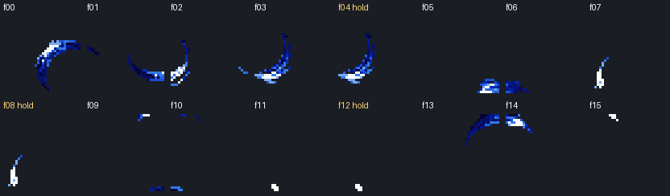
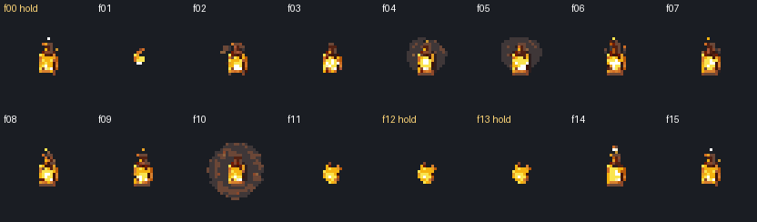

# FX-01 empty effect frames, October 26, 2026

INSTALLED: the six empty runtime slots now use exact neighboring-frame holds. Both effects retain their 16 frames, 32x32 canvas, palette, registration and existing playback duration. The other 26 frames are byte-identical. Original sheets and original cuts are preserved in [originals](originals/).

The six cells are fully transparent in the original 256x256 source sheets, not lost during downscaling. Re-cutting those same cells reproduces the blanks. This repair uses existing painted pixels; it does not claim to recover six missing drawings or to finish the source sheets' animation quality.

| Effect | Empty slot | Exact source hold |
| --- | --- | --- |
| sail_slash | f04 | f03 |
| sail_slash | f08 | f07 |
| sail_slash | f12 | f11 |
| mark_glyph | f00 | f15, preceding frame of the loop |
| mark_glyph | f12 | f11 |
| mark_glyph | f13 | f11 |

Runtime paths remain `res://assets/sprites/arena/vfx/sail_slash/fNN.png` and `res://assets/sprites/arena/vfx/mark_glyph/fNN.png`. No repoint or runtime wiring is needed from Claude. `tools/arena/slice_vfx.py` now applies only these six explicit holds when their source cell is empty. A future nonempty source cell automatically takes precedence; a missing donor raises an error. Every other sheet/cell uses the existing cut/downscale path.

## Native review

All frames below came from the current dungeon's `_fx_sheet` and `_draw_fx` methods in a disposable transparent viewport. This isolates the art without changing scene or gameplay code. Nearest 3x enlargement, native canvas 32x32. Holds are labelled.

[Sail Slash before](sail_slash-before.png), [Mark Glyph before](mark_glyph-before.png), [source-cell audit](audit.json), [Sail source grid](sail_slash-source-grid.png), [Mark source grid](mark_glyph-source-grid.png). Illustrative native-frame loops: [Sail Slash](sail_slash-native-loop.gif), [Mark Glyph](mark_glyph-native-loop.gif). GIFs use 50ms holds for review; game timing was not modified.

## Checks and preservation

- **67/67 native assertions, final log clean.** Actual dungeon loader retains 16 frames per effect; all 32 imported textures are nonempty, 32x32 and pixel-identical to the runtime PNGs. Actual dungeon draw selects and visibly renders every slot. Explicit private save sentinel hash unchanged. Compatibility/OpenGL, Dummy audio, fixed 30fps. [Fixture](native_check.gd), [results](native-result.json), [command/profile](native-command.json), [log](native.log).
- **Maintained dungeon_vfx PASS**, exit 0: projectile/hit/shake, Rake, Ember Feint, Seed Pod and wind-up regression. This check does not specifically exercise Shear/Signal Mark; the native fixture above covers their two art sheets directly. Its raw shutdown reports 23 ObjectDB instances and 9 resources; retained in [raw log](runner/dungeon_vfx_check.log), not a clean-teardown claim. [Runner result](runner-result.md), [command](official-command.json).
- Private cutter rebuild reproduces all 32 outputs; only six differ from originals, and each is byte-identical to its specified donor. [Rebuild log](rebuild.log), [private project-shaped fixture](rebuild-fixture/), [manifest](manifest.json), [source diff](source.diff), [verification](verification.json), [installed hashes](installed-files.json).
- Dungeon/arena code, TeamState, shared UI, project/export settings and all other snapshotted source files are unchanged. Claude's and Grok's uncommitted work is preserved. Only six PNGs and their cutter were installed. No build_dungeon_set.py run is relevant: these are effect assets, not creature directional sets.

Editor connection was ready on Hollowtide, arena_prototype open, game stopped. Native tests used the separate Godot 4.7.2 executable and private APPDATA/LOCALAPPDATA. The private headless editor import exited 0 but emitted existing plugin/theme and audio-UID/save-resource diagnostics, retained in [import log](import.log); a clean editor-import claim is not made. First native comparison emitted development-only raw res:// image warnings; [diagnostic log](native-raw-image-diagnostic.log) retained. The fixture now reads the comparison PNG by absolute path; final native log is clean. No plugin/audio repair was attempted.

## Source issues for Claude

The source sheets genuinely omit these six drawings. Holds close the empty-slot defect; the source quality remains a separate art task. Sail Slash also contains preexisting fragmentary/cell-edge cuts in its unchanged frames. No new pose, art selection, paint or paid generation was invented to hide that limitation. Original provenance remains under `docs/creatures/arena-starters-2026-10-07/vfx/` with its existing receipts.

Next ordered slice: **ART-08 Muskin back view**. Portrait crops still await Preston's look; C6 stays OFF, town/exterior art stays HOLD. C11 full Windows export/painted-art/cache review still waits on templates. No real save, rules, Route 1, cross-chat message or commit. Codex reviewed the native frames; Preston visual approval is not claimed. [Team handoff](../../team/CODEX_HANDOFF_2026-10-26_empty_fx.md).
