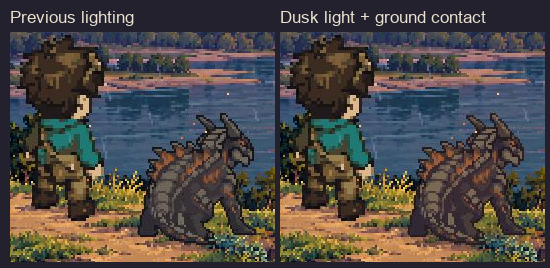

# Cinderhide in the Courier Lookout dusk lighting

Preston said the male courier blends into the scenery more naturally than Cinderhide. This revision brings the existing menu Cinderhide into the landscape's sunset lighting while preserving its shape and animation.

The new atlas uses warm sandstone and amber in lit armor, muted plum in shade, a colored dark contour, a small upper-right sunset rim and reflected ground warmth. The menu script adds a subtle, static two-layer contact shadow beneath the creature. The courier and scenery are unchanged.

## Actual menu comparison

Both captures show Cinderhide frame 4 at menu time 0.817. The comparison uses actual game captures at native display scale. Weather can vary between captures.

[Full menu capture](menu_dusk_integration_review.jpg) | [Prepared eight-frame animation](dusk_lit_idle_review.gif) | [Frame review](dusk_lit_frames_review.png) | [Lighting comparison](dusk_lighting_still_review.png)

## Exact changed project files

Modified:
- scripts/main_menu_art_preview.gd: load the dusk-lit atlas and add CinderhideContactShadow at feet (432,448), behind Cinderhide.
- docs/team/MENU_RETRO_DIFFUSION_HANDOFF_2026-10-01.md: prepend the latest state and retain prior history.

Added:
- assets/sprites/menu/retro_diffusion_idle_2026_10_01/cinderhide_idle_dusk_lit_atlas.png
- Its engine-generated .png.import companion.
- docs/art/menu/cinderhide-dusk-integration-2026-10-01/README.md
- dusk_lighting_manifest.json
- runtime_check.json
- dusk_lighting_still_review.png
- dusk_lit_frames_review.png
- dusk_lit_idle_review.gif
- menu_dusk_integration_review.jpg
- menu_dusk_before_after.png

The atlas is 640x80 with eight 80x80 frames. Exact alpha, silhouette and native pixel grid are preserved; no resampling. The fixed lower band begins at y=62 and remains identical across frames. Zero visible white pixels. Source and prior atlases remain saved.

Source atlas SHA256: 7b6c7f984e14fc94d1f8e42d09e27cc7e7d6508350b18839d77ee5fe9bfce4ea
New atlas SHA256: 56f89a5f218272f4d7cff9dd893d61139118d5681fd05cd61cf5c54d142475b1
Menu script SHA256: 489ef4bcfba49d341307905b0fed021604471b5e6dbe7dae433cbfdb55db0133

## Verified

Summer 0.5.68, fresh offscreen menu-dusk-review, deterministic 60 FPS. Observed frames 4,5,6,7,0,1,2,3,4 from menu time 0.817 through 4.017. Actor position (353,304) and shadow position (432,448) stayed fixed. Actual capture: process/image frame 2585, physics frame 2586, 1152x648. Inspected the image and the full prepared animation.

Post-play diagnostics: zero runtime, open-script and total errors; ten existing warnings in inherited menu/battle scripts. Both cold binary-import and screenshot-copy helpers completed without script or boot errors. The disposable review instance was stopped.

The existing 2x nearest display, 3.2-second Cinderhide cycle, phase 0.8, pose and feet anchor are unchanged. New Game and Reduce Motion were not retested in this pass; their unchanged code and earlier successful checks are recorded in the handoff.

No paid generation this revision. No gameplay, battle art, research, launch-setting or shared collaboration-file edits. No commits, staging or discarded work. No implementation blocker.

[Pixel and lighting receipt](dusk_lighting_manifest.json) | [Runtime receipt](runtime_check.json)
