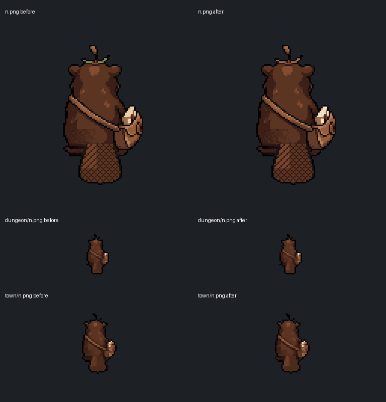

# ART-08 Muskin back palette, October 26, 2026

COMPLETE/INSTALLED. Muskin's north-facing still now uses the existing south/front palette. No new artwork, silhouette change or rescaling. Three PNGs changed; the remaining 318 snapshotted Muskin asset/import/source-walk files are hash-exact. Claude's and Grok's uncommitted sources are preserved.



Before is left, after is right. Enlarged nearest 3x. The shoulder strap, satchel, tail texture, twig and black outline retain their shapes and positions; selected RGB values change to the front's palette.

| Installed path under assets/sprites/arena/muskin/ | Before colors | After colors | Unchanged canvas |
| --- | ---: | ---: | --- |
| n.png | 129 | 21 | 128x128 |
| dungeon/n.png | 70 | 18 | 37x37 |
| town/n.png | 92 | 20 | 55x55 |

The current front `s.png` uses 23 opaque RGB colors. Every output color is an exact member of that palette, below the requested 30-color ceiling. Alpha is byte-identical at every pixel in all three replacements. The source mapping uses the existing resampler's weighted squared RGB distance (2 red, 4 green, 3 blue). Rebuilt north stills retain the existing black edge finish without peeling or changing alpha. [Manifest/hashes](manifest.json), [build metrics](build-result.json), [original assets](originals/), [prepared replacements](prepared/).

## Rebuild and preservation

Ran the unchanged current builder for Muskin in separate baseline/updated private project-shaped folders:

```text
python tools/arena/build_dungeon_set.py muskin
python tools/arena/build_dungeon_set.py muskin --set=town --scale=1.5
```

The baseline and updated rebuilds differ only in `dungeon/n.png` and `town/n.png`: source alpha/mass are unchanged, so stage size and every other rebuilt frame remain identical between them. A bare baseline rebuild differs from 144 currently installed PNGs because their finishing history is not reproduced by that builder. Those unselected results were not installed. All other current bytes, including every walk frame, other seven facings, `town/idle_s.png` with the job object, and `front_chosen.png`, remain exact. No builder/script/scene/settings edit. [Exact four commands and output](build-commands.json), [current builder/dependencies](build-dependencies/), [preparation script](prepare.py), [verification](verification.json).

## Native verification

**28/28 native assertions, clean log**, Godot 4.7.2 Compatibility/OpenGL, Dummy audio, fixed 30fps, private APPDATA/LOCALAPPDATA and explicit private TeamState save path.

- All three imported textures match the prepared RGBA pixels; alpha/canvas are exact to the originals, nonempty, and within 30 colors.
- Shared creature-finish shader renders matched original/repaired sprites at 3x in a transparent native viewport. [Native before/after](native-before-after.png), same row order as above.
- Actual dungeon `_load_art("muskin")` resolves the repaired north texture; `_set_tex` selects it with its original ground/foot row.
- Actual `SceneKit.spawn` selects `town/n.png`, keeps the south job-object idle, and loads eight walk frames for every facing. Disposable town host, not a full Hall story playthrough.
- Explicit private save sentinel SHA unchanged. All snapshotted gameplay/rules/tool/scene/settings source files exact, with no concurrent changes detected during verification.

[Fixture](native_check.gd), [mock town host](mock_town.gd), [native result](native-result.json), [native log](native.log), [command/profile](native-command.json). A minimal three-texture project imported the exact PNGs with existing live per-file settings; import clean. Only the three corresponding `.godot/imported` texture/cache checksum pairs were copied, and every live `.import` metadata file stayed byte-identical. [Import log](import.log), [import command](import-command.json), [cache receipt](cache-installed.json). No full-project editor import or export claim.

## Source issues for Claude

ART-08 is wired through the existing filenames; no path or runtime patch is needed. Both named set rebuilds are done. The remaining issue is the existing finishing-order mismatch: do not blanket-copy a bare Muskin rebuild over the other installed 144 outputs. This pass archives the exact current inputs and retains every unselected installed frame. No creature identity, anatomy, moves, stats or save model changed.

Next ordered task: **ART-03**, re-cut the title village image to 384x216. Portrait crops still await Preston's look; C6 remains OFF, town/exterior HOLD, C11 full Windows export/painted-art/cache review pending templates. No paid call, image generation, real save, Route 1, cross-chat message or commit. Codex reviewed the native comparison; Preston visual approval is not claimed. [Team handoff](../../team/CODEX_HANDOFF_2026-10-26_muskin_back.md).
