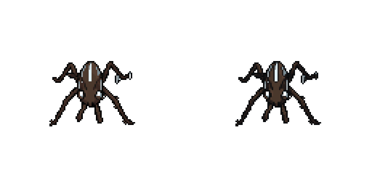

# New creatures sel-out and Skimlet leg correction — October 10, 2026

Covered Skimlet, Ozbender, Valvekin, Wayling, Swaphoard, Pouchbill, Inkhoot, Cairnshell and Crawdukes. Their current root/town/dungeon/portrait textures receive the existing near-black Hollowtide Sprite finish with the 0.65 bounded internal ink used on Gruntle and the crew. Source art, colours, alpha, animation files/timing, scaling, layout, stats and story remain unchanged.

Skimlet's two exact pale swatches (white and 225/241/247) are corrected only on thin silhouette edges with six or fewer occupied neighbours, using its existing leg brown before the contour ink. The user-identified three pixels at source south (89,51..53) and isolated (82,54) are corrected. Central body stripe and eyes stay exact. Other forms never enable this correction. Original PNGs remain untouched; reslicing/generation backups are preserved.

Team-page new-form headshots and still breathing previews use a separate finished sprite layer. Missing arena headshots fall back to the existing dialogue portraits. Frames clip finished creatures, retaining Gruntle's lower-left fix. Older forms, Sparkwick's separate layer, panels/shadows/text/labels, controls, data and selection methods remain unchanged. The current nine new forms have no registered large idle, so their existing still-and-breathing path is retained.

## Native checks

- 6/6 GPU comparisons over 1,329 installed new textures: all finished alpha/silhouettes exact, bright highlights exact for the other eight new forms, Skimlet specified dots corrected and eye/central highlights exact. Every older form's south-view output stays exact, including jade Oxbowarchon, Sparkwick, Gruntle and Starward. Switching resets Skimlet's correction.
- Actual Town and Dungeon with the three new wild forms confirm their materials. Real Team pages and previews pass. Dialogue portraits and dismissal pass, including Gruntle's clipped frame.
- Existing field-menu check passes, including Team text/controls, Bag item consuming a turn, and town pages.

## Concurrent gameplay update preserved

During review `Arena.KITS` initially lacked Skimlet, Ozbender and Valvekin. The early new-team and Hollow trials reported missing keys. Claude added those lookup entries concurrently; his current arena source was preserved untouched and copied into the isolated review project. The final live two-dungeon check passes without those errors: first crew boss, Rot Spit healing reduction, Drain Bite healing, valley/ruin/Warden pond and town routing. Final logs supersede the earlier trials. No kit/stat/rule table was edited in this art pass.

The final scene fixture constructs an actual three-member Skimlet/Ozbender/Valvekin town team, opens their real Team pages, checks dialogue and then constructs the same three actual dungeon actors. Earlier art-only fixture trials are superseded. A natural dungeon clear is not claimed. The six townsfolk currently have rotations/town stills and newly added dialogue portraits; their future NPC story/service placement is outside this finish slice.

## Previews

Left: previous finish. Right: new sel-out and corrected leg dots. Individual nine-form pairs are in review/live; native scene and Team presentation screenshots are in review/live-scene. Visual approval remains Preston's.

Original code, staged/installed candidate, explicit guards, baseline, logs and preservation audit are archived here. No commit, source PNG edit or settings edit.

Final audit: 16313 protected baseline files exact; 15314 original asset files exact; 1 concurrent paths retained. See audit.json.
