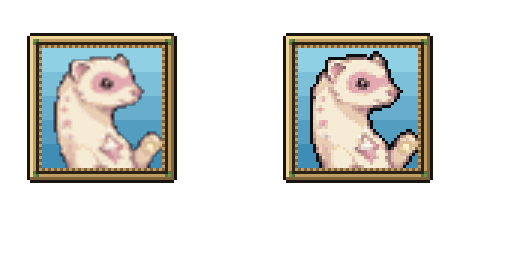
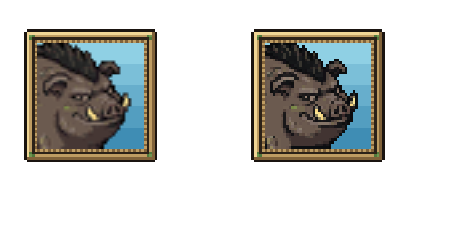

# New creature/scene sel-out — October 10, 2026

Starward and Gruntle base/expression dialogue portraits now use the current Hollowtide Sprite finish. Starward receives its normal silhouette/cluster finish; Gruntle receives the existing rival crew's 0.65 internal contour ink. Mirekit/Whinet expressions now follow their own rival finish. Individual pooled Sprite2D portraits keep the outline on the source pixel grid and leave frames, background motifs, emotion marks and text separate. Each portrait sprite sits inside a clipped window so expanded contour pixels cannot cover the brass border, including Gruntle's lower-left corner Preston flagged. Town now has the same creature-only portrait layer as the dungeon. Gruntle's dynamic Board NPC fallback keeps its identity when its texture has no resource path.

No generated redraws or source PNG edits. Shared shaders, source face shapes, palettes, animation frames, scaling, paths, entrances, rules, story and settings are unchanged. Original and late Claude source snapshots are archived. The late crew sound effects, creature-line lookups and blue portrait background were merged before installation. Rejected expression takes stay rejected; cached stale Whinet variants were excluded from the fixture using the live baseline.

## Live verification

- 9/9 native GPU comparisons; 4,056 town/root textures, including the newer town sets added during the pass, and 27 installed crew/Starward portraits. Existing forms' town finish byte-exact, including jade Oxbowarchon and Sparkwick correction. Gruntle finished alpha and bright highlights exact. Every pixel outside the 120x120 portrait window and the emotion marks remain exact; switching reuses one sprite; closing hides it.
- Native Town and Dungeon Gruntle angry/Starward worried portrait presentation and dismissal pass. The scene fixture's verification sentence exists only in the test.
- Actual first Board encounter completes: crew present, walk starts it, partner shoved then restored, crew depart, met flag set, absent on next visit.
- Hub: 13 reachable places, no building overlaps, all 12 services answer E, partner follows and Hollow gate works.
- Current two-dungeon check: first crew boss, Rot Spit healing reduction, Drain Bite healing, Warden valley/ruin pond, town's first/Hollow routing all pass.

Earlier review runs reported a Windows certificate-store error at startup. Final live native logs contain no errors or leaked instances. Headless trial runs could not capture native textures; final proof uses the actual Compatibility renderer.

## Previews and preservation

Before is left; installed runtime finish is right. Full scene shots are in review/live-scene-portraits and review/live-board.

Originals, reviewed candidate files, test scripts, native logs, baseline, guarded before/after hashes and audit are retained here. Source art and all previous backups were never overwritten. Preston's visual approval is not assumed; natural dungeon completion is not claimed. Job12 waking story remains pending in the handoff.

Final audit: 12529 baseline files exact outside installed hooks/concurrent work; 11677 original asset files exact; 1932 concurrent paths retained. See audit.json for precise scope.
