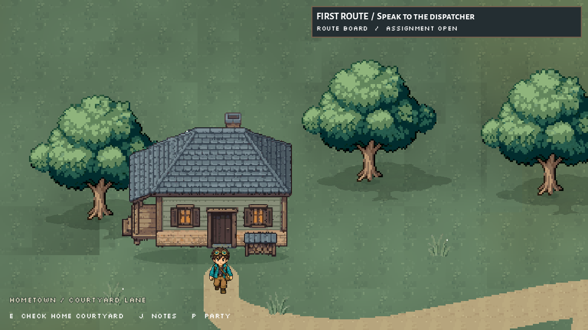
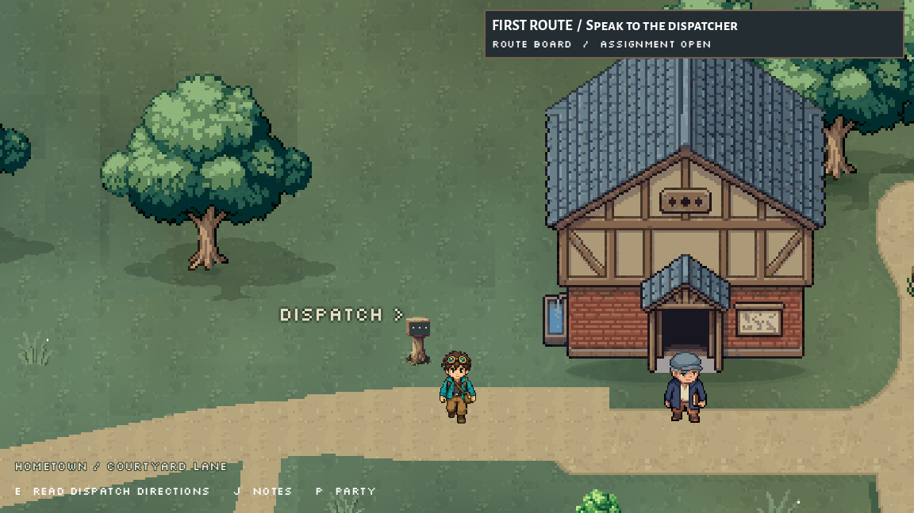
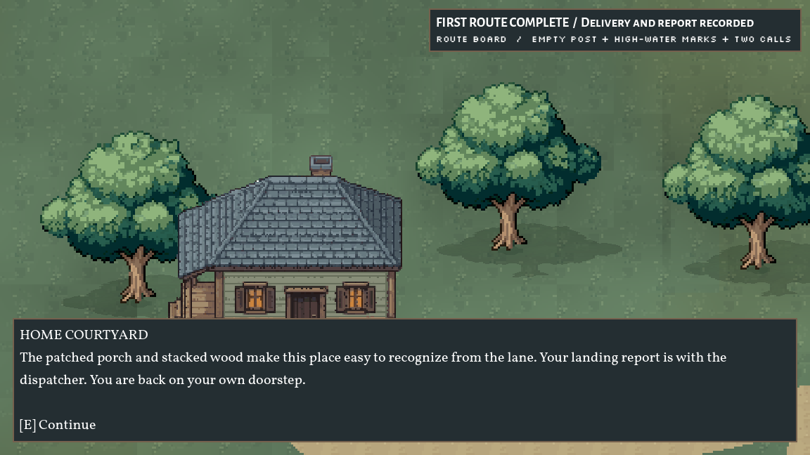

# Connected hometown courtyard
October 3, 2026. Implemented for Preston's active Hollowtide world/map goal. Later world and sprite requests supersede the October 1 menu-only handoff.

The west-bank hometown is now a compact attached 480x384 level: courtyard home, shared garden loop and a continuous lane into the existing dispatcher/Route 1. New journeys start at (-336,192). The west boundary opens only through y=168..216. Returning uses the same courier, route scene and party member, retaining the existing assignment/observation/report state.

HOMETOWN, HOME COURTYARD and SHARED GARDEN are descriptive prototype labels. Final fictional names remain open. The home/garden texts are environment proposals, not new canon, lore reveals, quests or rewards. The door supports a courtyard observation; no interior is built.

## Installed views

Start/return images are ordinary-input captures. Installed-* images are isolated camera fixtures, not traversal evidence.

## Exact runtime changes
- New scripts/hometown_courtyard.gd and scenes/hometown_courtyard.tscn: native terrain, home, six distinct existing cottonwood variants, planted beds, notices, foot collisions, crown visibility and quiet foliage motion. The attached level uses the existing route's player/HUD/music/state.
- New assets/sprites/world/hometown_courtyard_2026_10_03/courtyard_home.png: exact RD output, 160x144 RGBA, 43 opaque colors, 13925 occupied pixels and zero opaque edge pixels. Displayed at 0.75 scale, whole roof/porch/wood stack preserved.
- New hometown_lanes.png in that folder: 528x384 RGBA, rounded courtyard/garden/gate paths and beds assembled offline from the existing ground atlas's soil cell (11,0). It extends 48 pixels into the existing lane with a tapered width transition. No runtime pixel rebuilding.
- scripts/first_route_prototype.gd: three informational home sites/prompts/messages, hometown area label, left camera bound -480; hometown bottom 384 and route bottom 640.
- scripts/route1_crossing.gd: west wall split above/below the lane. River/bridge/levee geography stays.
- scenes/first_route_prototype.tscn: attaches the home level and changes courier spawn from (48,192) to (-336,192). The unchanged menu still selects Male/Female before Player._ready.
- Normal script UID/two PNG import companions. All 10 runtime files are in the [manifest](runtime-file-manifest.json).

Guarded before/current sources and the [task-only diff](task.diff.txt) are retained. No menu/player/party/battle/creature rules/save files or launch setting changed. Ironvent's previously installed grey head finish still matches its verified hashes.

## Native verification
Summer D3D12/Forward+, fixed 60 FPS, offscreen, Dummy audio, API/publishing disabled. User editor untouched.
- Male: home observation, house-foot collision, garden loop/notice, upper/lower gate boundaries, directions, exit, full courier delivery/optional observations/bridge/city/report, return home. All eleven flags true; same route/courier/active party member identities.
- Female: selected model before _ready, material present, same home/garden/boundary checks, assignment then two home/dispatcher return trips. Only pouch_accepted true; flags and instance identities unchanged.
- No teleports or quest overrides. All informational observations left flags unchanged.
- Readiness: 954ms male / 1025ms female on this PC, excluding application boot/menu fade.
- 577 existing sprite/tile files preserved by SHA-256; 23 protected route functions unchanged. Other recorded runtime files stay exact except the three listed.
- Final visual/full/female runtime stderr logs empty. Owned checks exited. Initial/revised captures, first fixture type-declaration error and earlier successful runs retained separately.
- Headless imports emitted previously known CanvasItem/ObjectDB shutdown warnings; import logs are separate from clean game-runtime checks.

[Full walkthrough](review/full/walkthrough-results.json), [female repeat visits](review/female/walkthrough-results.json), [preservation proof](review/preservation-audit.json), [source alpha](review/house-source-audit.json), [path provenance](review/path-bake.json).

## Generation
One RD Pro topdown house, with the existing complete dispatch hall as style/material/perspective reference. Confirmed cost $0.18, request c8079c88-efa7-4eeb-912e-dcae37ff7cb8; no paid retries or background cleanup. [Exact prompt](review/house-generation-prompt.txt), [sanitized receipt](review/house-generation-receipt.json), [estimate](review/house-cost-estimate.json), [exact original](review/courtyard_home_source.png). No API keys or signed download URLs archived.

First render exposed a grass gap into dispatch. The final road crosses it and tapers to the original width. Six town trees use six different preserved variants.

## Limits and next work
No implementation blocker. This is a connected opening slice, not a full hometown or complete Nexomon/Coromon-scale world. Interiors, more residents/services, a separately playable riverfront/historic block and district activities remain. The east-bank arrival remains Route 1 staging.

State survives travel within the live scene. Disk saves and richer individual progression stay Claude's ownership; neither is implemented here. Future unloaded maps must use that shared state contract, not another quest/party singleton.

Continue the [world checkpoint](../route1-landscape-2026-10-03/WORLD_DESIGN_NEXT.md): playable city streets, useful district activities and consistent returns, followed by sound/depth/boundary polish. Keep current geography and original fictional naming. User runs Gemini Deep Research; prompts only when requested. No research rerun, commits, staging or deletions. Accidental setup command stays cancelled.
