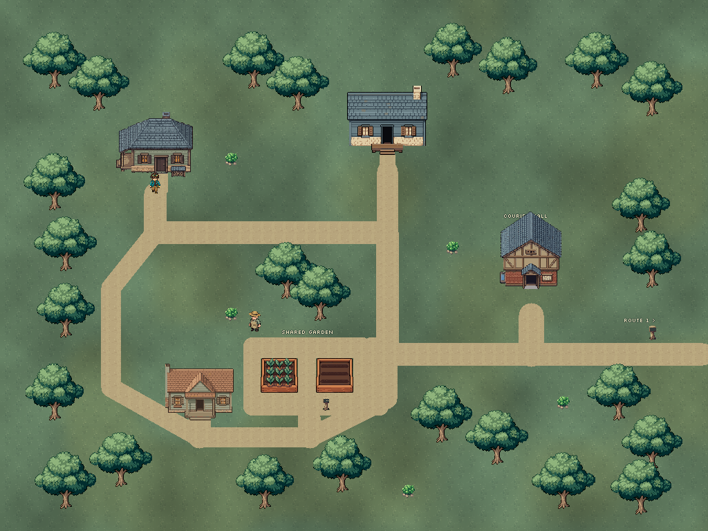
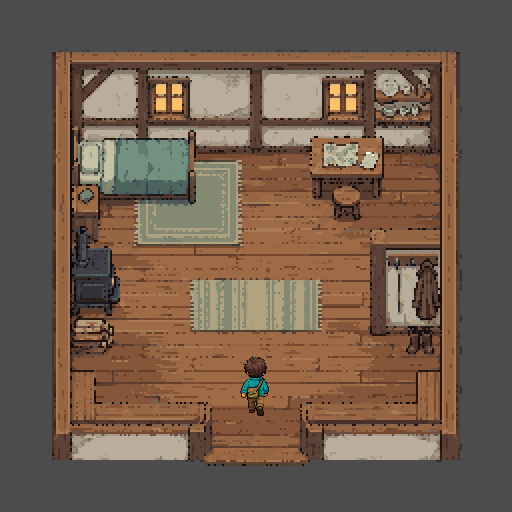
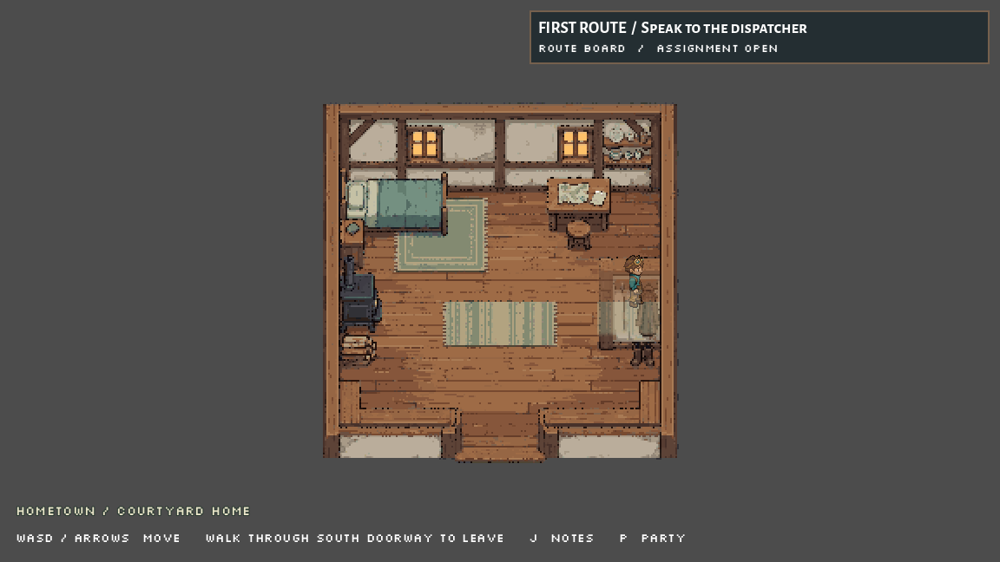

# Hometown homes and courtyard room, October 4, 2026

The hometown now has two distinct neighbor frontages and an enterable opening courtyard home. The original opening-house artwork stays intact. Walking through its front doorway enters a separate cached domestic room; walking through the south doorway returns to the same hometown. Native soil connects both northern thresholds to the original street. The garden home's porch stays closed.

The room has a route table, bed, stove and travel hook. Their text is a local prototype proposal. The table reads the existing assignment/report status and current objective; it does not mutate quest flags. The room creates no heal, inventory item, reward or disk-save behavior. It uses the established journey cache, player, party, notes and HUD. Furniture foot collision and foreground layers follow the source art. The cupboard's upper part fades to 0.45 only when it covers the courier, using the existing unmodified canopy shader; its rooted base remains. Full opacity returns after the courier clears it.

## Exact game changes

[Runtime manifest with original/final hashes and saved copies](runtime-manifest.json): three changed existing files and seventeen additions, twenty runtime files total. A fresh independent audit verifies 2,202 of 2,205 baseline game files exact, no missing file and no unexpected change.

| File | Change | Purpose |
| --- | --- | --- |
| scripts/area_landscape.gd | Changed | Two distinct neighbor house textures, connected native-soil approaches and a doorway corridor in the original house footprint. |
| scripts/world_area.gd | Changed | One home interaction hint updated to explain walking through the doorway. |
| scripts/world_journey.gd | Changed | One cached courtyard-home area, two real doorway gates, initial arrival and area label. |
| assets/sprites/world/hometown_homes_2026_10_04/garden_home.png | New | Native prepared world art. |
| assets/sprites/world/hometown_homes_2026_10_04/garden_home.png.import | New | Nearest-filter Godot import. |
| assets/sprites/world/hometown_homes_2026_10_04/home_approaches.png | New | Native prepared world art. |
| assets/sprites/world/hometown_homes_2026_10_04/home_approaches.png.import | New | Nearest-filter Godot import. |
| assets/sprites/world/hometown_homes_2026_10_04/home_coat_front.png | New | Native prepared world art. |
| assets/sprites/world/hometown_homes_2026_10_04/home_coat_front.png.import | New | Nearest-filter Godot import. |
| assets/sprites/world/hometown_homes_2026_10_04/home_room.png | New | Native prepared world art. |
| assets/sprites/world/hometown_homes_2026_10_04/home_room.png.import | New | Nearest-filter Godot import. |
| assets/sprites/world/hometown_homes_2026_10_04/home_stove_front.png | New | Native prepared world art. |
| assets/sprites/world/hometown_homes_2026_10_04/home_stove_front.png.import | New | Nearest-filter Godot import. |
| assets/sprites/world/hometown_homes_2026_10_04/home_threshold_front.png | New | Native prepared world art. |
| assets/sprites/world/hometown_homes_2026_10_04/home_threshold_front.png.import | New | Nearest-filter Godot import. |
| assets/sprites/world/hometown_homes_2026_10_04/neighbor_home.png | New | Native prepared world art. |
| assets/sprites/world/hometown_homes_2026_10_04/neighbor_home.png.import | New | Nearest-filter Godot import. |
| scenes/courtyard_home.tscn | New | Separate courtyard-home scene using the original player. |
| scripts/courtyard_home_room.gd | New | Local room props, art-aligned solids, read-only notes, direct scene entry and upper-cupboard visibility fade. |
| scripts/courtyard_home_room.gd.uid | New | Generated room script identity. |

Original menu, all creature images/resources/rules, original opening-house art, garden activity and resident, player/controller/party, city landscape suffix, previous area/gate definitions and generic travel functions remain exact. Project launch stays res://scenes/city_riverfront.tscn; the existing audio-bus UID stays unchanged. [Independent source/preservation audit](preservation-audit.json).

## Native verification

Final ordinary-input full journeys passed for both couriers: sixteen real gate crossings, two courtyard-home visits, 577 male and 563 female recorded steps, zero test teleports and zero quest overrides. They include the existing hall assignment, route/city/historic activities, delivery/report, garden planting/repeat/cache and return flow. Each home visit checks four read-only interactions, twelve physical wall/furniture contacts, doorway no-bounce, notes freeze/resume, room/player/material/foreground identity, cupboard fade and its restoration. The route table updates from preparation to filed report through existing quest flow. Original party/controller/flags remain consistent.

Both final owned walking processes exited 0 and their runtime stderr is empty. The separate direct room scene Play test and final native overview also exited 0 with empty runtime stderr. [Compact final summary](proof/final-summary.json), [owned terminal results](proof/terminal-results.json), [male complete proof](proof/walk/final/male-walkthrough.json), [female complete proof](proof/walk/final/female-walkthrough.json), [direct scene proof](proof/direct-entry.json), [final visual review](proof/final-visual-review.md).

The first full journeys in proof/walk/ passed before the cupboard fade and remain historical evidence. Final exact-state evidence is in proof/walk/final/. render/before-approaches/ preserves the earlier path joins. Diagnostic overview cameras hide the HUD for art review; full journey captures use the actual game camera and HUD. The full-town overview verifies complete house bounds; its north close-up intentionally crops the diagnostic viewport. Import logs retain the preexisting audio UID/resource-saver and shutdown diagnostics separately; they are not empty-runtime claims.

## Artwork, costs and reconstruction

Three text-only Retro Diffusion Pro requests produced two frontages and the domestic room. No reference image was uploaded. Each cost $0.18, total $0.54; verified remaining balance $1.86 and credits 50. All three jobs succeeded and were collected without a repeat paid generation. [Exact requests](prompts/request-specs.json), [handles and estimates](prompts/job-handles.json), [cost record](generation-costs.json), raw images and safe receipts in generation/.

The houses are exact native crops plus transparent padding, with no source resampling or visible pixel change. The room's stove, coat and lower wall foregrounds are extracted exact source pixels. Floor underpainting lies below those layers; the background plus foregrounds at full opacity reproduce the original visible RGBA image exactly. The runtime cupboard fade intentionally changes opacity during occlusion. Hidden RGB under zero-alpha threshold mask pixels is irrelevant to the displayed composite and is identified separately in the audit. The approach surface copies existing soil tile (11,0) at the original street phase.

[Portable native-art builder](rebuild/rebuild_art.py) uses only saved source files. [Completed rebuild check](rebuild-check.json) verifies all seven final PNGs byte-exact and the full-opacity source composite. [Preparation provenance](native-preparation.json). sources/before/ preserves original game code, house and pre-session handoffs. Earlier prepared room text and pre-fade fixture are historical snapshots; runtime-after/scripts/courtyard_home_room.gd and proof/source/hometown_home_walk.gd are final.

## Limits and next work

This is a bounded playable home step, not a completed competitive hometown or user aesthetic approval. The two new houses have closed doors and no interiors. The garden porch needs clearer doorway treatment before opening it. The faded cupboard slightly softens the courier's lower torso, but position is readable. Large open grass yards, repeated garden plant rows and the tiny garden-sign grass notch remain visible limits.

The world objective stays active. More purposeful hometown residents/services/spaces, full fictional city sectors, fuller route art/exploration/encounters/ambience and eventual save integration remain. New dialogue and room descriptions remain proposals. Claude owns save/reward/state and battle architecture; Grok creature/move rules. Preston runs Gemini Deep Research; prompt files only when requested.

Automatic approval review initially rejected the final project archive/handoff action twice using the historical menu-only scope. Preston then explicitly approved 'the archive and handoff updates'; that documentation action is completed. [Approval resolution](documentation-approval.json). No current blocker or pending approval. No staging, commit, deletion, reset or user-editor control occurred.
