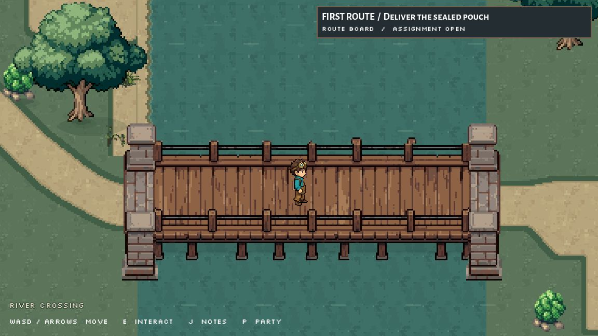

# Bridge support and city landing refinement, October 2, 2026

Preston asked for more refinement after the previous clipped-corner fix. The earlier extensions looked like pasted masonry plates. This pass replaces those ends with coherent paired stone supports and removes white fringe, while keeping the original wooden span and its walk alignment.

## Installed changes

- Modified `scripts/route1_crossing.gd`: preload the new sibling bridge; add a native city-road surface that starts at the bridge's 26px landing, widens to the existing 48px approach and samples the approved soil in the same world-coordinate phase as the west road. Turf/soil edging and small corner rounding replace abrupt square tile borders.
- Added `assets/sprites/world/route1_crossing_2026_10_02/river_bridge_refined.png` (288x112). The successful Retro Diffusion support is registered as a matching pair. The central wood/deck/rail remains unchanged except three pure-white rail speckles removed to alpha.
- Godot created `river_bridge_refined.png.import` beside the new PNG.
- Updated coordination documents `docs/AI_COLLABORATION.md` and `docs/team/ROUTE1_RD_AND_WALKS_HANDOFF_2026-10-01.md`.
- Updated the parent archive's `README.md`, `CHANGED_FILES.md`, `manifest.json`, `source_checks.json`; added this revision folder and its file manifest.

The route scene, quest script, camera, original bridge artwork, menu, battle and creature files were preserved. Exact before/installed helper snapshots and hashes are saved here. No staging or commit.

## Visual review

- [Bridge before](bridge_before.jpg) / [bridge after](bridge_after.jpg).
- [City approach before](city_before.jpg) / [city approach after](city_after.jpg).
- [West bank before](westbank_before.jpg) / [west bank after](westbank_after.jpg).
- [Home return](home_return.jpg).
- [Installed native PNG](bridge_installed_native.png), [before native PNG](bridge_before_native.png), [pixel checks](abutment_pixel_check.json).

Final opaque bounds: x22..265, y3..103 on a 288x112 canvas. No opaque pixel touches a canvas edge; no pure-white opaque pixel remains. Protected nonwhite original pixels have zero changes. Native registration and the complete lower-rail foreground crop stay fixed.

## Verification

A fresh disposable `crossing-final` instance ran the route with normal movement and actual E-key interactions, seed 20261002 and fixed 60fps. It started at (48,192), accepted the pouch, read the levee sign at (216,264), reached the bridge at (551.792,415.792), registered with the city courier at (815.788,479.793), then walked back via the west bank and levee to (48,192). No teleport was used in this final round trip.

Final recorded physics frames: start 862, levee 1089, bridge 1417, city 4047, return west 4401, return levee 4636, home 4828. All input scripts completed with zero rejected events. [Inputs, receipts, probes and diagnostics](abutment_verification.json). Earlier visual fixtures used a teleport only for before comparisons.

Final observed console/debugger/open-script errors: zero. Eleven existing battle shadowing/Rimefin UID warnings remain. Intermediate cold editor preparation logged an unknown UID/empty save path; the subsequent archive child boot had no errors, and final runtime remained clean. A final helper parse receipt is retained with archive validation. All owned test instances were stopped.

## Generation and retained work

RD spend: $0.37, including the rejected left inpaint ($0.18), accepted right inpaint ($0.18) and paired background removal ($0.01). Remaining balance: $3.26. The unpaired alpha and cap correction requests were only estimated, never submitted. The inconsistent left edit and first joined white preview are retained but are not used at runtime.

[Exact prompts](PROMPTS.md), request/estimate/task/output receipts, white inputs, alpha masks, rejected results, prepared final PNG and captured frames are included. [Revision manifest](manifest.json); `archive_file_manifest.json` lists every saved file and hash.

No blocker for this installed slice. Route 1 is still a prototype; shoreline continuity, bank dressing, the actual hometown and city sectors remain further work. The paired stone supports intentionally share structural artwork.
