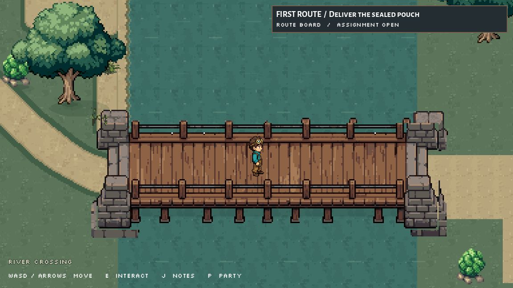
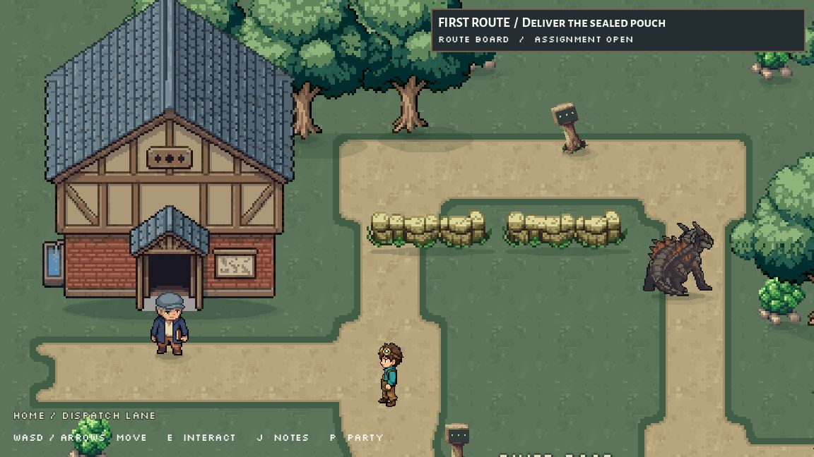

# Route 1: complete bridge corners and joined road

Preston reported that the upper and lower corners of the bridge were clipped and the approach road did not match the path it joined. The four stone corners are now completed with Retro Diffusion. The bridge has a transparent margin, its original 256x80 core pixels remain exact, and its full lower rail and stone feet draw in the foreground. The deck stays at the same world position and width.

The road entrance now shares the old lane's 48px opening before tapering to its 26px crest. The new and existing road masks are joined before their borders are drawn, removing the original end-cap seam. Soil comes from the approved 32px texture with the same world-coordinate phase and exact turf/rim colors. This road surface is rendered in-game from native geometry; no new terrain painting or TileMap source edits were needed.

## Review

[Before bridge](bridge_before.jpg), [before junction](junction_before.jpg), [road entrance](road_after.jpg), [city arrival](city_after.jpg), [western approach](westbank_after.jpg), [return home](home_return.jpg).

## Exact runtime changes

- `scripts/route1_crossing.gd`: completed bridge texture, registered origin and full foreground crop; widened entrance and joined native road mask using the original soil texture/phase and border colors.
- Added `assets/sprites/world/route1_crossing_2026_10_02/river_bridge_complete.png`: native 288x112, restored original core at (16,16), empty outer edges. Opaque bounds (12,6)-(279,102).
- Added `assets/sprites/world/route1_crossing_2026_10_02/path_soil_native32.png`: byte-for-byte copy of the previously approved path_quiet32.png.

The original `river_bridge.png`, original RD source, route scene and quest script remain unchanged. The scene and quest script hashes match the previous verified crossing revision. No battle, creature, menu, world naming or district changes were made in this revision. Import metadata is generated by the engine.

## Verification and limits

A fresh disposable game instance used normal movement and E to accept the pouch, read the levee sign, follow the road, cross the bridge, speak to the city courier, and return home. No teleport was used during that traversal. Final normal-camera bridge probe: frame 2659; city registration: frame 6092; return home with registration retained: frame 6874. Before/after junction and old-bridge shots used explicit isolated inspection fixtures, separate from that movement test. [Complete frame, input and diagnostics receipts](verification.json).

The final cold headless boot and helper reload passed. Latest runtime debugger, project validation and open scripts show zero errors. Eleven existing battle/roster warnings remain. The combined editor console retains one earlier preload error from staged installation before the new texture existed; final on-disk validation and fresh play prove it resolved. No blocker remains for this correction.

## Art preparation and spending

[Exact prompts](PROMPTS.md). The first transparent-input outpaint produced unwanted black shadows and stone fragments; all those intermediate outputs are retained for comparison and are not installed. White-background references fixed that interpretation. Two clean native-resolution half outpaints were registered into one bridge, its white background removed, and every original core pixel restored. Adding transparent padding alone would not have repaired the clipped source.

Total new RD spend: $0.74 ($0.37 accepted preparation and $0.37 rejected trial). Palette trial was free and is not part of the accepted final pipeline. Starting balance $4.37; ending balance $3.63. A timed-out synchronous edit was recovered from API Activity without resubmitting the paid request. Later edits used idempotent task submissions. Whole-width scheduled estimates failed their overlap constraint and cost nothing. Raw images, input references, prompts, estimates, task receipts and installed/before helper snapshots are retained here. Original earlier archives are retained.

[RD edit task and recovery reference](https://github.com/Retro-Diffusion/api-examples/blob/main/EDIT_TOOLS.md).

## Coordination records

Updated `docs/AI_COLLABORATION.md`, `docs/team/ROUTE1_RD_AND_WALKS_HANDOFF_2026-10-01.md`, and the parent crossing archive's `README.md`, `CHANGED_FILES.md`, `manifest.json`, `source_checks.json`. This directory contains exact sources, images and receipts, with hashes in `archive_file_manifest.json`.
