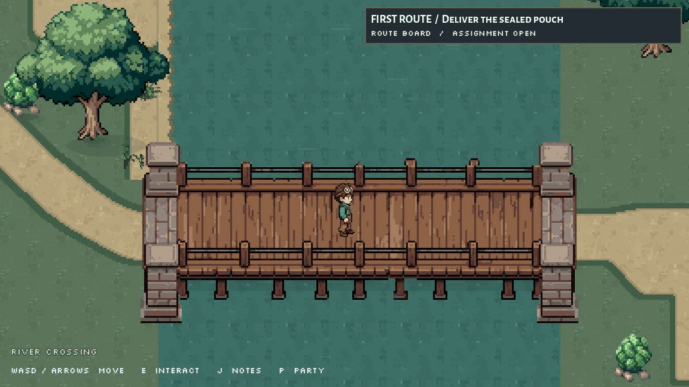

# Route 1: one bridge peg and moving river, October 2, 2026

The lower wooden peg immediately to the right of the one below the player now has its full right outline and foot. Retro Diffusion edited a 96x48 reference crop; only the 16x18 target rectangle was transferred into a new sibling bridge image. Exactly 107 RGBA pixels changed, all inside x=160..175, y=78..95. Everything outside that area matches the previous accepted artwork exactly. The 288x112 canvas, deck, stone supports, foreground registration and bank overlap are retained.

The existing teal river texture now moves down at two native pixels per scene second, with sparse moving highlights. A nearest-filtered 2D canvas shader uses the scene clock and a fixed mask of the existing water pixels. Dirt banks and grass keep their contour, and the river layer remains underneath the bridge and roads. No collision or quest changes were required.

## Review

This is a five-second preview encoded from ten actual game captures at half-second scene intervals. Its replay resets the short clip; it is not the game's animation loop or a new sprite asset.

- [Installed bridge in game](flow_frame_00.jpg)
- [Enlarged repaired peg](peg_enlarged.png)
- [City arrival](city_arrival.jpg)
- [Return home](home_return.jpg)
- [Original bridge](bridge_before.png) and [installed sibling](bridge_installed.png)

## Exact files

Modified runtime file: `scripts/route1_crossing.gd`. Added runtime assets:

- `assets/sprites/world/route1_crossing_2026_10_02/river_bridge_peg_fixed.png`
- `assets/sprites/world/route1_crossing_2026_10_02/river_water_native32.png`, an unchanged copy of the approved `water_quiet32.png`
- `assets/sprites/world/route1_crossing_2026_10_02/river_flow.gdshader`

Godot generated two PNG import files and the shader UID. The old bridge remains saved.

Updated coordination: `docs/AI_COLLABORATION.md`, `docs/team/ROUTE1_RD_AND_WALKS_HANDOFF_2026-10-01.md`, and the parent archive's `README.md`, `CHANGED_FILES.md`, `manifest.json` and `source_checks.json`.

This new archive contains the exact prompt, request, mask/input/output, estimate and paid receipt; before/installed source and art; water/shader copies; preparation source; ten actual river captures; home/city/return captures; verification records and hash manifest.

## Verification

A fresh deterministic offscreen instance, seed 20261002 at 60fps, used ordinary movement and E key inputs throughout the route. It accepted the pouch, read the levee sign, reached the bridge at (551.792,415.792), crossed to the clerk, registered arrival at (815.788,479.793), and returned to (48,192). No teleport was used in this final traversal.

Water motion is confirmed by frame-stamped probes: image frame 2123 at scene clock 8.9s had flow offset (0,17); image frame 4418 at 13.4s had offset (0,26), while the player stayed at the same position. The water capture region changed; the sampled land and bridge deck regions were identical. JPEG comparison is supporting visual evidence, not a raw renderer-pixel assertion.

[Pixel/hash checks](pixel_verification.json), [start/levee/bridge and motion probes](full_verification.json), [round-trip inputs and diagnostics](walk_verification.json), and [all motion frame metadata](flow_frame_metadata.json) are saved.

Final observed runtime, console and open-script errors: **0**. Eleven existing battle/Rimefin warnings remain. Initial headless preparation logged a stale project UID and empty save-path error; the later archive child editor booted cleanly with zero boot or script errors. These checks cover this crossing, not the entire project.

Exact source/hash comparisons also confirm that the route scene and quest script are unchanged, along with the helper's collision, ground extension, foreground bridge, road/junction and city-arrival functions. Only the art preload, water layer and visual clock/draw behavior changed. Owned test instances were stopped. No staging, commit, source deletion or creature/battle edits.

## Retro Diffusion receipt

One masked inpainting request, task `3eea86e6-d1b9-53f6-90e3-fd0990ea2da1`, succeeded. Confirmed charge **$0.18**, remaining balance **$3.08**. No additional generation was used for the river. Cumulative bridge generation across retained revisions is $1.47.

The exact [prompt](peg_prompt.txt), [request](peg_request.json), [free estimate](peg_estimate.json), [accepted task](peg_task_start.json) and [paid result receipt](peg_receipt.json) are saved without credentials.

Implementation references: [Godot canvas shaders](https://docs.godotengine.org/en/stable/tutorials/shaders/shader_reference/canvas_item_shader.html) and [shader language](https://docs.godotengine.org/en/stable/tutorials/shaders/shader_reference/shading_language.html). The library's 3D ripple recipe was not applied to this 2D surface.

No blocker remains for the requested peg/current refinement. Route 1 remains a prototype; further shoreline/bank dressing, hometown and city sectors remain separate work.
