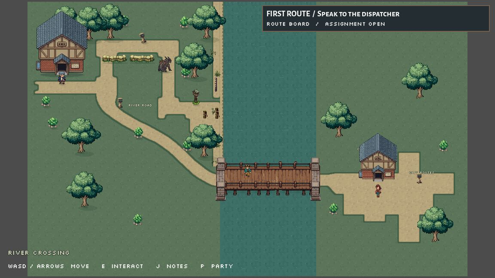
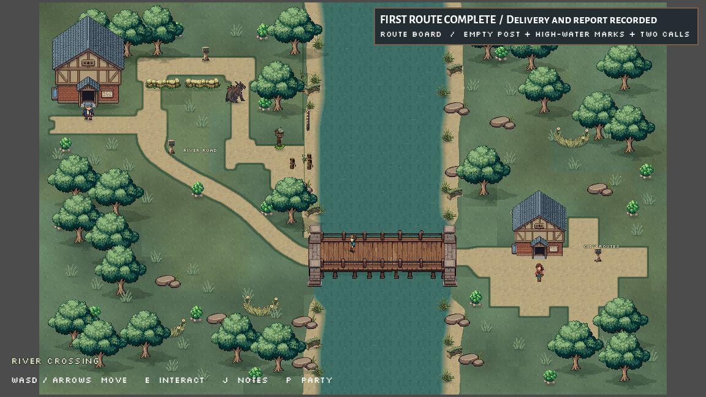
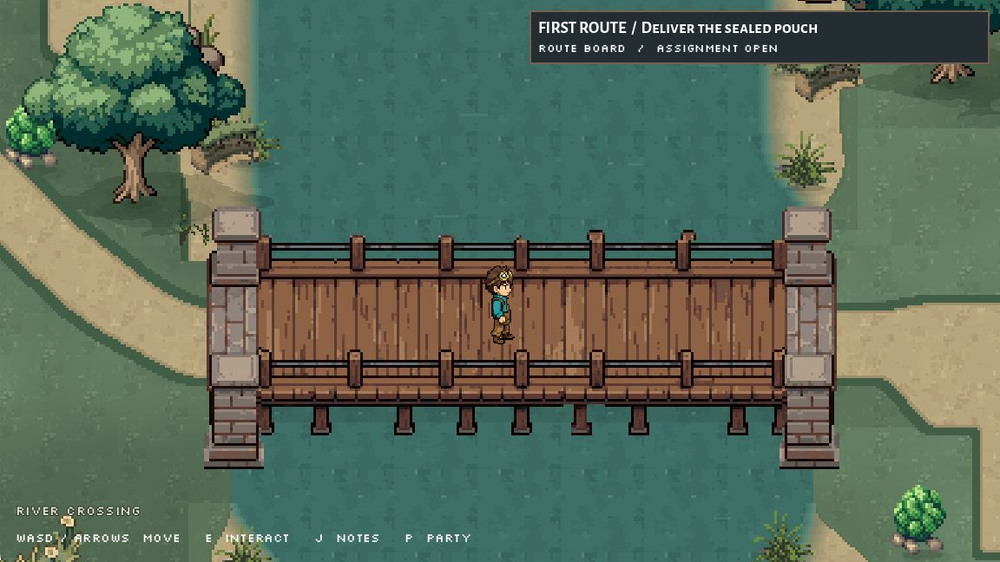
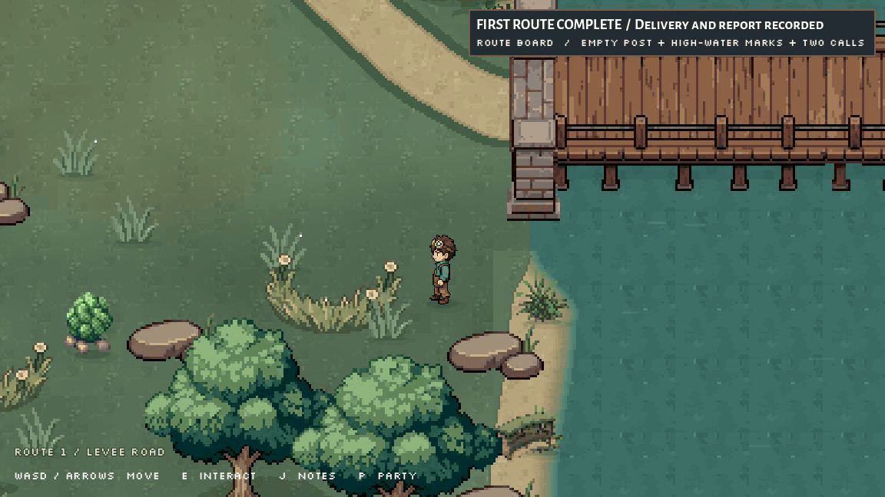

# Route 1 landscape refinement
Saved October 2 evening, 2026 in Chicago; October 3 UTC.

Route 1 now has clustered cottonwood groves, low meadow foliage, warmer and cooler turf patches, small silt/root details, stones, reeds and damp shoreline contours. Sparse foliage sways by one native pixel. The complete existing delivery and crossing remain playable.

This is a reviewed environment pass toward the requested Nexomon/Coromon quality bar. Route 1 and the broader game world remain in development.

## What changed
- Added 15 cottonwoods using seven approved native variants. Three existing city cottonwoods now use different approved variants.
- Added 35 small grass tufts, three outer meadow thickets, 15 reed details, 12 stone clusters, six small root details and eight shrubs. Large meadow clumps were reduced after the first in-game review obscured the encounter approach.
- Added subtle terrain color variation through a canvas shader, using the original atlas unchanged.
- Built irregular damp margins from the approved soil/grass textures; they taper into the accepted bridge approaches. The landing's walking space and existing river/bridge blockers are preserved.
- Added anchored, integer-pixel foliage wind. Removed the older sideways-moving extra highlights so the river keeps one direction of flow.
- Flattened the actual canopy silhouettes into shadows and extended the small contact shadows to the new vegetation.

Runtime source: three scripts and two new shaders. Six original RD outputs remain saved; the larger silt/root candidate is retained but the smaller version is installed for rendering. Normal Godot import/UID files are listed explicitly in [installed-files.json](installed-files.json).

[Exact changed files](CHANGED_FILES.md). [Current world and map design priorities](WORLD_DESIGN_NEXT.md). [References and visual decisions](REFERENCES.md).

## Review

The overview uses camera zoom 1; normal gameplay is zoom 3. Overviews and the motion view are review fixtures only, made after the normal-control assignment. The motion GIF contains ten actual captures separated by 30 physics ticks, shown at two frames per second. Original captures and their sampled clock values are retained.

## Verification
A fresh deterministic offscreen game at seed 20261003 and 60 fixed physics ticks was walked with ordinary controls. Pouch accepted; levee sign read; bridge crossed; city courier and directions board visited; delivery made at the old post; height marks inspected; two calls heard; marker restored; full report submitted. The notes panel and board both show the completed assignment. No teleport or quest-flag override was used for that trip.

[Actual input replay, final flags, motion clocks and diagnostics](review/verification.json).

Final observed diagnostics: zero errors and 12 existing warnings in battle/effect code and the Rimefin UID fallback. No warning points to the new Route 1 code. These diagnostics cover the observed runtime and open scripts, not every game system. The cold editor archive-copy pass separately logged an unrecognized default-audio-bus UID (`uid://blm6ps3r8bf7l`) and an empty-resource-save-path error during boot. A read-only search identifies the existing `default_bus_layout.tres` / `project.godot` reference; the same pair is documented in earlier menu work. All 49 byte-checked archive copies completed; no copy operation failed. Those boot messages are retained in the verification record.

The quest script and route scene retain their pre-pass hashes:
- `scripts/first_route_prototype.gd`: `16642c8d181b1704656b1f2fbf90064b8b7ba87a1376b7021218e886fb4d2cd1`
- `scenes/first_route_prototype.tscn`: `88edcd961f4608584a5d1c505bffab7e7a44af0662b1ab9a2a8584030a3abddc`

The repaired bridge PNG and flowing-water sources remain unchanged. Previous candidates, menu work and creature assets are preserved. Owned offscreen test games were stopped; the user's game/editor was not stopped.

## Retro Diffusion record
Five completed jobs produced six outputs. Confirmed balance charges: $0.18 grass, $0.18 full-size roots, $0.18 stones, $0.36 for two small tufts, $0.18 for smaller roots. Total this pass: **$1.08**. Latest checked account balance at 03:12 UTC was approximately **$1.37**. Other concurrent account activity means wallet differences should not be assigned solely to this pass.

Original output pixels were installed without local painting. The smaller root asset was generated by RD from the full-size candidate. Exact saved prompts, task IDs, source hashes and sanitized paid receipts are in `source/`. Two responses did not echo seeds; those request records explicitly leave the seed unknown. API keys, embedded reference data and signed download URLs are excluded.

## Limits and coordination
No local implementation blocker. Optional Summer library feedback was rejected by automatic approval review because it would export project notes/session metadata. No workaround submission was attempted; local artifacts are unaffected.

The next quality gains are readable levee height, more deliberate path contours, worthwhile side exploration, real hometown/city scene transitions, and distinct city-sector architecture. Further detail scattering alone will not establish the requested commercial quality.

Codex owns environment/Route 1 work. Claude's battle/save/state work and Grok's future creature/move role remain intact. No staging, commits or deletions were performed.

