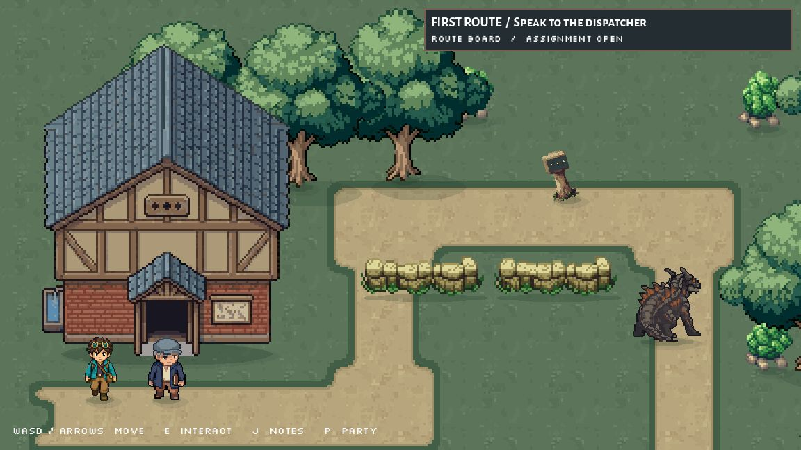
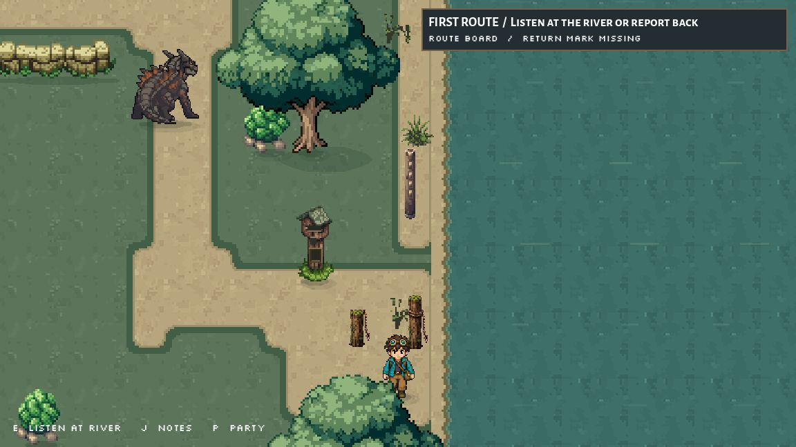

# Route 1: complete hall, individual props and regional synthesis

October 2, 2026. Preston's current house, duplicate-art, native-tree and river-map feedback guides this pass. Run `scenes/first_route_prototype.tscn` in Summer. The current launch setting and Courier Lookout menu are preserved.

## Visible result
- Completed the Dispatch Hall's clipped main roof. The facade, porch, door and threshold pixels remain exact. Adjusted the starting camera so the entire roof is visible. The existing foot-based depth ordering puts the hall in front of the trees behind it.
- Installed seven individual cottonwood crowns, eight shrubs, six reed arrangements and two distinct masonry sections. They reuse the current models and palette. All seven tree trunks/roots remain pixel-exact and all existing ground positions remain.
- Added two weathered timber ferry tie-offs from Preston's saved Grok study, at (442,273) and (414,272), with small foot collisions. The shorter post was moved out of canopy cover before final verification.
- Added a recessed empty return-mark holder to the existing relay post. The original post pixels outside x12..20, y31..40 remain exact. This makes an existing story clue visible; quest behavior is unchanged.

## Research applied
Read the current concept, world bible proposal, region atlas, opening chapter/route/perspective briefs, St. Joseph field notes, and the two local St. Joseph research reports. Inspected the saved rope-post and cutbank studies, EasyScape native trees and all eight supplied map/satellite images. Sources and resulting decisions are in [the regional synthesis](../../../world/route1-regional-synthesis-2026-10-02.md).

The short masonry wall is a bluff/path retaining structure. The real levee reference is a broad grassy earth embankment with sloped sides and a crest track. Keep Elwood/low-field inspiration west (left), St. Joseph/bluff-town inspiration east (right), with the river between them in regional maps and distant views. The existing compact route staging is not a declared north-up map; its quest sites were preserved.

Upper-slope oak/hickory variety, readable bluff descent, lower landing texture and a future far-bank levee remain terrain work. This pass does not claim Route 1 is finished or establish new place-name canon. Older research roster pitches and workflow instructions were not restored.

## Verification
Final cold launch: `route-regional-final2`, scene hash `b986a617ddf384d9b09d7594dedf270fcb44b165a570e3a21ae22bc59cd5f1c2`.

The complete assignment passed through normal movement and E/Down/Enter controls, without teleports or direct flag changes: dispatcher pouch, route marker, delivery, height observation, river calls and full return report. Final physics frames 3007–4531; all eight flags true. Both new posts are visible and the river approach remains traversable. [Exact input/state evidence](review/final_playtest.json), [final diagnostics](review/final_diagnostics.json).

Final observed diagnostics: zero errors, eleven existing warnings (battle variable shadowing and Rimefin UID fallback). Earlier missing-image import errors are saved in [historical diagnostics](review/historical_import_diagnostics.json); a cold editor import and fresh game restart resolved them. Initial disconnected debugger attempts are not treated as successful review. All owned test instances were stopped.

[Preservation checks](review/preservation_checks.json): all 27 runtime PNGs match the archived prepared files and manifests; each has a distinct hash and import sidecar. Original five prop sources remain exact, tree trunks/roots and hall facade/threshold pixels are exact, all terrain cell data is unchanged. The route script differs only in the camera offset from -48 to -84. This is focused route evidence, not a full project audit.

## Generation and preparation
Retro Diffusion was used for roof outpainting and prop editing. Six returned receipts confirm $1.08 in charges for this pass. One additional tree edit timed out and may have incurred $0.18; it has no returned inference ID. Existing-job lookup did not recover it, and no paid retry was made.

The generated roof cap was detached; it was rejected and a connected cap was prepared from the approved building's native slate pixels. Generated tree, shrub and wall edits changed anatomy or style too much; they remain in raw/ and were not installed. Individual crowns, shrubs and masonry were prepared from the approved model pixels. Three reed variants use the returned edit remapped to the original palette; the others reuse the existing reeds. Tie-offs and the empty holder required no paid generation.

Exact prompts, seeds, input images, masks, receipts, rejected outputs and preparation are in source/ and raw/. The archived PNG input associated with the roof prompt matches the original building pixel for pixel. Research hashes and text extraction are in source/research_ledger.json and the two report text files. Supplied map originals and hashes are in reference/ and source/map_reference_manifest.json.

[Exact changed files](CHANGED_FILES.md). Original approved art and earlier archives remain. No staging, commit, deletion, new Gemini research, launch-setting change or creature/menu edit was made in this pass.
