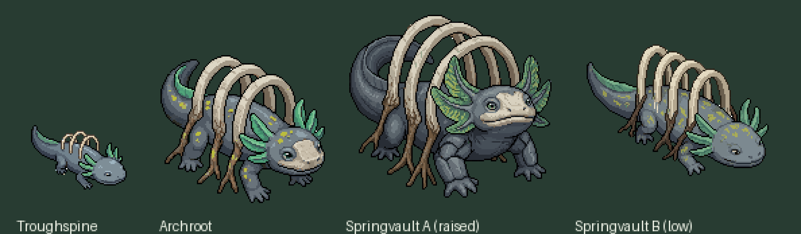

# The Springvault line: Troughspine, Archroot, Springvault (Claude, 2026-10-10)

Preston, 2026-10-10: "Lets make new line", then chose **Springvault, the healer** (line 12 of `docs/creatures/creature-roster-draft.md`; the Healer row of `arena-roles-roster-proposal-2026-10-08.md`). Stone / Tide. The names are the roster draft's working labels, his to approve; every number to come is a draft for Grok.

## Art, step 1: front takes

**Preston, 2026-10-10: Springvault A.** He asked how the arches work for walking; the answer and the proposal are under "Walking" below.

Retro Diffusion `rd_pro__default` through `tools/debug/rd_creature.py front`, $0.18 a take, each stage taking the earlier stages as reference. Anchor: a spring salamander (axolotl-like gills) with stone rib arches over the back, open gaps through each arch, as the brief asks; no shell, no bridge.
- Troughspine (96 px): first take used. Its white background came back opaque; `tools/arena/strip_take_bg.py` clears it (raw kept as `_raw`).
- Archroot (128 px): first take used: taller arches with root braces, wide gills, pale muzzle kept.
- Springvault (160 px): three takes. **A** (`springvault_arena_front_take1.png`): front raised, fan flanges like a mane, arches taller than the body. **B** (`_low`): long and low, reads smaller than Archroot. A retake asking for "massive, towering" overflowed the canvas (`_clipped`, the big-take lesson again).
- Spent $0.72; Retro Diffusion balance $9.92.

Files: `docs/creatures/arena-starters-2026-10-07/forms/{troughspine,archroot,springvault}_arena_*`.

## Next, after Preston picks
1. Rotations ($0.10 each) and walks, then the dungeon and small sets (`build_dungeon_set.py`, `build_small.py`).
2. Data: `LINES` entry, creature resources (Stone, second essence Tide), `EVO` and learnset rows for Grok.
3. The healer needs a system the dungeon does not have yet: moves that heal or shield allies (every dungeon move today is an attack). Kit sketch from the proposal: Spring Spit; Seep (an allies-only healing pool); Mineral Brace (a shield on one ally); Vault Arch (a stone arch that blocks shots); the final's Headspring (heals and cleanses the team).

## Walking (proposal, for Preston and Grok)
- **The arches are rigid.** They are ribs grown up out of the spine, fused to it like a crest, so they ride along with the body and only bob a little. All the walking is the legs, with the side-to-side sway a salamander has. The open gaps also keep them light.
- **The root braces are the real question.** In the art they reach the ground beside the legs, which would pin it in place. Proposal: the braces are living roots that pull up and hang along the flanks while it walks, and dig into the ground when it stops. The walk sheets are prompted that way: braces lifted and tucked, arches steady, legs doing the work.
- **That can be the healer's mechanic.** Planting the roots is how it heals: rooted, it cannot be knocked back and its spring wells up as the healing pool (Seep); moving again pulls the roots up and ends the pool. A healer that has to choose between staying put and following the team. Grok owns the numbers and whether this becomes the rule.

## Art, step 2: rotations and walks (2026-10-10)
- Rotations ($0.10 each): all three sheets in Tallowroot's layout, no background debris (0.1% pale at most). Sliced by `tools/arena/slice_rotations.py` into `assets/sprites/arena/{troughspine,archroot,springvault}/`.
- Walks ($0.14 each, s, se, e, ne, n; the rest mirrored): Troughspine prompted as a salamander crawl; Archroot and Springvault with the arches rigid and the root braces lifted. The arches stay steady and the body sways, as hoped; the braces did not tuck up, they hang and swing a little above the ground. Good enough to read as roots lifted off the ground; a retake can try harder if Preston wants them tucked. `walk_e.gif` shows the three side by side.
- Small set built (`build_small.py`, scales 0.9 / 1.05 / 1.2). The dungeon set waits for the `LINES` entry (`build_dungeon_set.py` reads stages from it).
- Spent this step $2.40; Retro Diffusion total for the line $3.12.

## In the game (2026-10-10, Preston: "stage 1 hurt, sleep, and the rest")
- **Troughspine's actions:** attack (s, e, n), hurt (s, e), sleep, the stage-1 plan ($1.17; `build_actions.py` makes all eight facings). Archroot and Springvault wait for the stage 2 and 3 animation pass with the other evolved forms.
- **Data:** `data/creatures/1201_troughspine.tres`, `1202_archroot.tres`, `1203_springvault.tres` (Stone, second Tide); line 10 in `Arena.LINES`, signature name Headspring (not built); kits in `Arena.KITS`; body parts in `move_body.gd` (muzzle, gills, arches; roots from stage II); dungeon set built.
- **Moves:** Spring Spit (Tide, 10, a short line shot; also in the arena) and **Seep** (dungeon only): the healer plants its roots and a spring wells up; it heals itself and every teammate beside it at once and at the end of each turn it stays, for 3 turns; it cannot be knocked back while rooted; moving pulls the roots up. Partners and wild healers seep when the team beside them is missing a full heal.
- **Drafts for Grok:** Spring Spit 10 damage; Seep heals 6, cooldown 9, 3 turns; `EVO[10]` (way "healed": health restored, 40 then 100; KOs 2/5; floors 2/4); learnsets (Troughspine Lv 1 Spring Spit and Seep; Archroot's evolve move to be Mineral Brace, Springvault's Vault Arch); Troughspine added to B2F's wild spawns; the body parts.
- **Arena:** basic only for now (all three forms fight a full AI match); the heals and Headspring come later.
- Check: `tools/debug/springvault_check.gd`.
