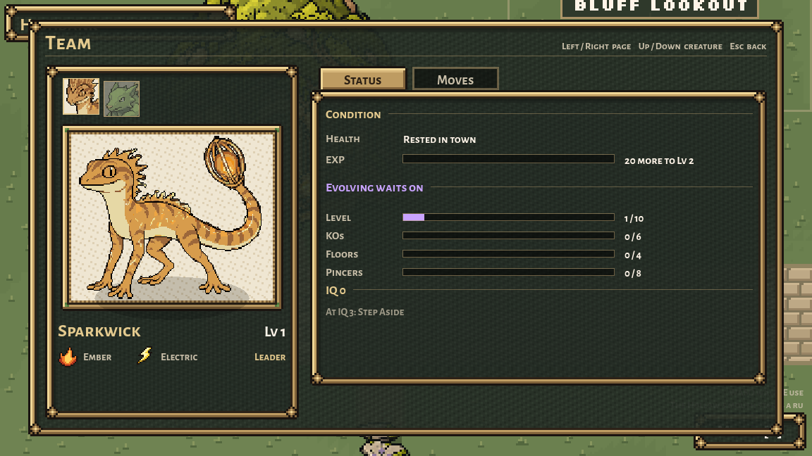

# Sparkwick material consistency, October 10, 2026

Preston flagged brown painted patches in both the field sprites and the large animated preview. Inspected the installed art, approved front, previous palette/back fixes, first-generation idles and current shared idle helper before editing.

The previous locks retained desaturated brown material swatches that already existed in their references. A palette lock alone therefore did not remove them. Large idles also used a different set of body shades from the arena/dungeon take. This scoped render correction uses Sparkwick's approved arena-front gold/tan/copper material ramp for both. It retains the original dark stripe markings, pale belly and bright lantern core. It changes material colour, not the drawn marking shapes or creature anatomy; it is not a texture redraw.

## Installed presentation

- `scripts/arena/sparkwick_palette.gdshaderinc`: exact body-swatch substitutions. Source: `docs/creatures/arena-starters-2026-10-07/forms/sparkwick.png`, its established body/stripe material colours. No new random grain, gradients or time-varying material.
- Shared sel-out samples pass through this function with a false default. `creature_finish.gd` follows the sprite's texture-change signal and enables it only for recognized Sparkwick resource paths. Town, dungeon and arena construction assign their textures after creating the sprite, so checking only at construction would have missed them.
- The party screen draws only Sparkwick's animated creature and headshot on a dedicated sel-out layer; panel art, text, shadows, framing, inputs, pages, facts and other creatures retain their old draw paths. Claude's front-idle folder, eight-frame order and 5 FPS stay intact.
- Evolution applies the same palette before its existing white-silhouette interpolation. Stormwick's display and the evolution sequence/rules stay intact.

All PNG/source/rotation/walk/idle/portrait/backups remain untouched. Legacy front/back frames were included in the shared-material render proof; the inactive legacy `battle_screen.gd` has its separate rendering system and was not rewired here. Current party/evolution previews and field/arena creatures are the installed scope. No creature data, progression, controller, size or foot-row edits. No generated replacement, paid call, commit or settings edit.

## Native verification

The native Compatibility renderer checked 168 actual Sparkwick textures: every standing facing and walking frame in the dungeon/small sets, current eight-frame large preview, and existing legacy front/back frames. It found 19,506 rendered pixels using the identified dull material swatches before the change and zero afterward. Rendered alpha/silhouette and bright lantern cores remain exact to the previous finish. All other creature forms' south-facing native renders remain byte-exact, including Oxbowarchon's jade. This is a colour proof, not a claim that inherited animation anatomy or all internal drawings were redrawn.

The fixture also checks actual town movement/texture changes, actual dungeon construction, actual summary animation advancement and teammate switching, and the evolution material/whitening. Native screenshots were inspected at game size. Final results/logs are alongside this document. The first fixture used `town.ents` instead of `town.team` and was corrected; no production workaround was added. Review import retains the pre-existing certificate-store/audio UID/empty-save-path diagnostics, so stderr is not described as clean.

[Large idle native before/after](review/large-idle-before-after.png) and [walking native before/after](review/walk-before-after-3x.png).

## Preservation

Four exact original presentation scripts are in `originals/`; the two new helpers are versioned files. The guarded installer archives all candidates, originals, checks and previews before writing only the reviewed files. Its manifest protects Claude/Grok's current collaboration notes and records exact before/after hashes. Every pre-existing image/backup and unrelated current runtime file is verified after installation. Creature rules, current UI functionality, title, all finished town exteriors, seven-form refinements, darker jade and Claude's concurrent Warden introduction/music remain preserved.

Appearance is implemented and natively reviewed by Codex; Preston's visual approval is still his to give.

Installed native verification: all 15 checks pass in the live project as well as review. The preservation audit checks 24,241 unrelated current files and 11,505 source-sprite/original-backup files with no mismatches. Seven owned installed files match their guarded candidates exactly. The retained pre-install archive changes in the manifest are completion of the preceding Mouth entrance documentation/capture, not an overwrite of another agent's work.

The live full Shrine evolution check also passes: intro/whiten/trade/reveal/done, Kithflare-to-Sparkwick record and street replacement, retained moves, and the pending move offered on the next run. Its captures and log are archived here.
