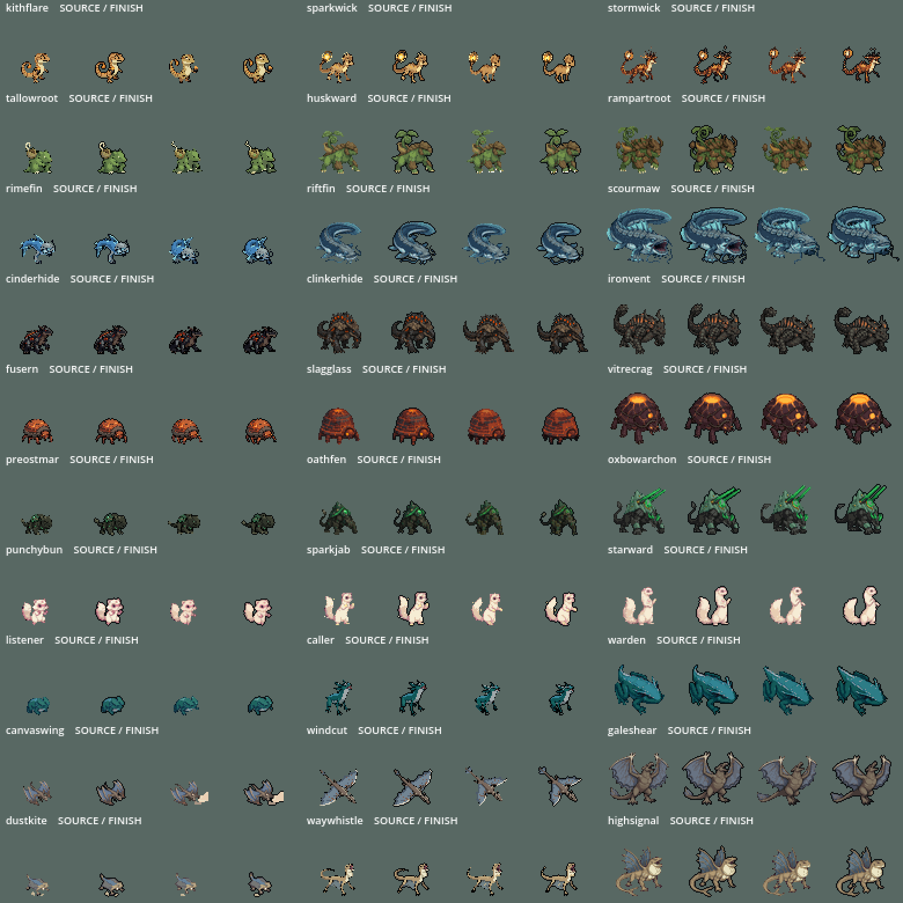

# Hollowtide creature finish, October 8, 2026

Preston requested a texture/outline consistency pass and explicitly chose the **Hollowtide Sprite reference/preset**. The authority used is the saved [Sprite Forge house style](../../forges/gemini-skills/sprite-forge.md): dark silhouette outlines, clean shaded clusters, very few lone pixels, each creature's own palette and native grid. This is a shared in-game rendering pass, not a generated replacement for the approved artwork.

## Visible result

All 30 arena forms, across their eight standing facings and eight-frame walking cycles, receive the same finish. Existing dark edge pixels become a consistent near-black ink. Light silhouette gaps gain at most one native pixel of contour; existing dark contours do not gain another layer. A weak isolated shade can join a repeated neighbouring colour only when at least five neighbours support that colour. The filter chooses existing local colours rather than averaging or introducing a new material palette. High-contrast eyes, markings, highlights and thin silhouette features are retained.

The shared arena constructor also supplies the finish to **Hollows**, story arena fights and relay practice. Current originals, full-size source facings, source walk sheets, menu portraits and picker icons are unchanged. The finish does not redraw material anatomy or make every species equally detailed; stronger internal texture differences remain deliberate candidates for individual review. There was no image generation or Retro Diffusion spend.

Native six-creature [before](native/arena-six-before.png), [after](native/arena-six-after.png), and [Hollow](native/hollow-after.png) captures are included. Full eight-facing/nine-pose rendered sheets for every form are in `native/frames/`.

## Integration and preservation

- `scripts/arena/creature_finish.gdshader`: the native pixel contour and restrained shade-cluster treatment. No time-based noise or animated dithering.
- `scripts/arena/creature_finish.gd`: applies the material to the creature Sprite2D.
- `scripts/arena/arena_prototype.gd`: one added line in `_make_fighter`, before the existing special-material override. Claude's other code stays byte-for-byte intact around that insertion. A future creature using the existing Absence effect will retain its special shader.

The shader makes one texel of draw room around the quad, so no silhouette is cropped at a texture edge. Sprite texture, offset, timing, scale, foot-row calculation, hitbox and gameplay data are unchanged. Source PNGs are never written. In particular, the installed seven-form palette pass, dark-jade Oxbowarchon, Listener pass, Galeshear repaired wings and Claude's new Riftfin/Scourmaw assets stay intact. `originals/arena_prototype.gd` and the installation record preserve the exact pre-integration code and hashes.

## Verification

- **2,160 actual native-rendered textures**: zero erased opaque body pixels and zero new opaque pixels farther than one cardinal neighbour from the source silhouette.
- **2,160 actual arena texture swaps**: every form has the finish and the original anchored foot row remains aligned.
- Six fighters retain the material through a short moving combat run; Hollow allies and wild spawns inherit it; a fully transparent creature also loses its contour.
- Native Compatibility renderer captures were inspected at game size. Windows root-certificate-store diagnostics remain; final creature runs have no script errors.

`checks.json`, `integration-checks.json`, `logs/`, `reproduction/` and `installation.json` contain the exact evidence. Tests ran in an isolated Godot project. The full roster render check is deliberately stronger than a source-code assertion, but it does not establish game balance or complete animation anatomy consistency. No commit or live launch-setting change.

## Relay follow-up

The current relay practice integration passes **25 native assertions**, including opening the current picker, launching the arena with the finish, both Escape returns, real yard exits, cached observations and unchanged party/main-delivery flags. This rechecks Claude's repaired picker override alongside the new riverfront. Evidence is in `native/relay/` and `logs/relay_latest.log`.
