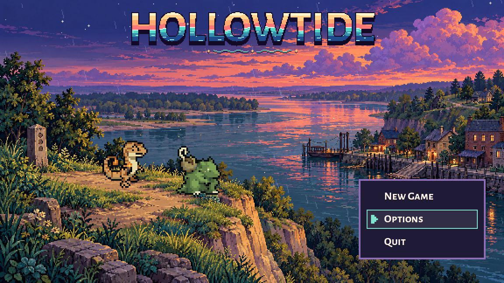
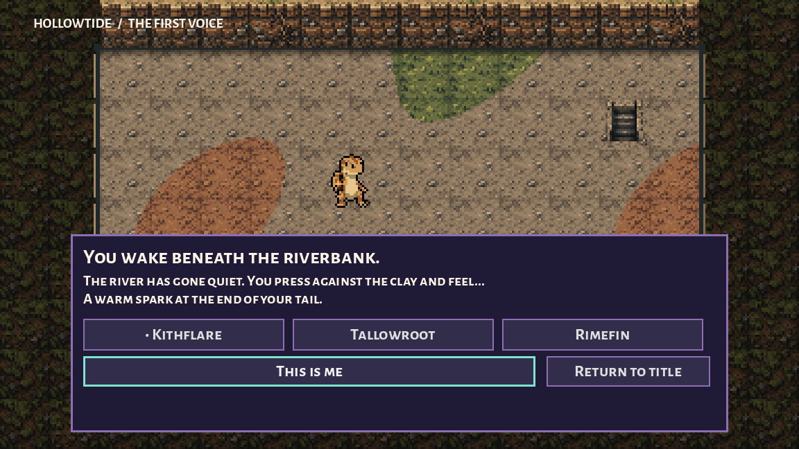
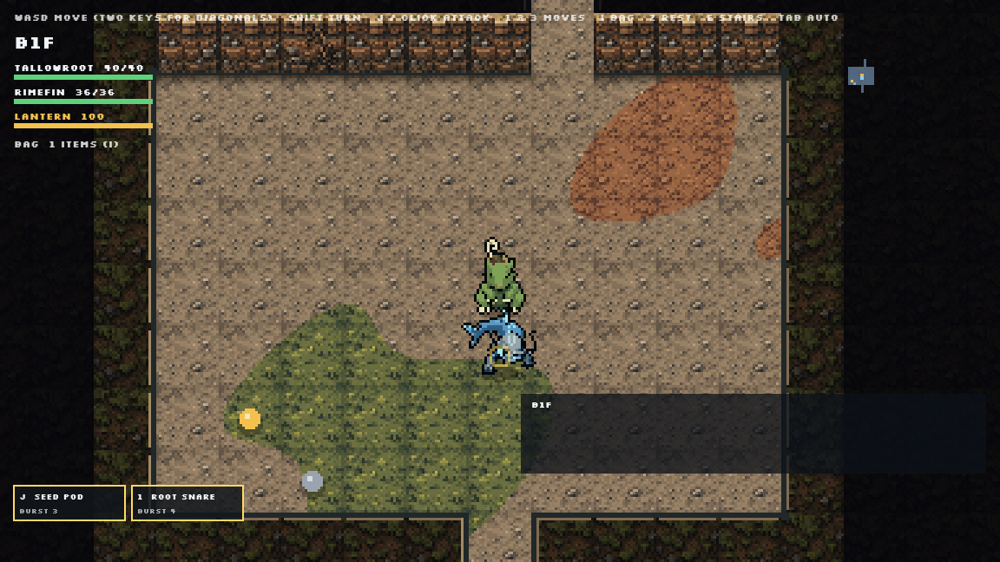

# Creature-player opening and Hollow terrain, October 9, 2026

Preston's direct revision: the player is now a creature. This supersedes the human courier selection in the previous opening. The approved dusk title artwork, wordmark, lighting, music and settings remain. Claude's current exploration and recruiting systems remain the gameplay authority. His latest concurrent update restores turn-based dungeon combat and cleans Dustkite's dust puffs; both are preserved, along with his Hollow pathing fix. The optional hybrid bridge remains available but is not enabled by this launch.

## Play

F5 starts `scenes/creature_opening.tscn`. New Game opens an awakening beneath the riverbank. Choose which of the original three playable forms you are, hear another survivor, choose a different creature as your companion, then enter the existing Hollow with that exact two-creature party. Identity and companion choices can be revised before entering. Escape backs up and can return to the title. The title's two creatures use existing walking frames and the shared sprite finish; Reduce Motion stops their arrival.

The awakening text and title **The First Voice** are proposals for review. This is a playable launch slice, not an approved final script or a completed chapter. It enters the existing generated dungeon directly; there is no claim of a new tutorial floor, personality quiz, persistent player identity, save system, creature guild or return-to-town loop. The old human opening, hometown and courier hall remain intact as reference/playable scenes, but are not the new game's current entry path.

## Dungeon artwork

The original 4-by-4 terrain sheet was generated with built-in imagegen, retained in `source/terrain-source.png`, and cut into sixteen **24x24** cells by Godot using nearest-neighbour sampling. Runtime atlas: `assets/tilesets/hollow_bank_2026_10_09/terrain_24.png`. The companion TileSet resource exposes those cells in the editor.

The new painter uses silt, moss/grass and clay surfaces, dark bank tops, textured cliff faces with root variants, cardinal edges, diagonal corner caps, contact shadow and descending stairs. Broad continuous material regions avoid rectangular patches. It checks all eight neighbours for the visible bank boundary. All decoration stays in the existing tile coordinates. The generator's wall/floor mask, movement, visibility, encounter rules and stats are unchanged.

`floor_painter.gd` chooses this atlas-backed painter for 24px floors when the atlas exists. The original procedural method remains the fallback, including other tile sizes. The real-time fight uses the same resulting floor picture. Deep/shallow water and wet-silt cells are included in the art sheet for later terrain work; **they do not add water or silt gameplay** in this slice. The current bank corners combine atlas faces with small native edge caps; a full set of separately authored corner sprites remains a later art refinement.

## Verification

- 30 opening/terrain assertions: boot, title creatures, options, all six hero/companion combinations, backtracking, selected leader/party entering the actual dungeon, retained turn-based mode and sprite finish, nonblank opaque atlas, sixteen editor TileSet cells, deterministic painting, unchanged topology and procedural fallback.
- 7 real mouse/keyboard assertions: skip input does not double-trigger New Game, reduced motion, clicking New Game and choosing Rimefin, Enter confirmation and both Escape returns.
- Those 37 assertions were repeated after bringing in Claude's concurrent ambush/pincer/shove additions. No battle code is installed by this slice. The broader turn-based test, before that positional-combat update, verified movement, bump damage, refused empty attacks, wall corners and no overlaps/wall occupants, but autoplay remained on B1F after 1,035 turns with no faints. Its unconditional final `B2F: team` print is misleading; the floor did not advance. Follow-up belongs with Claude's current gameplay work. The logs retain the failure, and a full current combat pass is not claimed.
- Paired original/new-art optional battle probes: both start correctly, transfer the identical floor picture and register damaging attacks. These explicitly enable the retained hybrid bridge for the test only. Before Claude's concurrent pathing and turn-mode update, the existing hybrid regression reached B2F after three battles and no faints, retaining recruits. Its separate arranged first encounter did not finish before its frame cap; fleeing worked. This older evidence is retained as history, not a fully passing current combat suite.
- Native screenshots inspected in the Compatibility renderer. Final scoped tests have no script/resource errors. Windows certificate-store diagnostics remain; opening shutdown reports 102 ObjectDB instances, consistent with the existing opening-test family.

`native/`, `checks.json`, `input-checks.json`, `bridge-checks.json`, `logs/` and `reproduction/` preserve the evidence. `originals/` and `installation.json` record the exact scoped installation. No creature PNG, palette reference, wing repair, animation sheet or prior backup is overwritten. No commit, Retro Diffusion charge, creature stat or combat-rule edit.

## Structural reference

Firecrawl searched and read the [SkyTemple Dungeon Tileset documentation](https://wiki.skytemple.org/index.php/Dungeon_Tileset). It describes 24px dungeon chunks, separate ground/wall/secondary-terrain graphics and adjacency editing. That informed the material separation and neighbour-aware renderer. No game code, maps, art, numbers, text or music was copied. Only this tileset page was read for this slice; complete-game coverage is not claimed. The search and scrape receipts are in `source/firecrawl.json`.

## Generation brief

Built-in imagegen, one opaque square atlas, an exact four-by-four grid without labels/gaps. Sixteen original riverbank-grotto materials at a 24px logical target: silt, grass, dry clay, damp silt; mossy bank top, sediment cliff, root-bearing cliff, bedrock; deep/shallow teal water, wet silt, stone ground; descending stairs, grass tuft, mossy bank variation and quiet silt. Mature folklore pixel finish, muted earth colours, dark edges, substantial clean clusters, no game references copied. The full production prompt is saved in `source/generation-prompt.txt`.
