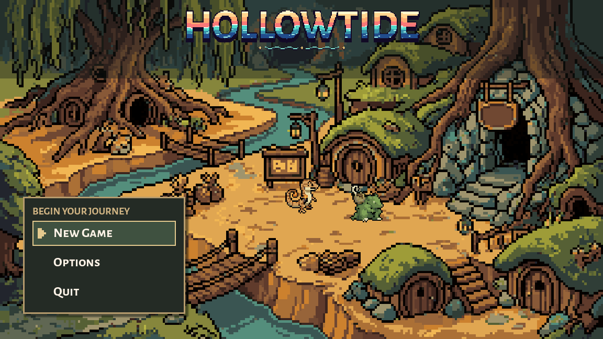
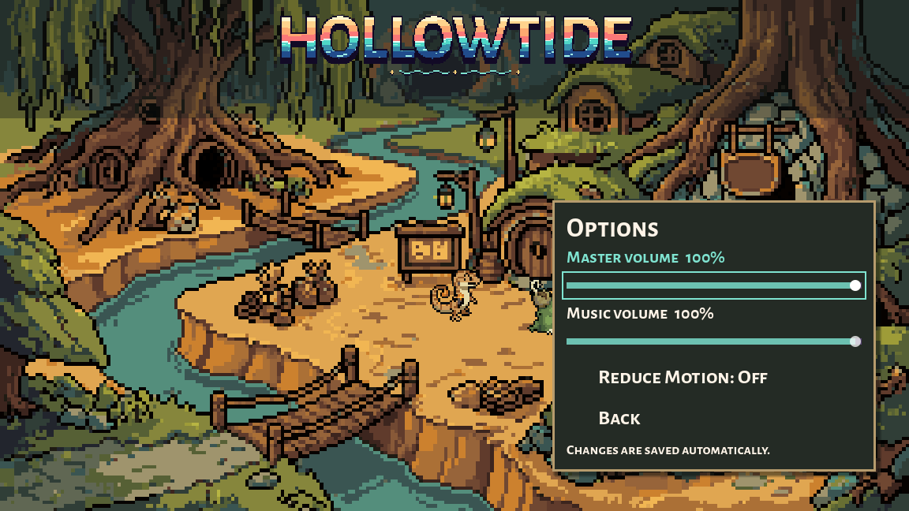

# Creature village title menu, October 9, 2026

Preston requested a new menu style that fits the creature-player Mystery Dungeon direction and authorized Retro Diffusion. F5 still opens `scenes/creature_opening.tscn`. The title now shows a close creature settlement with root and clay burrows, moss roofs, a stone guild entrance, lanterns, bridges and a stream. Architecture and village identity are visual proposals, not approved world canon. This changes the title screen's town painting; the playable hometown and guild conversion are separate future work.

The main choices sit on the lower-left bank in an earth-and-moss panel with parchment focus and cursor colours. Two existing finished creature sprites stand on the open path at village scale, use their existing walking frames on arrival, then rest. A few fireflies animate on the banks. Reduce Motion freezes arrival and ambient motion. The Hollowtide wordmark and its prelude remain, with their scale/placement adapted to the new painting. Existing music, volume sliders, settings persistence, keyboard/controller/mouse controls and quit confirmation remain.

New Game enters the previously installed creature awakening: choose identity inside the story, meet a different companion and enter Claude's current turn-based dungeon. The flow and party handoff are unchanged. No gameplay rules, creature images, palettes or stats are edited.

## Original art and cost

One Retro Diffusion generation: `rd_pro__fantasy`, 256x144, opaque, no input/reference images, no baked characters or UI. Request `11b6f2af-393c-4553-88a4-794a27b68811`. Estimated and charged cost **$0.18**, reported remaining balance $6.22. The painting displays across the 1152x648 menu with nearest filtering; its 4.5x fit alternates four/five display pixels per source pixel. It is title-screen art, not a tilemap or a newly playable hub. `source/town-source.png` retains the original; `source/generation.json` records the prompt, estimate and receipt. No paid rerolls or animation generations.

Runtime change: `scripts/creature_opening.gd` only, plus new `assets/sprites/menu/creature_village_2026_10_09.png`. The original sunset painting, launch scripts/scenes, installed terrain and all existing backups remain exact. The changed script is backed up under `originals/`.

## Verification and limits

32 existing opening/terrain assertions pass, including boot, menu options, all six identity/companion combinations, backtracking, chosen leader/party in the actual dungeon, current turn combat, shared creature finish, terrain determinism and fallback. Two added composition assertions verify the new backdrop and an on-screen menu. Seven real mouse/keyboard checks pass: boot skip, Reduce Motion, New Game click, Rimefin selection, Enter and both Escape paths. Total: **39** assertions. The prelude logo was also centred after reducing its width.

Godot Compatibility screenshots inspected at 1152x648: title, options, awakening, companion and dungeon. No final script/resource errors. Existing Windows root-certificate diagnostics and 102 shutdown ObjectDB instances remain. These tests do not establish a full dungeon clear or validate Claude's newer combat mechanics; the previous slice's B1F autoplay limitation remains recorded there. `checks.json`, `input-checks.json`, `logs/`, `reproduction/` and `installation.json` contain the evidence and exact installed scope. No commit/reset/stash.
