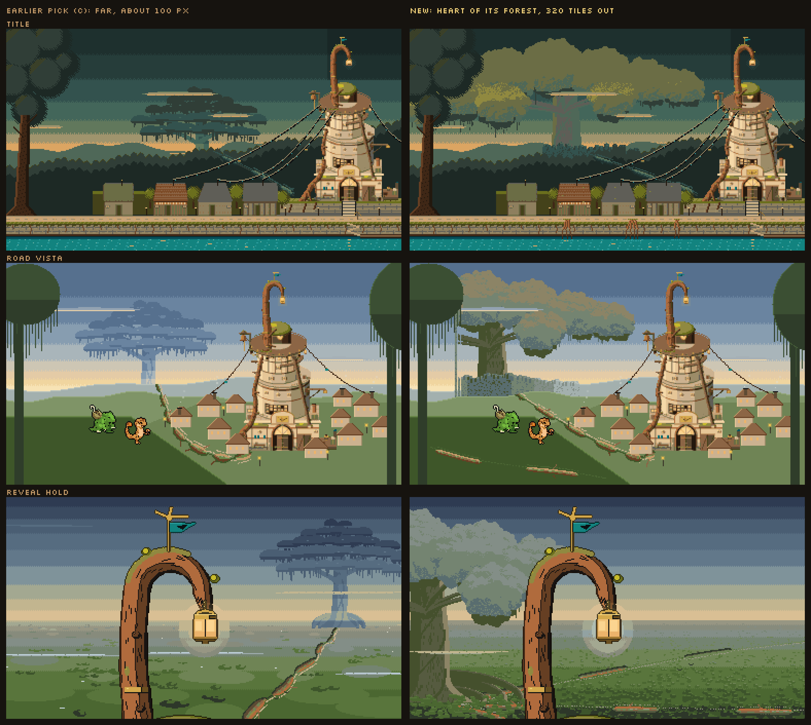
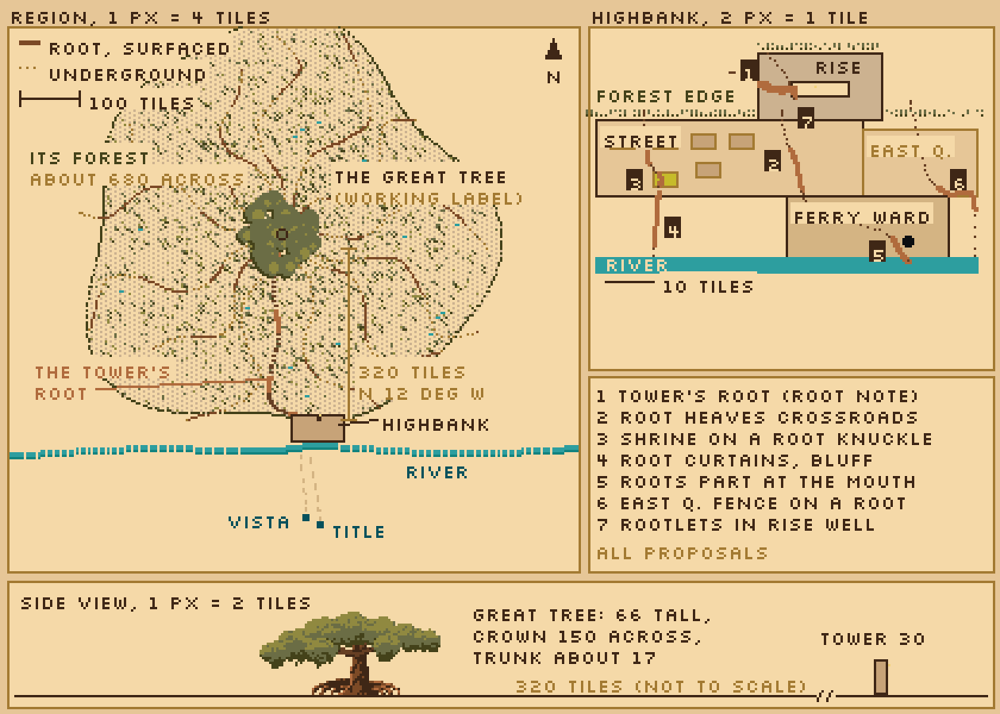

# The great tree (working label): design, v2 (2026-10-27)

Everything here is a proposal until you sign it. Nothing is installed. The name is yours.

## 1. Your words

> "like not too far from the town. Like the tree of life kind of like its so great and vasts its at the center of the forest but its just so big its influence is everywhere around the town."

Earlier: "that tree root is going to be from a huge great tree. It will be a dungeon [though] but it'll be a massive tree too."

Read as: the tree stands in the middle of its own forest, close to Highbank but not over it. It is so big that you feel it all over town: its roots, its leaves, its forest, and its crown on every skyline.

## 2. The recommendation in five lines

1. The great tree stands 320 tiles north-north-west of the Tower (about six Streets end to end), at the heart of its own forest.
2. It is 66 tiles tall (2.2 Towers) with a crown 150 tiles across, so its crown fills half to all of the sky in every outdoor view.
3. Its forest starts at the hedge behind the Rise and wraps the town on the north, west and east. Its trunk always goes down into that forest.
4. Its roots run under the whole region and come up all over town. The crown never hangs over town; only the forest edge shades it.
5. The Tower stays the town's landmark: nearest, sharpest, and the only light. The tree is the region's landmark behind it.

## 3. Map

| | |
|---|---|
| Where | 320 tiles from the Tower, 12 degrees west of north: 313 north, 67 west. |
| Size | 66 tiles tall. Crown 150 across (80 west of the trunk, 70 east). Trunk about 17 wide, flaring into six crook-shaped buttress roots. |
| Shape | Braided trunk, limbs rising into one broad mossy dome of leaf clumps, hanging moss and root curtains under it. No face, no lights. |
| Forest | About 680 tiles across, centred on the trunk. South edge is the hedge and treeline behind the Rise. A south-west arm reaches the river. The title's dark ridge woods and the vista's far wooded hills are its fringe. |
| Roots | 13 main roots radiate from the trunk, some on the surface, some under it. Springs sit between them. One long root becomes the Tower's root and enters town from the west. |

## 4. Each view

| View | What you see | Size at 1x (measured) |
|---|---|---|
| [Title](final_v2/title_3x.png) | The crown fills the northern sky behind the Street, left of and behind the crook. The hazed trunk goes down into a rise of forest above the ridge woods; cloud streaks cross it. Finger roots hold the bluff and drink the river. A few leaves drift over the Street. | 1.96 px per tile. Crown 293 px wide, tree 129 px tall. 0 px changed in the menu, the shade box, or right of x 298. 47 colours before and after, 0 new. |
| [Road vista](final_v2/vista_3x.png) | Dawn: the hazed crown stands left of the Tower over its forest on the far hills. The trunk goes into the forest. The Tower's root comes out of the forest and runs down the slope to the Tower's west foot; a second root rises under the party's slope. | 2.01 px per tile. Crown 302 px wide, tree 133 px tall. 0 tree px right of x 224. 0 colours outside the dawn palette and the frame. |
| [Reveal hold](final_v2/hold_3x.png) | At the top of the climb the crown fills the upper left, the trunk stands at the left edge with a cloud strip across it, root rides cut through the forest below. The lamp hangs in clean sky with a warm halo. | 2.72 px per tile, so the crown (408 px by the lens) overflows the frame. 0 tree px in the lamp's window (x 160 to 245, y 80 to 152). Backdrop 24 colours (limit 32). |
| Road far | Not mocked. A fixed far layer behind the far town. | Computed: 1.33 px per tile, about 88 px tall and 199 px wide. |
| In town | You never see the trunk. You see roots, leaves and dapple (section 5). | [Influence sheet](final_v2/influence_3x.png) |

## 5. Influence around town

| Place | What the player sees | Later file or slot |
|---|---|---|
| Rise west lane | The Tower's root comes in from the forest at full girth as a mossy ridge, with its leaves | `town.prop.hall.root_ridge` in `hall_rise.gd` |
| Rise west grass | Evening leaf dapple from the forest edge just west | `hall_rise.gd`, ground overlay |
| Rise well (8,10) | Fine rootlets in the well wall | `hall_rise.gd` |
| Crossroads | A root heaves the paving, surfaces twice, dives again | `street.gd`, new slot `town.prop.street.root_hump` |
| Growth Shrine (12,11) | Sits on a root knuckle, tying growth to the tree | `street.gd`, `town.landmark.shrine` |
| Bluff below the Street | Finger roots hold the bank and drink at the water | `street.gd` row 15; `title_highbank.gd` |
| Ferry Ward | Two roots part around the Mouth and drink the river. One rootlet reached for the Mouth and stopped short: Hollow is absence | `ferry_ward.gd` |
| East Quarter | South fence posts set into a surfaced root | `east_quarter.gd` |
| Street and Rise air | Big warm leaves and pale seed tufts on the north wind | new `fx.ambient.great_tree_leaf`, `hub_town.gd` |
| Rootbank Warren | Its root walls are the tree's roots (bark colour match only) | `rootbank_detail.gd` |
| Sound, later | Wind in the crown under the town, a low creak near the Tower's root | ElevenLabs sfx; needs an ambience home |

## 6. The Tower's root

Codex already has [CODEX_ROOT_NOTE.md](CODEX_ROOT_NOTE.md): cx-12 root_foot leaves the west edge at full girth heading west-north-west, cx-13 root_vein half sunk, cx-14 Reach silhouette unchanged. **All three still fit, so nothing has to go to Codex now.** A tree to the north-north-west sends its root in from the west, which is what cx-12 already draws.

Two lines go stale, for the note's owner to fix later (not edited here):
- The context line "where it stands ... is still Preston's pick" can name this place once you sign off.
- The "Later" line's cx-10 re-brief says "the tree right of the crook". It must become: crown in the upper left, behind and left of the crook, nothing in the lamp's window (x 160 to 245, y 80 to 152), horizon y 120, 32 colours or fewer.

TOWER_DESIGN.md:111 ("forbid canopies") still needs restating by its owner: no canopy on the Tower, but the root belongs to the great tree.

## 7. The dungeon hook (proposal, no numbers)

- **When:** after the pilot and the first growth (THE_CONCEPT step 9). Until then it is scenery.
- **Way in:** from the Rise's west lane post (2,10), the route 6 dark lantern, follow the Tower's root north into the forest.
- **Shape:** down first (the forest floor among the roots, then root galleries), then up (a door between two buttress roots opens on the braided trunk and floors count up, the first dungeon that climbs), then out along the limbs into the crown. Rootbank Warren reads as an outer edge of the same root network.
- **Top:** the boss alone on a fixed crown-top floor after a scene, on the Warden entrance model, with an optional rest floor before it. From the crown top you look back south and see the Tower's lamp, the one warm light.
- **Who:** Grok sets floors, levels, wild lines and the boss. Codex paints bark, galleries and crown terrain. Claude builds up-counting floors, open-air floors and the boss scene. Names are yours.

## 8. Defaults ("go with the defaults")

1. Place: 320 tiles N 12 W of the Tower, the heart of its own forest.
2. Size: 66 tiles tall, crown 150 across, trunk about 17 on six buttress roots.
3. Forest: about 680 across, starting at the hedge behind the Rise, wrapping north, west and east.
4. Never overhead: the crown never shades town; only the forest edge does.
5. Look: hazed, mossy, warm on its sunward tops, never lit; the lamp stays the only light.
6. Every outdoor view: left of and behind the crook, trunk going down into its forest.
7. In town: no trunk, only roots, leaves, seed tufts and dapple, as in section 5.
8. Hold: crown upper left, lamp window empty, 32 colours or fewer.
9. Road far: keep `road.backdrop.great_tree_far` as a fixed far layer, about 88 px tall.
10. Codex: nothing new now; fix the two stale note lines at the cx-10 re-brief.
11. Dungeon: design only until after the pilot and the first growth.
12. Label: "the great tree" until you name it.

## 9. Questions only you can answer

1. **Name.** What is the tree called?
2. **Height on screen.** In the title and vista the crown's top now sits level with the Tower's crook, so the Tower is no longer the tallest thing on screen (it is still nearest, sharpest and the only light). Keep that, or keep the crown a little lower?
3. **Close enough?** 320 tiles out, felt through roots and leaves, or should the canopy's edge actually reach over the Rise? That other reading is mocked in `v2_boughs/` (section 12).

## 10. First build slice

**The reveal's sky backdrop, in code.** Rewrite `paint_sky()` in `scripts/story/tower_reveal.gd` (the coded placeholder for `story.backdrop.tower_sky`) to draw the hold backdrop at 384x216: sky bands to a horizon at y 120, forest bands and crowns, the crown in the upper left, root rides, the cloud strip, two birds. Port it from `build_hold_backdrop()` in `final_v2/final_v2_mocks.py`. It stays a coded placeholder, so Codex's cx-10 art still replaces it through the slot.

Before starting: wait for factory pass 9 to finish, and commit or confirm the uncommitted changes in `tower_reveal.gd` so this is its own diff. The sky sprite is fixed on screen for the whole climb (tower_reveal.gd:259-264), so the mid-climb frames change too.

Done when:
- `tools/debug/tower_reveal_check.gd` passes and `tools/debug/run_checks.py --fixed-fps 30` matches the baseline.
- Windowed shots of mid-climb and the top hold show 32 colours or fewer in the backdrop, 0 tree px in the lamp's window, the crook and lamp unchanged, and nothing showing through the Tower body.
- You press play, walk the Rise, trigger the reveal, and the tree is there the whole way up.

Slice 2: the title (`title_highbank.gd`), checked like the mock: 47 colours, 0 px in the menu, the shade box or the Tower.

## 11. Mocks

All in `final_v2/`, each at 1x and 3x, built by `final_v2_mocks.py` (`python -W ignore final_v2_mocks.py`): [title](final_v2/title_3x.png), [vista](final_v2/vista_3x.png), [hold](final_v2/hold_3x.png), [hold backdrop alone](final_v2/hold_backdrop_3x.png), [influence](final_v2/influence_3x.png), [map](final_v2/map_3x.png), [C against the new pick](final_v2/compare_c_3x.png).

## 12. Earlier options

- **C, horizon (the earlier pick):** 4,400 tiles out, 480 tall, about 100 px in every far view. Replaced: you said "not too far". Mocks in `final/`.
- **B, over the bluff:** 42 tiles north-west, crown overhead. You saw it and did not take it. Mocks in `concept_b-bluff/`.
- **A, upriver island:** read as cloud shelves, and it invented an island. Dropped. Mocks in `concept_a-upriver/`.
- **v2 boughs reading:** 115 tiles out, 150 tall, the canopy's rim crossing the Rise. It sold sheer size best in the vista, but it puts the crown over town, close to B, where your words put the tree at the forest's centre. Kept from it: the trunk going down into its forest, finger roots on the bluff, the rootlet that stopped short of the Mouth, a clean lamp window, no mist bars. Mocks in `v2_boughs/`.
- **v2 skyline reading:** the base of this pick. Its first mocks had a floating trunk, flat T-shaped limbs, mist bars and a cool ring round the lamp; all fixed in `final_v2/`. Mocks in `v2_skyline/`.
- Old name ideas from the first pass, yours to use or ignore: the Holdfast, Oldcrown, the Waymother.

Measured, unverified, and process

- Measured by `final_v2_mocks.py` on its last run: title tree box x 0 to 286, y 9 to 127, trunk painted down to y 127 where the ridge woods start (y 126), forest crowns over its foot; wordmark area edges 1230 before, 803 after (calmer). Title tree brightness 100 against the dark evening sky's 73, so it reads, but it stays darker and cooler than the Tower. Vista tree box x 44 to 218, y 7 to 130, colours 143 to 149, brightness 112 against sky 142. Hold tree box x 0 to 159, crown's right edge x 159, brightness 110 against 126. Map side view tree 76 by 35 px.
- Composed, not lens-exact: the title and vista trunks sit about 50 px left of where the lens puts them, so the crown stops short of the crook. The hold is within a few px of the lens (the hold's Tower centre was estimated from the lamp).
- Road far is computed only, not mocked.
- The in-town roots are drawn over existing captures as mocks, not built tiles. The influence and map pictures are v2_skyline's (re-rendered); only the caption spacing and the map's scale-break label were fixed.
- The hold's lamp halo is rebuilt from warm colours only; it is still a mock of what the game's glow would do.
- Unverified: whether `hub_town.gd` has an ambience hook for the sound idea (one designer said yes, the other found no ambience script).
- Nothing was run in Godot (factory pass 9 was running). No commits. No paid generation. Nothing edited under scripts, scenes, assets, tools, project.godot, docs/team, docs/AI_COLLABORATION.md, TOWER_DESIGN.md, docs/art/slot-candidates or CODEX_ROOT_NOTE.md.
- Process: one number in `final_v2_mocks.py` (the vista forest's spread) was changed with `sed` through Bash instead of the Edit tool. It was not Python through a heredoc, and the script was re-run and every mock re-checked after it. A read-only probe script was written, run and deleted.

