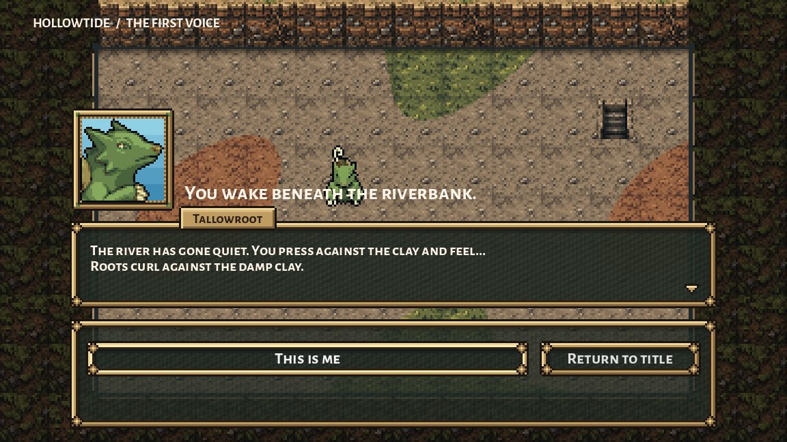
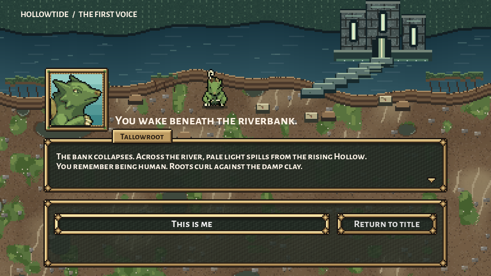
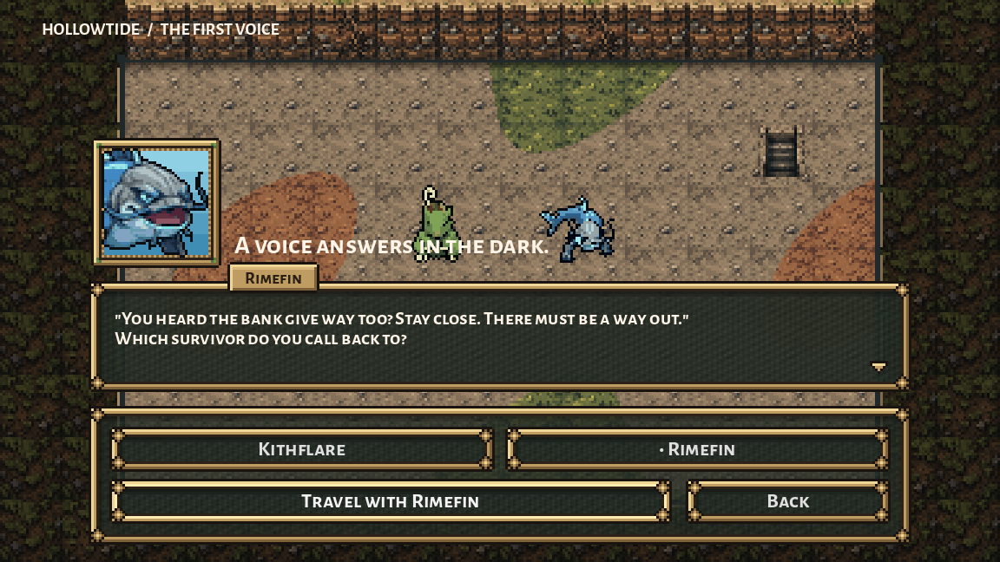
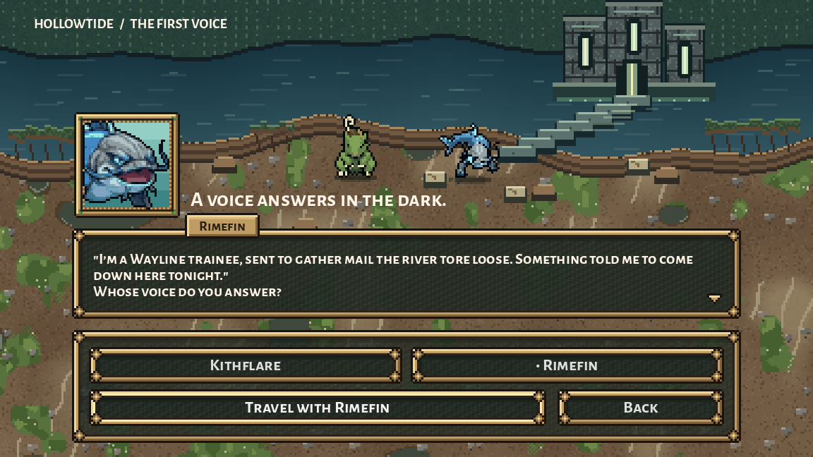
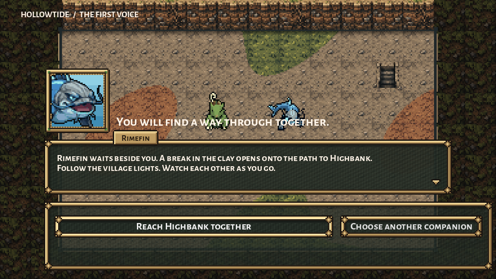
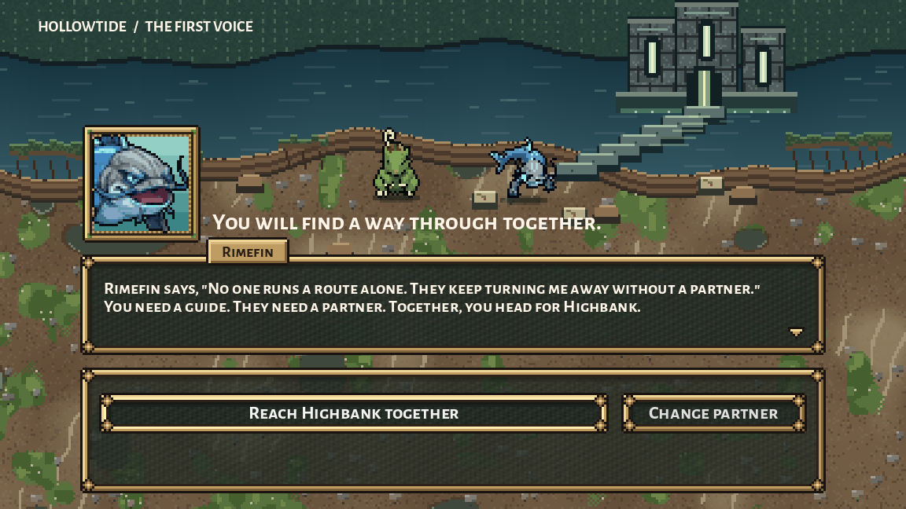

# Pilot waking scene, handoff job 12

Implemented October 10, 2026. The first three beats follow Preston's approved pilot outline. The new lines and distant architecture are proposals for his review, not newly approved canon.

## In the game

The generic enclosed room becomes a freshly collapsed, wet clay bank. Loose sealed letters lead toward the trainee; across the river, light spills from the risen Hollow and its wet stone approach. Existing Rootbank clay and Hollow stone materials supply the native 384×216 staging, nearest 3×. Water reflections drift gently; Reduce Motion freezes them. The creatures keep their installed sprite finish and stand above the heading, with contact shadows.

The awakening names the collapse, rising Hollow and some memory of being human. The voice belongs to a Wayline trainee collecting mail the river tore loose, drawn down by a quiet call. The agreement names the no-solo-route rule and the trainee's repeated refusal for lacking a partner: the player needs a guide, the trainee needs a partner, and they head for Highbank together.

| Original waking | Installed waking |
| --- | --- |
|  |  |
|  |  |
|  |  |

Original previews render the exact archived script, using the same Tallowroot/Rimefin pairing as installed previews. The hero/partner selector, soul-selected identity, dialogue frame/portrait, focus/input, fade, town transition and team metadata are retained. The eight existing actor, form, label, button, choice, Back, advance and input methods compare exactly with the original.

## Verification

- Installed native Godot Compatibility run: **95/95 waking checks**. All three soul identities and all six permitted pairings, fitted two/three-line dialogue, aligned 948px choice panels in every phase, house-finished actors/portraits, animated/frozen river, clear heading, actual mouse/Enter/Back and the selected Rimefin/Kithflare team arriving in Highbank. The final Back label is shortened to “Change partner” so it fits its existing button width.
- Claude's current soul check reaches chosen Tallowroot, retains its Roots line and offers no second starter picker.
- Claude's current town-loop check, with added result assertions, exercises real scene changes: prologue → town → dungeon → clear → town → second run → faint → town. Items, taught moves and IQ carry through the clear; carried oil is lost on faint. The existing fresh-run reedberry remains, as dungeon.gd explicitly specifies. An initial overly strict empty-bag assertion was corrected to this existing rule; gameplay was not changed.
- Final live logs contain no script/parse errors or cleanup leaks. Review issues were corrected before final verification. Draft preparation scripts are working history; the installed source is archived in `candidate/`.

## Scope and preservation

Installed only `scripts/creature_prologue.gd`, the new presentation-only `scripts/ui/waking_bank.gd`, and a prepended collaboration note. Original code/notes are in `originals/`. No original PNG, title painting/wordmark, shared creature shader, palette, rules, save/state method, project settings or commit changed. The seven-form refinements, Oxbowarchon's darker jade, Sparkwick correction, Skimlet leg correction, Gruntle portrait clipping and prior art backups remain in place.

The painter borrows the existing riverbank ground primitives and Hollow material constants, without modifying their sources or dungeon layouts. Keep those contracts available when changing the dungeon painters.

Preservation audit: 3 installed files and both original backups hash-exact; prior collaboration body retained; 16089/16253 baseline protected files and 15520/15680 original asset files exact. Concurrent changed paths retained: 164. Details: `checks/audit.json`.

## Next handoff

Job 12 is implemented and engine-verified; Preston's review of final dialogue/staging remains open. Claude owns the Guildmaster and town introduction plus later pilot story/state. No Guildmaster scene was written here. The title remains the approved creature-village painting and bare choices, and F5 remains the current development setting. Play the launch from `scenes/creature_opening.tscn` (F6), or test this slice directly from `scenes/creature_prologue.tscn` (F6).
