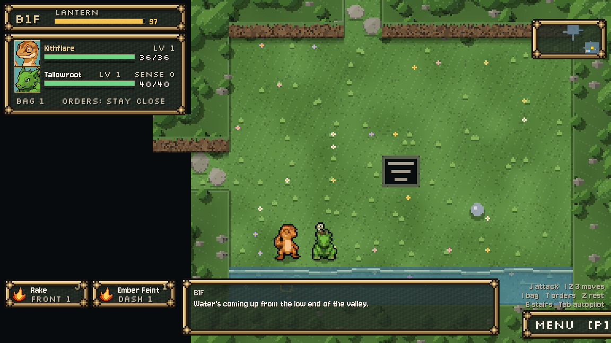
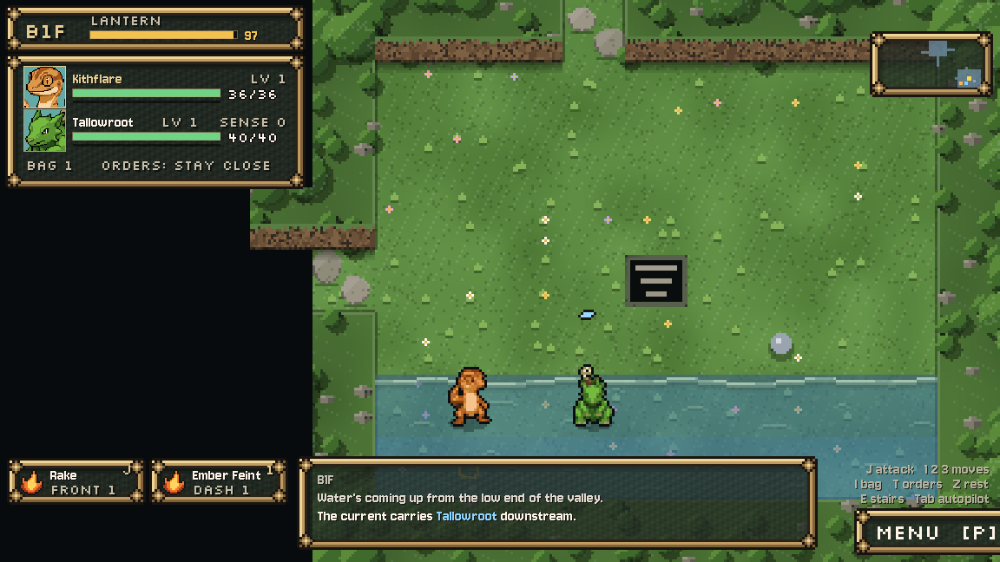

# Painted rising water, October 14, 2026

Task 2 is installed. The Hollow B1F's rising water now has a layered, gently moving silt/foam shoreline and quiet broken ripple strokes in the town river's muted teal direction. The existing translucent depth wash still lets the painted meadow, slabs and flowers show through. Four native 400ms frames on 192px strips share one phase across tile boundaries. The textured valley remains in use; **USE_TILE_ART stays false**. Art is a visual proposal for Preston.

## Runtime scope

New `assets/sprites/world/rising_water_2026_10_14/{shoreline,ripples}.png`, two lossless native imports, and `scripts/dungeon/rising_water_art.gd`. The shoreline atlas is 192×32 (four 8px rows), the ripple atlas 192×96 (four 24px rows). The helper draws inside the same visible/explored wet floor tiles and existing floor-effect layer; it never paints a dry tile or wall. Missing/wrong-sized textures or a non-24px tile size return to the retained original renderer.

`dungeon.gd` has exactly **three added lines**: one preload and a two-line presentation hook in `_draw_water`. Removing them restores the complete original source text exactly. The original depth opacity and 400ms tick are retained. Flood frequency, limits, wet tests, eastward pushes, Tide swimmers, lantern drain, items, collision, actors, terrain, banner/messages, saves and Continue are unchanged. No other production source file changed; no project/settings, creature, other source image, sound, Claude proposal or training-job edit. No commit.

## Native verification

Godot 4.7.2 compatibility rendering with isolated profiles and private saves. **22/22 staging and 22/22 installed live**:

- The original water check's six assertions pass: valley/base/ceiling, initially dry, first row at turn ten, current carrying leader/item while a Tide swimmer stays and wet feet drain lantern, no off-beat rise and a dry start/stairs at the ceiling, dry Rootbank Warren. Production check unedited; private copy only changes output/framing and teardown.
- Sixteen additional native checks prove both atlas imports RGBA-exact; turn nine dry/turn ten wet; painting changes no suspend fields; a real suspend writes the exact current record including water_rows; the real title's Continue restores the same Hollow B1F, seed, water height/base/ceiling, turn and lantern; the team still resumes at the original dry start; the one-use suspend is consumed in memory and on disk; turn 21 stays at two rows and turn 30 reaches the original ceiling.

Before/after native composites at turns 9, 10, 20 and 30: **zero changed dry-ground/wall pixels**, both staging and live. Turn nine is byte-exact everywhere. The wet-only changed pixels are 5,184 at the first row, 14,976 at two rows and 24,768 at the three-row ceiling for seed 1. Floor data and state exact. These composites expose the map for a complete wet-footprint comparison; game captures retain normal visibility. Animation phase can differ between processes, so wet colours are not claimed identical frame-for-frame between staging/live.

`final-verification.json`: 823 existing source files protected, only dungeon.gd changed; 822 remain exact. All installed candidates and PNGs exact. Final live logs are clean. Staging includes the existing Windows root-certificate-store diagnostic. Audio driver Dummy.

Earlier unsuccessful tooling attempts are not final proof: the first installer had a Python syntax error before any write. A prematurely launched live check then lacked the helper, the legacy logic run used the old renderer, and the capture file did not yet exist. Those previous logs remain archived. The installer was corrected, syntax-checked, installed successfully under source guards, and every final live check/capture rerun through a failure-stopping driver.

## Evidence and reproduction

`before/`, `after/`, `live-captures/` contain native composites and game views at the four turn counts. For clear art review, the fixture places the party on the dry bank, frames the shore and suppresses the rise banner only in its captures. The normal gameplay banner/messages are untouched; the original logic check still captures them. Save/Continue is exercised separately in the real scenes. This is fixture evidence, not a full manual campaign traversal or exported-build test.

`originals/`, `changes.diff`, both final scripts, `art/`, `build_art.gd`, isolated import/check/capture/install drivers and manifests preserve exact sources and receipts. `build_art.gd` paints the two atlases explicitly with Godot Image operations; `import_art.py` imports just those two files in a small isolated project, then copies the native imports/caches. Never blanket-copy staging into live. Native caches can be regenerated by the normal editor.

Provenance: **AI-assisted code-painted pixel art**, authored by Codex under Preston's direction, using the existing Claude river/terrain palette and drawing conventions. No image-generation call, runtime model, paid API or external artwork. The existing terrain retains its own provenance.

**Next:** task 3, Storage interior art at Hall scale, delivered as staged art and placement notes for Claude to wire. No keeper creature yet.

