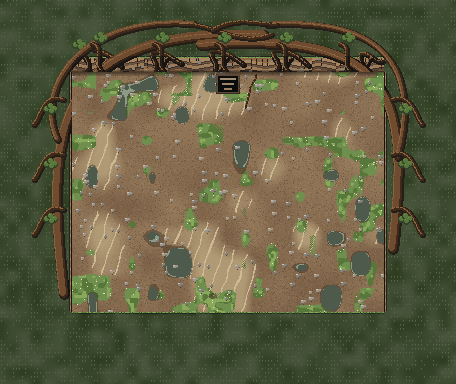
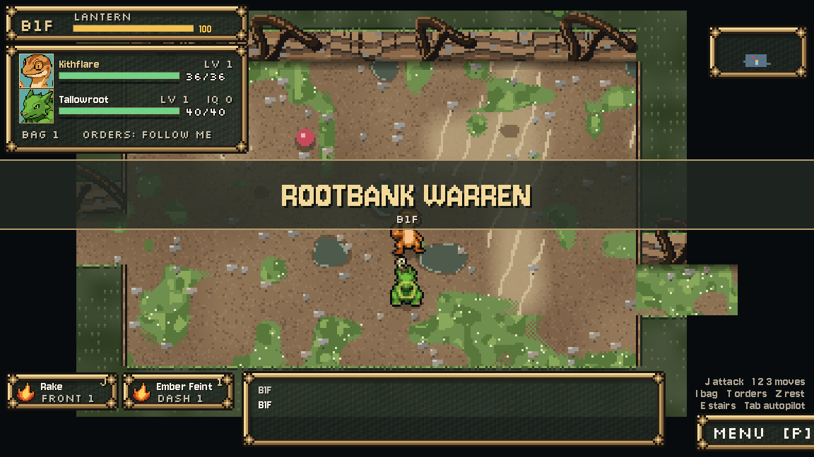

# Rootbank Warren finish — October 11, 2026

Installed under Preston's direct request to finish Rootbank Warren. Builds on Claude's latest restored textured painter: **USE_TILE_ART remains false** in riverbank, valley and ruin. The October 10 atlas assets and all original painter code are preserved. This is a visual proposal for Preston's review.

Root networks now grow from connected exposed banks, with varied spacing and curves, forked hanging roots, small clover clusters and narrow clay reveals along the side banks. The existing 13×10 Shortcut Crew arena has two thick roots bracing its sides and a woven crown over the back bank. Top-left bark highlights use the existing earthy material direction. Every new pixel is clipped to an existing WALL tile. Clay/sand/grass/pools/pebbles on walking ground and stairs are byte-exact, including their native shader output.

Runtime change: new `scripts/dungeon/rootbank_detail.gd`, one preload and one final-image call in `riverbank_painter.gd`. Non-24px rendering returns the original image. The disabled atlas branch is unchanged. To remove this finish, restore the archived riverbank painter; the standalone helper can remain unused. No dungeon controller, crew cinematic, topology, actor/parcel placement, collision, move rules, save state, music, project settings, other painters or original raster assets were edited. No commit.

## Verification

- Native Godot 4.7.2 compatibility rendering, isolated APPDATA/LOCALAPPDATA, fixed 30fps; test audio driver Dummy. No audio listening claim.
- Final staged material check: **21/21** across seeds 7, 983 and 19031. Drawing deterministic; data unchanged; dimensions and opacity exact; all floor/stair pixels exact; old tile-size fallback exact. See `material-check.json` and `logs/stage/material.log`.
- All four actual Rootbank floors captured before/after at seed 4242, plus native shader output. Normal floors deliberately use the same fixed seed, so their geometry repeats in this fixture; the material check above covers additional generated layouts. `image-verification.json`: 0 altered walking-floor pixels in raw and native images on every floor; all data exact. Final normal layout: 17,812 raw / 18,887 shader wall pixels changed; den: 16,484 / 16,724.
- Installed live captures of all four floors exactly match final staged raw images, native shader output and layout data. `live-verification.json`: 794 existing source files checked; the only changed existing source is riverbank_painter. Both installed candidates exact. Dungeon/crew/other painter sources remain exact.
- Existing dungeon check, isolated driver with real failure exit and cleanup: **5/5 staging and 5/5 live**. Mirekit/Whinet crew boss and talk; Rot Spit Blight; Drain Bite healing; Hollow valley/ruin/Warden/pond; town selects first then Hollow. Original production check unedited.
- Existing crew cinematic check passes staging (initial art revision) and **final installed live**: fight starts, visible Mirekit flop, escape, parcel recovered, first dungeon marked beaten. Final live `crew/` captures include the parcel and all dialogue beats. This fixture directly places the party on the boss floor; it does not claim a manual campaign traversal.
- Final live logs have no script/resource/shutdown errors. Staging's pre-existing Windows root-certificate diagnostic appears in logs. First candidate failed compilation (native Noise class name conflict and two inferred types); corrected before install. Earlier candidate logs remain in `logs/stage/after-previous-*` and are not passing evidence.

## Evidence and provenance

`originals/` preserves the restored textured source and protected dungeon/crew/shared painter files. `before/` is the current textured baseline; `after/` is final staging; `after-live/` is final installed live. `before-stale-atlas/` is an explicitly superseded initial capture made before detecting Claude's restored source: it is not the accepted baseline. `rootbank.diff`, the two candidates, private capture/check drivers and hash manifest preserve the exact work.

Art is **AI-assisted code-painted pixel art**, authored by Codex under Preston's direction using Godot Image drawing and the existing Claude painter. No image-generation call, downloaded source, external model inference or paid API call. The existing floor art retains its own provenance. This finish adds no media files to the runtime asset census.

