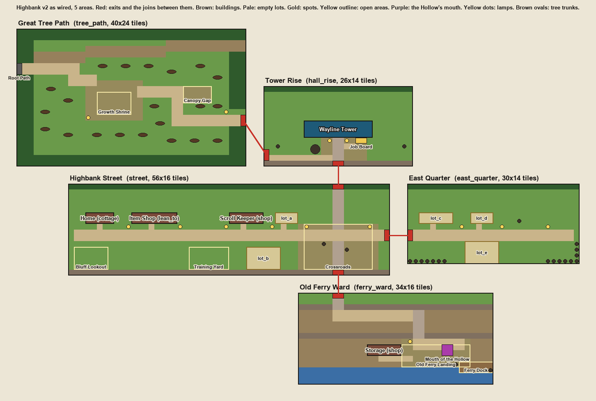

# Highbank town map, 2026-10-28

Preston: "start town map, lets rethink the buildings as they just look like the same designs square boxes. Not unique buildings with specific purpouses. You can use the snythesis to get ideas but need you to wire them then codex will generate. First wire the map though and the foundations of the town. The Tower and tree will have their own areas while the tower is in a part of town not surrounded by buildings."

This file covers the map and the forest interior, both wired. Preston answered the four questions the same day (below). The keeper-shaped buildings are not built yet; the Item Shop goes first.

Redraw it after any area change with `python tools/art/town_map.py`. The script reads the area files themselves, so the picture can't drift from the game.

## What is wired (Highbank v2, `HT_HIGHBANK_V2=1`)

| area | size | what's in it | exits |
|---|---|---|---|
| Tower Rise (`hall_rise`) | 26x14 | The Wayline Tower, the Job Board and lamps. **No other buildings.** | south steps to the Street; **new:** a west path to the Great Tree Path |
| Great Tree Path (`tree_path`) **new** | 40x24 | Inside the forest: the great root, trunks walling a winding path, the Canopy Gap, the **Growth Shrine** in its clearing, and the Root Path (shut: "There's no way through yet") | east to Tower Rise |
| Highbank Street (`street`) | 56x16 | Home, Item Shop, Scroll Keeper, lot_a, lot_b, Bluff Lookout, Training Yard, Crossroads. Storage's and the Shrine's old ground is left open. | north to the Rise, south to the Ferry Ward, east road (shut) |
| Old Ferry Ward (`ferry_ward`) | 34x16 | **Storage** on the landing at the foot of the switchbacks, the Old Ferry Landing, the Mouth of the Hollow and the Ferry Dock | north steps to the Street |
| East Quarter (`east_quarter`) | 30x14 | lots c, d and e | west road to the Street |

The Great Tree Path's ground is a placeholder: the root is a solid strip, the deep forest is hedge, and the forest floor is the town's grass. The trunks have their own art slot, `town.prop.forest_trunk` (Grok's batch gb-09), drawn by a coded placeholder until Grok's file is installed.

**Checks (after the moves and the forest):** with v2 on, 15 checks pass: area_data, hub_town, town_loop, town_props, town_room, storage, evolution, stone, building_template, tower_lean, tower_reveal, board_scene, job_board, music and art_slots. With v2 off, town_props, hub_town and area_data pass. Four checks were taught the new area: area_data, hub_town, tower_lean and town_props (each had an exact expected count). The default map (v1) is unchanged, so the pilot chain was not rerun; run it once v2 becomes the default, because the Shrine has moved.

## Inside the forest (wired)

Preston: "Do a inside the forest map design." The Great Tree Path is now a forest interior (40x24), not a grass strip. These are the structural ideas from enclosed forest screens in top-down games. Only the ideas are borrowed, never a layout:

- **Trunks are the walls, not hedges.** You can see between them, so the forest reads as deep, but they still steer you.
- **The path never runs straight.** It turns three times, so no screen shows both ends, and every turn shows something new.
- **Light marks the stops.** The canopy only opens where something is: the Canopy Gap and the Shrine's clearing.
- **One landmark leads.** The great root runs the width of the map. Follow it west and you reach the spot where it dives into the deep forest.
- **A promise at the end.** The Root Path is shut, so the way on to the tree is something to come back for.

The walk: in from Tower Rise on the east; north around a wall of trunks (two of them hide the Canopy Gap until you turn); west into the Shrine's clearing; up out of its corner to the root; then west under the root to the Root Path.

Not made yet: art slots for the root, a forest floor and the clearing light. The trunk slot is the first.

## Why the buildings look the same

Every building is one of four classes in `scripts/town/building_template.gd`: cottage 5x2, shop 6x2, stall 4x2 and hall 12x3. A class fixes the footprint, the canvas size and the door column, so the Item Shop, Storage and Scroll Keeper are the same 6x2 box with a different sign. They also stand in one row along the Street's north side.

## Synthesis: how a town makes a building mean something (structure only)

- **The shape says the job before the sign does.** In Explorers of Sky's town, most services sit in a building shaped like its keeper (the guild, the shop and the swap shop). You know what a place is from across the screen. Hollowtide's keepers are already decided (`docs/creatures/npc-roles-2026-10-10.md`), so each building can grow from its keeper's body and trade.
- **The site says the job too.** A river bluff town sorts itself by height. Homes and trade go on the top streets, anything to do with boats goes down by the water, and the oldest and holiest things sit apart. That matches the world bible: homes and shops on the upper streets, switchbacks down to the ferry.
- **Not every service needs walls.** A ring, a yard or a stone circle reads as a place without being a box. The Shrine, the Yard and the Lookout are already open areas. They can stay open and get a shape.

## Proposal: buildings shaped by their keepers

These are proposals. Preston decides. The keepers and their jobs are from the approved roles; the shapes and footprints are new.

| place | keeper | shape idea | footprint (proposal) | where |
|---|---|---|---|---|
| Home | the team | Dug into the bluff at the Street's west end: a round door in an earth bank, a grass roof and a stovepipe | 5x2 face in the cliff | Street, west end (**yes**, after the Item Shop) |
| Item Shop | Swaphoard (packrat, "take a thing, leave a thing") | A lean-to heaped with found goods, a roof of mismatched boards and a hanging scale | 6x3, ragged outline | Street |
| Storage | Pouchbill (pelican, throat pouch) | A boathouse on stilts with a hoist arm and a net pouch hanging from it | 6x3 on stilts | **Ferry Ward (moved, wired)** |
| Scroll Keeper | Inkhoot (barred owl) | A tall, narrow archive house with round eye windows, a steep roof and a cellar hatch. Still well below the Tower. | 4x2 base, tall canvas | Street |
| Growth Shrine | Cairnshell (box turtle, a shell of standing stones) | A ring of standing stones around the socket for the pond artifact | open ring, 6x4 | **Great Tree Path (moved, wired)** |
| Training Yard | Crawdukes (crayfish sparring coach) | A ring of river stones on sand with an arch shaped like a claw | open ring, 6x4 | Street |
| Wayline Tower | Wayling (guild assistant) | Unchanged, and alone on Tower Rise | 12x3 | Tower Rise |
| lots a to e | none yet | Each becomes one particular building later, never a generic shop | as now | as now |

Read top to bottom, the town would be: the Tower alone on the Rise; the tree's path beside it with the shrine; the Street of homes and trade; the Ferry Ward for anything to do with water and going into the Hollow.

## What wiring a unique building takes (the next slice)

1. **Classes become shapes.** A building gets its own footprint (including parts that aren't a rectangle, such as stilts or a ring), its canvas size and its door tiles. These are data in the area file, not one of four fixed boxes. Existing buildings keep working.
2. **One art slot per building** in `scripts/art/slots/`, with a brief written from the table above, plus a coded placeholder so the building shows in the game before the art does.
3. **Codex generates** through the usual gates (validate_slot, install_slot).
4. **One building end to end first**, then the rest. Preston picked the Item Shop. Home, dug into the bluff, comes after it.

Moving the Shrine touches the pilot story (the pond artifact is installed there), so that move means a pilot chain run afterwards.

## The Item Shop, wired (2026-10-28)

Preston: "ok start wiring and getting it ready for codex".

- **Its own class:** `lean_to` in `scripts/town/building_template.gd`. The base is 8x2 tiles (two wider than the shop box), the canvas 204x144, and the door is on base column 3, so it stays on its old tile (14,6) over the same worn step. The schema knows the class (`area_schema.gd`).
- **Its own painter:** `_lean_to` draws a roof of mismatched boards with a ragged back, a plank front with the door, a propped-open trade hatch with goods on the sill, a hanging scale, and heaps on both sides (crates, a barrel, a sack, a cartwheel and a rake; a basket, a crate, a broken lantern, a rolled rug and a ladder onto the roof). 23 colours of the 32 allowed.
- **Ready for Codex:** the slot `town.building.shop` now has the new size, door and brief. It is Codex's batch **cx-16-item-shop** in `docs/team/CODEX_ART_TASKS_2026-10-26.md`. The cx-01 candidate for the shop was the old box, so it is marked superseded. The reference sheet is `docs/design/placeholder-factory-2026-10-26/refs/town.building.shop_card.png`.
- **Checks:** building_template, art_slots, area_data and hub_town pass with v2 on; the first three also pass with v2 off.

Next in the same pattern: Home dug into the bluff (a burrow class), then Pouchbill's boathouse for Storage.

## Preston's answers (2026-10-28)

1. Storage to the Ferry Ward: **yes**. Wired: it stands on the landing, a short walk from the Mouth.
2. The Growth Shrine to the Great Tree Path: **yes**. Wired: it's in the forest's clearing.
3. Home dug into the bluff: **yes**. It needs the shape data, so it comes after the Item Shop.
4. First building: **the Item Shop**.
