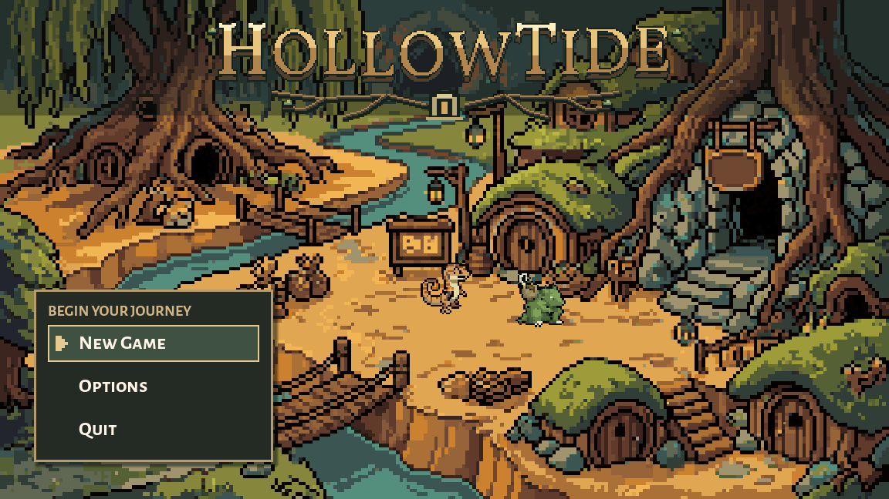
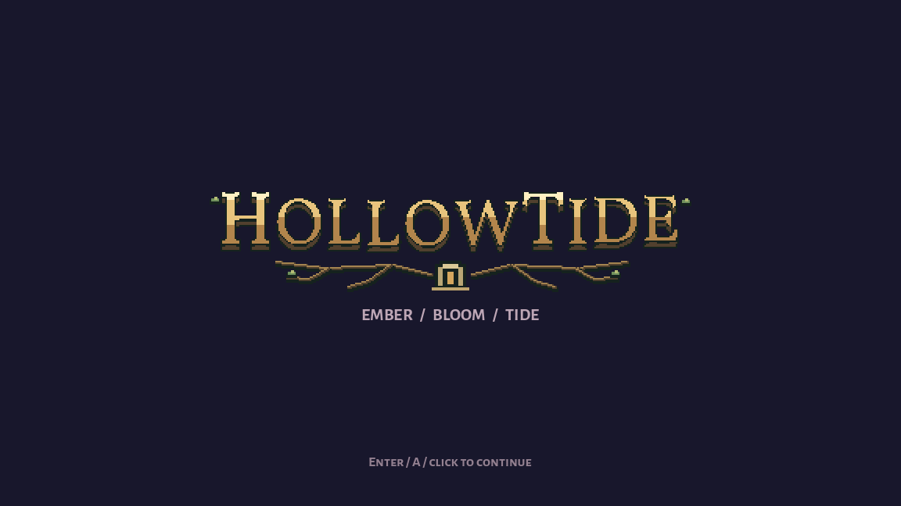

# Hollowtide village wordmark, October 9, 2026

Preston asked to redo the Hollowtide title text and then finish the interrupted work. The new wordmark uses exact native Godot lettering: warm parchment/ochre faces, dark wood depth, larger H and T, a gentle arch, moss tips and branching roots around a small Hollow doorway. It replaces the previous sunset/tide-stripe wordmark in the creature village menu and the launch prelude. The village painting, creature sprites and menu panels are unchanged.

Original code-native artwork: `scripts/ui/hollowtide_wordmark.gd`. Existing OFL Vollkorn font, heavy variable weight, no antialiasing/subpixel positioning; native transparent 384x84 canvas displayed at exactly 2x. The lettering and ornament remain still. No generated bitmap, paid generation or external asset added. The design remains available for Preston's visual review.

## Integration and verification

Changed `scripts/creature_opening.gd` to create the new transparent wordmark canvas. Added a small virtual `_request_route()` hook to `scripts/main_menu.gd`: the original menu retains its background route request, while the creature menu skips the unused human-world request. Before this change, background-loading the retired route produced varying legacy resource-preload errors during title preview. That initial diagnostic log is retained. The final title/prelude/options previews and seven real mouse/keyboard checks have no script or resource errors; only the existing Windows root-certificate diagnostic remains. The seven checks cover boot skip, Reduce Motion, mouse New Game/identity selection, Enter and both Escape returns.

Live F5 was found pointing at `main_menu_art_preview.tscn` through its UID. Restored only the main-scene setting to `res://scenes/creature_opening.tscn`, so F5 opens the current creature-player launch. All other project settings are preserved. Existing scripts, prior wordmark, source artwork, palette/wing refinements and creature backups are retained. Originals and exact installation hashes are recorded here; no combat/stats/dungeon data edit, commit, reset or stash. Grok and Claude's concurrent work is preserved; these title/input checks do not validate their combat changes or a full dungeon clear.
