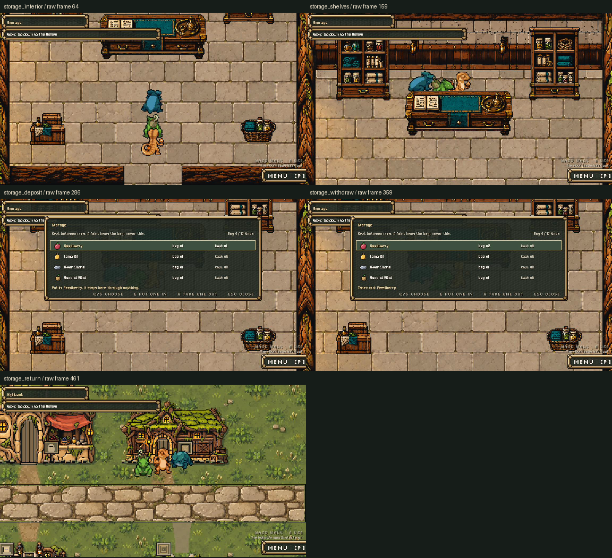

# Fresh indoor Storage shot and V4 capture workflow, October14,2026

The current Storage room is now recorded from the running live game, using `tools/trailer/record_pitch_v4.gd --storage-only`. The new V4 file derives from Claude's V3 but replaces its obsolete outside-panel block with the actual room/door/counter route. Both full-mode and Storage-only mode call **the same** `_storage_shot` function, so its12 checked steps are the production recording segment. Other V3 shot logic is inherited. Every shot stays on the recorder's private save path, with cleanup at the end; the old V3 reset to the real default path is not carried forward.

**Scope:** this is a finished Storage shot plus a parse-checked new recorder. The full eight-segment V4 run has **not** been recorded or reviewed, and no V4 full-pitch cutter/output is supplied. V3 timings and media remain historical; do not feed a new full recording through the V3 cutter without adapting its timings. A future full V4 should capture current Parcel/water/dialogue/Storage visuals and use a new cutter/output folder.

## Watch

- `storage_room.mp4`: **16.167s**,1152x648,30fps,485 frames,H.264/AAC, native viewport size with no resize. Actual engine audio retained (peak-7.1dB); no added music/model or generated video.
- `storage_room.gif`: **8.67s**,768x432,15fps,130 frames,128-colour palette with nearest resizing; a quick looping view of shelves/counter/deposit/withdraw, not the native pixel reference.
- `contact-sheet.png` and `storage_*.png`: samples extracted from the raw movie; `native-stills/` contains the direct engine stills. All five sampled movie moments were inspected, including bag x1/kept x1 after deposit and bag x2/kept x0 after withdrawal.

## Evidence and editing

Native Movie Maker recorded **503 frames** at30fps into `raw.avi`, with12/12 assertions and a clean final log. Checks cover actual unlocked door, three party members, walked access behind/front of counter, live panel, exact berry deposit/withdraw, walked south exit, real town return location, unchanged party and private save path. The take uses scripted party/levels/door placement, inherited from V3, followed by actual scene transitions and room steps; it is not a continuous player playthrough or new balance test. It does not edit gameplay, assets or rules.

`shot-markers.json`, `record.log`, `verification.json` and `edit-commands.json` preserve the exact captured timeline/codec commands and measured output. Full clip trims raw frame indices9..493; GIF uses144..403, sampled at15fps. Recorded process count502 is one below the raw movie's503 frames; this measured offset is explicitly noted, and the review frames are indexed from the actual raw movie. MP4 audio is trimmed to the same range and checked for non-silence; no separate waveform/music identity claim is made. Generated art and existing generated music/sound keep their inventory classifications after filming/encoding. Exact image/music model versions remain as recorded in the inventory, including unknowns.

The complete V4 script passes Godot `--headless --check-only`. `drivers/` retains the source generator, wrapper, encoder, original V3 source and protection manifest. FFmpeg/Pillow measure and encode existing captures; they do not generate game content. A Python f-string escape warning in the encoder was corrected to a raw f-string without changing the emitted FFmpeg argument; the existing successful media was not needlessly re-encoded.

## Reproduce safely

Work folder: `D:/dev/hollowtide-storage-capture-20261014`. `record.py` uses the live project, Dummy audio, fixed30fps, separate APPDATA/LOCALAPPDATA, its own save, and outputs only under that work folder. It manages only its own Godot subprocess. `record.py --parse` checks syntax; `record.py` records Storage-only; `encode.py` creates delivery media and measurements. The wrapper refuses to overwrite its existing capture/log; use a fresh work copy/output folder for a new take. Preserve the current raw/output/markers as a set. `HT_CAPTURE_REVIEW` chooses direct still/marker output in V4; without it, those go to its user profile.

For a new full take, create a **fresh** movie/output folder, keep the isolated profile setup from the wrapper, and run the new recorder without `--storage-only`. Review every scene and measure new segment markers before constructing a V4 cutter. That full-mode execution is the remaining media follow-up, not part of this checked shot.

All554 protected current scripts/scenes/data/dialogue/old trailer files, V3 root outputs (including raw AVI hashes) and four prior GIFs are exact before/after publication. Only the new recorder, this new V4 folder, inventory and handoff docs were added/updated. V3 is neither overwritten nor claimed repaired; use V4 for the new indoor segment. No existing game source, real player save, Claude proposal, training file, generation, paid API call, export, post, message to another chat or commit. Preston's visual approval remains his.

