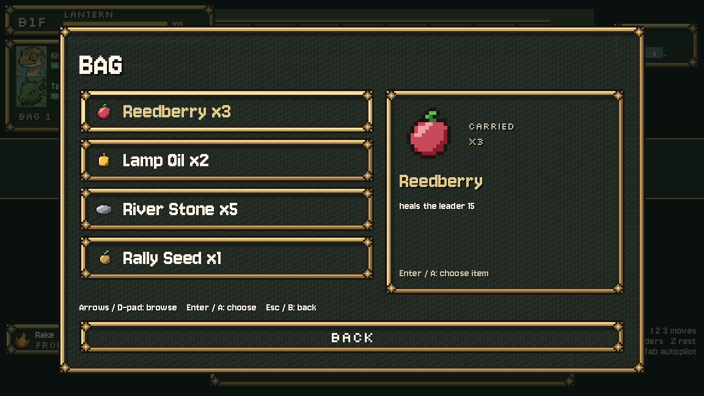
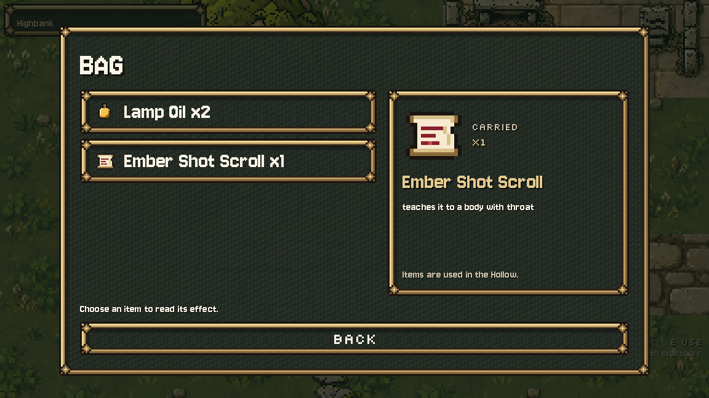
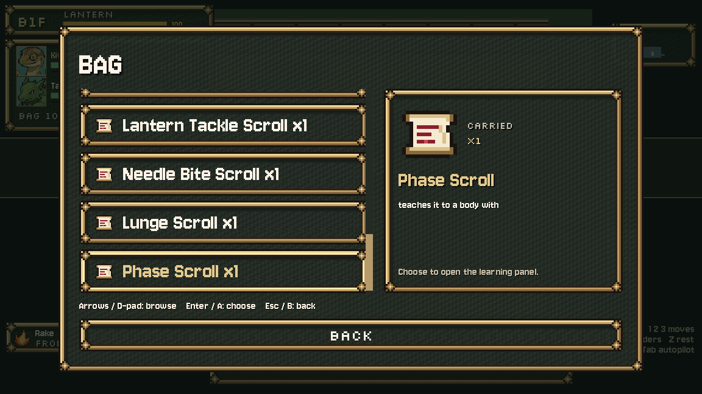
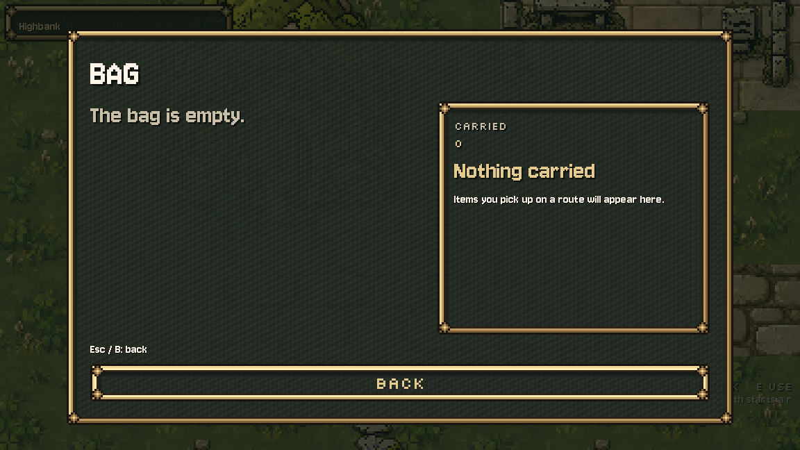

# Finished Bag field page, October 10, 2026

Handoff job 3: existing hand-drawn item icons in a focused list, a separate icon/name/count/effect panel, bounded scrolling and a useful empty state. Uses the shared moss-and-brass frames, role fonts and exact native icon pixels (32px rows; 96px detail at nearest 3x). This presentation is a proposal for Preston's review.

Open P, then Bag in town or a dungeon. Arrows/D-pad and hover show the selected effect. Dungeon selection still calls the original pause-menu `_use_item` and `dungeon.act_use_item`. One berry spends exactly one turn; opening a scroll retains its existing free learning preview. Town selection reads the carried record and never uses an item. Scroll names and body requirements use the existing dungeon metadata, including in town. No second rules table or inventory state.

Only game_pause_menu.gd and the new bag_page.gd are runtime changes. The field_menu_check.gd lookup now finds Use_reedberry recursively because its button is inside the list; all expected text and button names remain. Deferred focus uses the current page's controls, and the panel measures its completed contents before drawing, including an empty inventory. Back restores other pages' original width.

Native GL checks: 29/29. Actual mouse item use, exactly one turn/heal/quantity, D-pad wrapping, hover, scrolling to the last row, every move-scroll name/effect fitting, original learning panel, town read-only clicks, empty frame containment and unknown icon/metadata fallback. Existing field_menu_check passes TEAM, BAG, FLOOR, LOG, town and actual item use. Main pause capture is pixel-identical before/after. Final live runs pass, without errors or warnings, and are saved beside these staging logs. The isolated field-check wrapper explicitly frees persistent music on teardown; production music and the check assertions remain unchanged.

Originals and changes.diff show the exact scope. manifest.json and protected-at-install.json guard the current source and existing icons. Claude's party screen, dungeon rules/story/turns, town, team/save, UI module, parcel-free waking PNG, all creature refinements, Starward/fringe, darker jade Oxbowarchon and original asset backups are preserved. No PNG generation/replacement, settings edit, commit, reset or stash.

Next handoff task: check the currently wired Growth Shrine presentation before choosing its next visual slice. Claude retains systems and state ownership. Codex is out of the pause/Bag presentation files.
