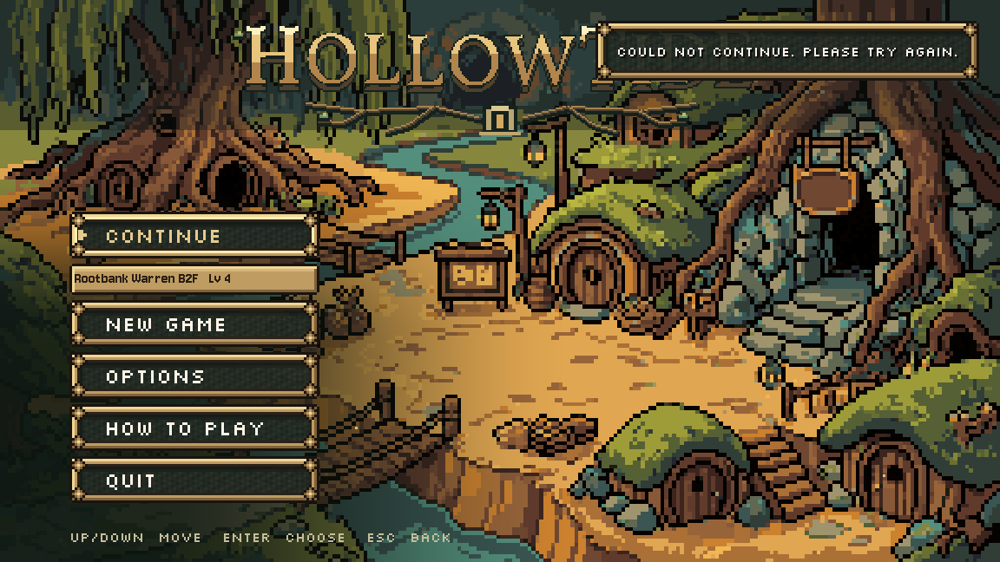

# A5 Continue without a visible load freeze, October 26, 2026

COMPLETE/INSTALLED in `scripts/main_menu.gd` only. Continue starts its confirm sound and existing title/music fade immediately, disables repeat activation, then reads the save and requests the destination on a loader thread under opaque black. The threaded getter is used only after LOADED. Instantiation and state transfer also happen under cover. Highbank inherits the shared cover for its existing card/build/reveal; a suspended dungeon receives its existing opaque floor card and the shared cover is released to it.

| Capture on this machine | Original | Installed |
| --- | ---: | ---: |
| Continue button callback | 779.303 ms | 0.175 ms, normal Highbank |
| Confirm player created after press | 778.428 ms | 0.065 ms |
| Reduced Highbank callback | not sampled | 0.232 ms |
| Warren suspend callback | not sampled | 0.161 ms |
| Loader starts with title/shared black | no shared loader stage | alpha1 / alpha1 in every native success case |

These are callback/confirmation-player timings, **not total loading time or audio-device latency**. Dummy audio verifies the stream and call order, not audible hardware output. The earlier first baseline took1101.897 ms in the callback. Destination loading/building still takes time; it occurs after the title has faded. The longest measured visible-fade frame in the final normal case was16.714 ms, while the covered cached arrival still had a137.914 ms frame. This does not claim every arrival frame is below a performance threshold or that the reported901 ms boot cost is solved.

## Save, failure and preload behaviour

The existing Highbank save/arrival and dungeon suspend formats are unchanged. A suspend record is copied for destination setup and consumed with the existing TeamState.take_suspended **after the scene change is accepted**. A resource failure restores the menu, music and focus, releases the black and keeps the unconsumed save intact. Retrying succeeds. A missing/invalid save disables Continue, restores the remaining menu choices and starts no destination request. New proposed utility copy: `Could not continue. Please try again.`

[Highbank arrival](after/highbank-normal-arrived.png), [Rootbank Warren resumed at B2F](after/warren-suspend-arrived.png), [successful retry](after/retry-arrived.png).

The task's route-preload condition was checked on current source. The campaign title already overrides _request_route/_poll_route with no-ops; it was **not** starting world_journey at boot. The legacy `opening_flow.gd` really does instantiate _route_scene, so deleting its route would break that entry. The base menu now requests it only when legacy New Game opens the courier choice, guarded against duplicate requests. There is no boot request or polling of an unrequested route. Its original Begin action becomes enabled when the lazy load completes. FIRST_SCENE and all Route1 files remain intact. No campaign boot-speed improvement is claimed from this change.

## Checked

- Native **52/52 functional assertions**, Compatibility/Dummy/fixed30, explicit private TeamState.save_path and private APPDATA/LOCALAPPDATA. Normal/cold Highbank, reduced/cached Highbank, Warren suspend, duplicate presses, one confirm per dispatch, opaque local/shared covers at loader entry, save SHA unchanged through loader entry, correct team/levels/progress, arrival-cover ownership, suspend dungeon/floor/seed/HP/turn and once-only consumption. Simulated resource failure preserves the exact suspend bytes and a subsequent real retry resumes; removed save restores a usable menu; legacy route is unrequested at boot and requested/enabled by New Game. [Results/metrics](after-result.json), [log](after.log), [command](after-command.json), [fixture](native_check.gd), [probe](probe_title.gd), [captures](after/).
- The private probe subclasses the real campaign title and delegates to the production loader for successes. Only the failure case injects a null resource; it is a simulated loader failure, not a claimed disk fault. Continue tests invoke the real button's pressed signal. Destination scenes and their native builders are real, with no poll_input shortcut.
- Fresh baseline **8/8 functional assertions**, [results](before-result.json), [log](before.log), [command](before-command.json), [captures](before/). Both final native logs have no script/engine errors, but raw exit-resource warnings remain:216 objects in the final baseline and309 in the broader installed matrix, which also loads the legacy route and dungeon. **Neither is claimed as a clean resource exit**, and the larger counts have not been attributed or fixed by this slice.
- Maintained `save_check` and `opening_flow`: **2 PASS**, exit0. [Runner result](runner-result.md), [raw logs](runner/). They retain their known raw exit diagnostics. The save regression includes real suspend/continue and backup/save checks.
- [Source verification](verification.json):47 other original menu methods exact, including all settings writers, C6/Continue summary, input, sound, UI and journey dispatch. TeamState, Highbank, dungeon, opening_flow, creature_opening, shared UI and project settings exact to the fresh baseline. C6 remains OFF. [Diff](source.diff), [originals](originals/), [installed hash](installed-files.json), [protected hashes](protected-before.json).

The [first baseline](first-baseline/before.log) stopped while Highbank's real warm-up was still reading resources, producing a half-read shader/room error. Final captures wait for its background room workers. The [first installed attempt](first-installed-attempt/after.log) passed52 assertions but a fixture lambda captured the freed old title during retry; comparing its numeric instance ID removed that error. Production source needed no repair after installation. Initial diagnostic logs/results remain retained. Highbank's normal arrival autosave and a successful suspend consumption intentionally change **private** save bytes; byte-exact claims apply to loader entry and failed loading, not completed arrivals.

## Handoff

Source issues for Claude: no new functional Continue failure. Exit resource retention remains documented and untriaged; this slice makes no lifecycle-cleanup claim. The legacy route is still used, now lazy; the current campaign already had no such boot preload. The prior shared UI.pressed neutral-motion follow-up remains in its existing handoff.

Next actionable queue: **B7 icon, plain splash and Windows export preset**. Test export still requires checking whether Preston has installed templates. C6 New Game replacement prompt stays OFF pending words; town/exterior art HOLD pending named slot readiness. No real save, new art/generation, paid call, creature rule, Route1 edit, cross-chat message or commit. Native visuals reviewed by Codex, Preston approval not claimed. [Team handoff](../../team/CODEX_HANDOFF_2026-10-26_continue_load.md).
