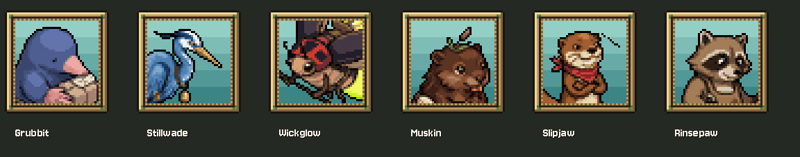

# Six crew dialogue portraits — October 11, 2026

Task 4 of Claude's current master queue is installed: normal dialogue portraits for Grubbit, Stillwade, Wickglow, Muskin, Slipjaw and Rinsepaw, cut from Preston's current chosen fronts. Visual proposal for Preston's review. Expression faces remain deferred.

## Installed / preparation

Six new `assets/sprites/ui/dialogue/<form>.png` files and their native imports. Existing `UI.dialogue_portrait` and `SceneKit.say` discover the names automatically; no game-script, speaker-map, layout, shader, expression, rule or state changes by Codex.

Added `tools/ui/build_crew_dialogue_portraits.py`, a scoped reproducible builder. It uses the same 40×40 square crops and `downscale.resample` method as `build_dialogue_portraits.py`, and calls the existing `outline_portrait.outline` implementation. It never rebuilds the old portraits. Output files must be absent; use fresh output/evidence directories when reproducing.

Chosen-front files are excluded from the existing recolour tool's input list. The builder applies each current `SCHEMES` rule to a working copy, as for the crew idle assets, then crops/resamples. Source alpha remains exact; the resulting alpha is binary. Outline colour comes from the current full-size south sprite: black for all six. The outline changed **357 transparency-boundary pixels**, preserving alpha, crop-border behavior and all pixels away from that boundary.

| Form | Chosen-front crop (left, top, right, bottom) | Black rim pixels |
| --- | --- | ---: |
| Grubbit | 22, 4, 76, 58 | 50 |
| Stillwade | 44, 9, 102, 67 | 95 |
| Wickglow | 20, 32, 78, 90 | 62 |
| Muskin | 32, 6, 80, 54 | 44 |
| Slipjaw | 28, 8, 76, 56 | 51 |
| Rinsepaw | 30, 6, 84, 60 | 55 |

Headshot framing matches the townsfolk, with the original crowns/crests, ears, beaks, snouts and bandana retained. Shoulders and job gear may continue through the lower crop border, as in the existing portraits. No faces were generated or redrawn. Provenance: derived from the approved Retro Diffusion chosen fronts with existing Codex/Claude crop, recolour, resample and outline tools. No generation or paid calls during this slice.

## Native verification / preservation

Godot 4.7.2, OpenGL Compatibility: **49/49 staging and 49/49 live**.

- Every portrait resolves by form and imports byte-exact RGBA at 40×40.
- Alpha, black outline and pixels away from the transparency boundary are verified from the fresh pre-outline copies.
- Every opaque pixel renders at exact nearest 3× in the existing portrait frame; actual Hall conversation screenshots show the correct portrait in its normal HUD position.
- Actual `act_use` interactions at all six current NPC posts resolve the speaker through `SceneKit`, and each conversation exits. Fixtures advance/clear the queued lines in memory; no hardware input or production dialogue changes.
- All eight deferred expression names fall back to the normal portrait. Unknown speaker retains the existing null behavior.
- 2,905 existing files were protected: 2,902 match the initial hashes; three concurrent Claude script changes were reviewed and preserved. All 2,905 were exact against the reviewed versions immediately before/after installation. Existing portraits, chosen fronts, six crew facings/walks/idles, world art, tools, settings and remaining game scripts are unchanged by this pass.
- Concurrent `soul_prologue.gd` music, `guild_crew.gd` roll-call staging and `town_room.gd` room landings are archived separately. Guild/room before sources match the initial hashes. The soul staging sync already contained the music change, so its initial hash and current/staging copies are retained without claiming an earlier source snapshot. Live tests include the concurrent scripts; subsequent roll-call leader-nudge tuning is also preserved in versioned snapshots/diffs. That tuning does not alter the NPC post or portrait lookup paths exercised here.

Fresh chosen fronts/reference portraits/tools are in `originals/`; working recoloured sources, crops, pre-outline portraits and exact manifests in `evidence/`; installed candidates in `prepared/`. Native gallery and six actual conversations for both stages are in `review/`. Protected hashes, import list, installation/final audit and concurrent sources/diffs accompany the logs/drivers. Staging's prior Dialogue Manager UID/certificate warnings remain unrelated; the final live run exited cleanly.

## Reproduce / next

Private workspace: `D:/dev/hollowtide-crew-portraits-20261011`. `python run.py verify --live` uses isolated APPDATA/LOCALAPPDATA, a hidden native Godot process and private output. Paths to the bundled Python/Godot executables are in `drivers/run.py`; archived drivers retain the private workspace paths. Importing uses a minimal texture-only project with current importer defaults, avoiding a full-project editor import.

Task 5 is next: the evidence-backed AI asset inventory for the pitch. Tasks 1, 3 and 4 are complete; task 2 assets are installed and Claude still owns the production standing-south idle swap. It remains pending in the current scripts. No creature post/facing, walk animation or job-object rule changed here. No commit, reset, stash, revert or messages to another chat.
