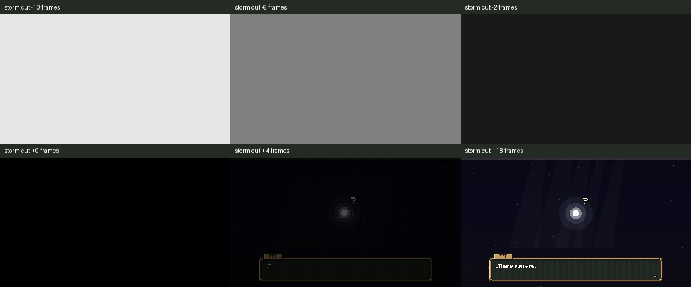
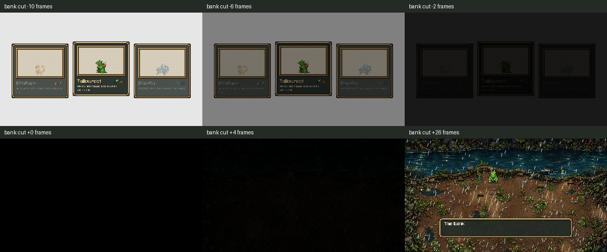

# Opening white-out transitions

October 26, 2026. **A3 white-out slice installed and checked.**

Storm now holds the end of its light for two process frames, fades to shared black, and changes scenes beneath that cover. The soul scene draws for two frames, then reveals through the shared fade. A skipped Storm uses the same black cover. Advance input waits until the soul reveal finishes.

The soul's outgoing flash also gets a short hold and black fade. The flood scene already builds beneath its own opaque veil, so the handoff gives that veil the cover and lets its existing reveal continue after construction. No change to Claude's flood scene was needed. Normal shared fades are about10 frames (one third of a second at30fps); the shared helper halves them under the saved Reduce motion setting. Storm's final full-screen bloom is capped at0.4 in reduced mode; the previous0.4 soul flash and softened lightning remain.

The dedicated October26 queue and pass7/8 notes ask for fades **through black**. This is a controlled black transition, replacing abrupt cuts; it follows that newer direction rather than the older pass6 wording about avoiding any black frame.

## Native frame measurements

Mean sampled RGB luminance, range0 to1; largest falling step around each actual scene change:

| Mode / boundary | Before | After |
|---|---:|---:|
| Normal Storm to soul | 0.8845 | 0.1020 |
| Normal soul to bank | 0.8323 | 0.0864 |
| Reduced Storm to soul | 0.8846 | 0.0527 |
| Reduced soul to bank | 0.2518 | 0.1095 |

The first soul frame is covered by shared black at alpha1. The bank's first frame has its own veil at alpha1, and its first four sampled frames remain covered while it builds. The chosen hero, pending story partner choice and Reduce motion survive. Dialogue begins after the bank reveal, and the previous private save remains byte-exact. Raw [frame CSV](luminance.csv), [summary](luminance-summary.json), and per-frame native PNGs under [before](before) / [after](after) are archived. Measurements use a24px sample grid after native frame_post_draw, not a headless renderer or a visual approximation.

| Check | Result | Evidence |
|---|---|---|
| Native baseline, natural normal/reduced | 10/10; clean | [log](before.log), [results](before-result.json), [command](before-command.json) |
| Native installed, natural and skipped normal/reduced | 34/34; clean | [log](after.log), [results](after-result.json), [command](after-command.json), [fixture](native_check.gd) |
| Official Storm, soul and opening flow | 3 PASS; exit0 | [results](runner-result.md), [command](official-command.json), [raw logs](runner) |
| Scope and preservation | Checked | [diff](source.diff), [verification](verification.json), [receipt](publication.json) |

Native scenes actually replace one another as current_scene. The fixture plays Storm through, stages the existing last after-choice line and uses its real advance/flight handoff, then waits for the actual bank to build, reveal and begin dialogue. Two additional runs skip Storm with real Enter presses, including a check that the first press only arms it. An E press under the incoming soul's black cover is ignored. All use Compatibility, fixed-fps30, Dummy audio and private APPDATA/LOCALAPPDATA/TeamState paths. No personal saves/preferences included. Official logs retain known ObjectDB/resource exit warnings; both final native logs are clean. Screenshots were inspected.

The existing non-current-scene metadata hooks remain for older logic checks: they do not exercise fades. The soul hook keeps its prior0.7s handoff timer. Native current-scene tests above exercise the new visual path; the official opening check also reaches the real scenes and playable bank. The initial baseline fixture expected the provisional partner field to survive bank construction; the bank intentionally sets the first available partner while waiting for the story's choice. That fixture assertion was corrected; failed baseline log/source retained under [attempts](attempts). No gameplay change was made for it.

## Source issues for Claude

No new issue in the fade path. Only storm_open.gd and soul_prologue.gd were edited; [originals](originals) and [installed source](prepared) retained. The bank source and shared fade helpers are preserved; story words, existing C7 skip/actions, flash decay and creature handoff data stay intact. Concurrent Claude/Grok paths are listed in the receipt. No shared UI, town, save format, rules, Route1, art generation, paid call, cross-chat message or commit.

A3 remains open for C8 starter-card art/sounds/choice protection/hint contrast, C9 top bar/grey band/soft shaft ends, and Storm pixel light. C6 stays OFF pending Preston's words; town/exterior art remains on HOLD until slots exist. Latest pass8 section11 C7, A1/A2 and logo-repeat items are already closed by the recorded work; no duplicate implementation.

Next: the soul's top bar, grey band and light-shaft edges.
