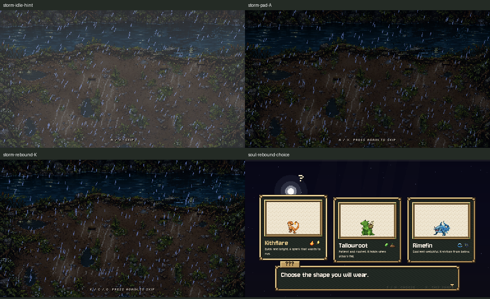

# Opening controls and safe Storm skip

October 26, 2026. **C7 / A3 input slice installed and checked.** A3's other visual work remains pending.

Storm and soul now read the shared advance actions. E, J, Enter, Space, pad A/X and saved replacements work. A Storm press opens a small prompt; only another press after release skips to the soul. Key echo, a held stick/trigger or a repeated down event cannot perform that second press. Without input the existing Storm plays through normally. A binding-aware hint appears after four seconds, or immediately when armed, and updates for the device/bindings in use.

Soul choices use shared left/right and advance actions, including the left stick, pad buttons and saved keys. Returning a stick to centre lets the same direction select again; holding it does not repeat. A press matching more than one advance action is handled once. Mouse choices keep their existing path. The choice hint prints actual bindings; its old pulsing contrast is still C8 work.

Title prelude/back reads shared input; focused title buttons also accept story advance bindings alongside the standard GUI keys. The obsolete `_ensure_menu_inputs` definition and call are removed: project.godot already defines pad confirm/back. Loading the title no longer patches the input map. Story words, flash fixes, title settings and Continue behavior stay intact.

Proposed instruction words installed for review: **Skip** and **Press again to skip**. The existing choice words remain, with actual key names substituted. C6's separate wording flag stays OFF.

| Check | Result | Evidence |
|---|---|---|
| Actual native input events | 85/85; clean | [log](native.log), [checks](native-result.json), [command](native-command.json), [fixture](native_check.gd) |
| Real native title-to-riverbank flow | 28/28; clean | [log](flow.log), [checks and captures](flow-results), [command](flow-command.json), [private driver](opening_flow_private.gd) |
| Official opening_flow, soul_prologue, input_map, rebind | 4 PASS; exit0 | [results](runner-result.md), [command](official-command.json), [raw logs](runner) |
| Scope/preservation | Checked | [diff](source.diff), [verification](verification.json), [publication receipt](publication.json) |

The input fixture injects keyboard/pad/stick/trigger events through Godot Input, saves private rebinds through InputPrefs, restores the map and reapplies the saved file. It checks retired raw keys cannot bypass saved choices, title Help/Options with rebound confirm/back, unchanged standard accept map, hint layout/timing, exact private save bytes, and every skip gate. The native flow presses once to assert Storm is still present, presses again, then reaches the actual soul, chosen hero, partner and playable riverbank. Native Compatibility at fixed-fps30, Dummy audio; private APPDATA/LOCALAPPDATA and TeamState paths only. No personal save or preferences included.

Both final native logs are clean. The official scripts retain their known ObjectDB/resource exit warnings. Headless results are logic regressions; native screenshots were inspected. The first real-flow run caught an input error after the skip detached Storm; functional checks passed but the raw log exposed it. The handler now consumes the event before changing scenes. Earlier output/source is retained in [attempts](attempts), and the wrapper now rejects runtime script errors in that flow. All final checks were rerun after the fix.

Only four production files changed: main_menu.gd, opening_flow.gd, storm_open.gd and soul_prologue.gd. [Originals](originals) and [installed sources](prepared) are archived. Critical settings/save/Continue, logo reveal, Storm animation/destination/lightning and soul words/flight/flash methods match the fresh baseline. Claude/Grok concurrent changes are preserved and listed in the receipt. No assets, paid calls, rules, Route1 or commit.

## Source issues for Claude

- **C7 is landed.** No runtime `UI.HEAD` users remain; Claude already removed the shared constant in pass8. No further font deletion by Codex.
- Shared `UI.pressed` returns before its stick-edge tracker sees centre events. The three owned opening entry points feed all motion events into existing `UI._motion_edge` before asking `UI.pressed`. This keeps neutral/repress behavior correct without editing the active shared UI lane. Please fold neutral bookkeeping into the shared public helper when ready, then these explicit feeds can go away. Current helper bodies are preserved.
- The current public opening-flow check sends one Enter then waits; it now reaches the soul naturally rather than proving skip. The active Claude check was left intact. [Minimal candidate update](proposal/opening-flow-two-press.diff) adds the armed assertion and second press. The equivalent private copy passes28/28 through the real flow. Rebase/install that small check update in the active lane.
- No cross-chat message was sent; these notes are the shared handoff. C6 remains OFF pending Preston's words; the town/exterior art hold remains in force.

Next A3 slice: white-out transitions. C8 starter art/sounds/hint contrast and C9 top bar/shaft ends, plus Storm's pixel soul light, remain pending. No blanket A3 completion claim.
