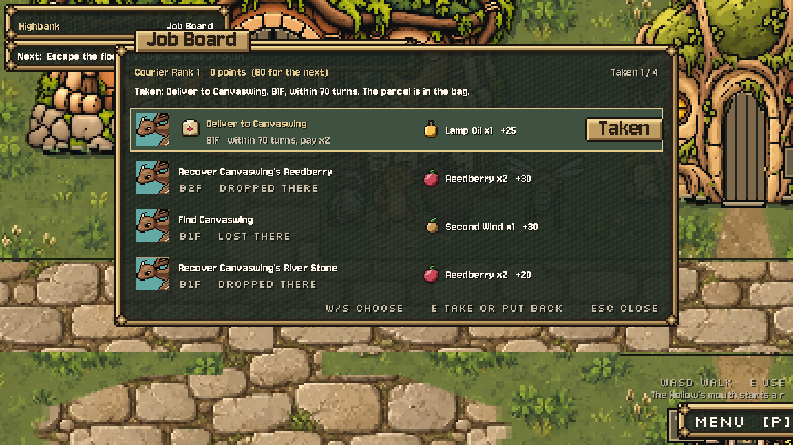
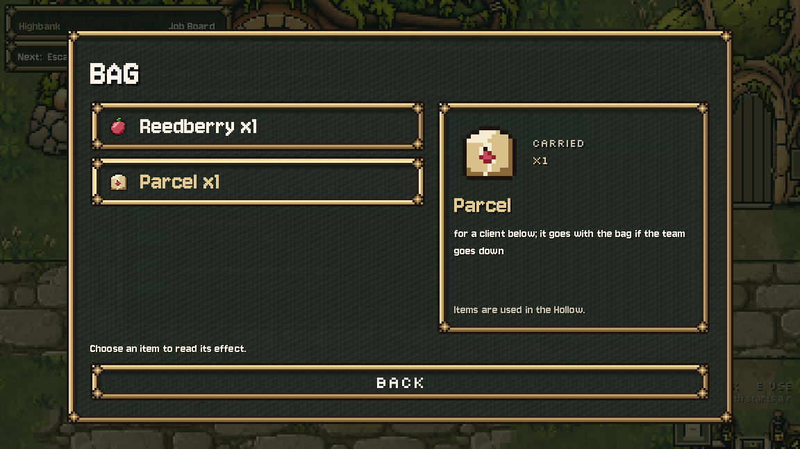

# Parcel icon, October 14, 2026

Task 1 of the current Claude-to-Codex queue is installed. A sealed paper parcel with pale twine and a red wax seal uses the existing item icon system: a 16×16 logical grid doubled to 32×32, the exact six opaque paper/wax/outline colours from Scroll, and hard alpha. New artwork is a visual proposal for Preston.

The generic `UI.item_icon("parcel")` already resolves `assets/sprites/ui/item/parcel.png`; the Bag needs no code change. Inspection showed that Board rows previously drew only the reward icon. A delivery-only presentation hook now draws cargo beside its title and moves its two text lines 40px to the right inside their existing allocated width. The client portrait and reward icon stay separate. Other request rows keep their original text positions; missing parcel artwork falls back to the original spacing. Requests, item metadata, conditions, rewards, quantities, save state and delivery rules are unchanged.

## Installed files

- `assets/sprites/ui/item/parcel.png` and its new lossless texture import. Native `.ctex`/`.md5` cache installed for immediate use; the editor can regenerate them normally.
- `tools/ui/build_icons.py`: one new item-grid recipe. All 17 prior recipes exact. Only Parcel was built for this task; no prior icon PNG or `icons_sheet.png` was regenerated.
- `scripts/town/hub_town.gd`: delivery-row drawing only. `ui_style.gd`, Bag, Jobs, TeamState and all other protected game/UI files remain exact.

## Verification

Native Godot 4.7.2 compatibility renderer: **20/20 staging and 20/20 installed live** (`stage/checks.json`, `live/checks.json`). A real generated board (seed 2) is opened at its door; a Deliver to Canvaswing request is accepted using the Board's actual action. The test then opens the real town pause menu's Bag and focuses Parcel. Imported RGBA, native Board cargo/reward pixels, Bag button icon and its 96px nearest 3× detail image are exact. Putting the request back removes Parcel while retaining the original bag contents. Current old icons and unknown-item fallback resolve correctly. This is an isolated fixture, not a manual campaign traversal or a full replay of delivery combat.

`asset-verification.json`: 32px dimensions, hard alpha, six exact existing colours, 2× logical pixel blocks, 17 unchanged recipes. `installed-verification.json`: 811 original source/UI files protected; only the two owned source files changed; the other 809 remain exact. Native imports and final PNG exact. No project/settings, rule, save, creature, other UI asset, training job or Claude proposal-art edit. No paid API, image-generation call or commit. Audio driver Dummy; no listening claim.

Final live log has no script/resource/shutdown errors. Staging has the existing Windows certificate-store diagnostic. Earlier tooling/fixture attempts are retained explicitly: full-project import first hit Dialogue Manager's headless editor theme error; a second scan exceeded the owned runner's 300s limit and was stopped by that runner. Its temporary editor-plugin override was restored exactly. A small isolated one-asset Godot import succeeded, supplying the tested native texture with the same resource path and existing item import parameters. A staging audio-bus dependency was refreshed. The first UI run passed 19/20 because its test expected an empty initial bag while the current game supplies a Reedberry; the fixture now starts with that normal carried item, and the final 20/20 runs pass. No production logic was changed to satisfy the check.

## Reproduction and provenance

`originals/`, `changes.diff`, both final candidates, `recipe.json`, private preparation/import/check/install drivers, logs, captures, manifests and verification receipts preserve this slice. `build.py` uses only the Parcel entry of the existing grid renderer; the normal builder also retains that entry for future full rebuilds. Private fixtures write only to their isolated output/profile folders. Never blanket-copy staging into live.

This is **AI-assisted code-painted UI art**, authored by Codex as an explicit native pixel grid using the existing Claude palette/renderer. It is not a human-drawn or generative-image output. No new creature design or external source image.

**Next:** task 2, painted rising water on The Hollow B1F. Preserve the textured terrain (`USE_TILE_ART=false`), all water logic/numbers and water_rows save/resume.

