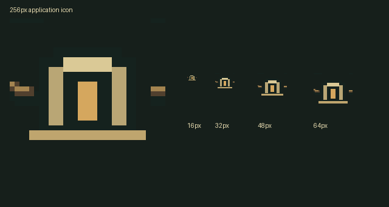

# C10 icon/plain splash, C11 Windows preset, October 26, 2026

**C10 COMPLETE/INSTALLED. C11 preset READY; full game export and exported-art review PENDING TEMPLATES.** C22 arena-front relocation remains a separate next slice. No Windows game executable was produced or claimed.

The256px icon is a nearest8x rendering of a32x32 crop of the **existing** title wordmark's burrow/root ornament. Its geometry, colours and amber doorway come directly from `hollowtide_wordmark.gd`; no new emblem, lettering, generated image or art service was used. The source wordmark is unchanged. Rebuild with `tools/ui/build_app_icon.gd` using native Compatibility rendering. The script accepts an output directory after `--`; default output is the project root. Old stock icon.svg is retained as an original but no longer configured, and is excluded from the preset.

The actual normally-launched Windows game window was queried with WM_GETICON and its icon drawn into an image. [Captured native window icon](native-window-icon.png) matches the new PNG RGB exactly, mean error0. [Capture result](window-icon-result.json), [command/private profile](normal-window-command.json). This is a window-icon check; the eventual EXE's PE/file-icon conversion is not yet tested.

`project.godot` now selects `res://icon.png`, disables the engine splash image, and makes its background pure black, matching the existing clear colour. This concerns the engine boot splash; C5's timed Hollowtide launch card and all gameplay remain unchanged. Native settings and a real menu launch were checked. No frame-accurate recording of the brief engine boot interval is claimed. The PNG export-icon fields use Godot's documented PNG-to-Windows-icon support. [Official icon documentation](https://docs.godotengine.org/en/stable/tutorials/export/changing_application_icon_for_windows.html).

## Windows preset

`export_presets.cfg`: Windows Desktop/x86_64, separate PCK, target `builds/windows/Hollowtide.exe`, Hollowtide icon/product fields, custom tag `hollowtide_windows`. `tools/*`, `addons/godot_ai/*`, `scenes/_lab/*`, `builds/*` and old icon.svg are excluded. Archived docs .gd/.tscn/.tres/.gdshader files are excluded while docs images remain. JSON/dialogue data included; docs resources retained until C22. Build output is Git-ignored. Source editor plugins and the development `_mcp_game_helper` autoload remain intact.

The installed Godot AI addon already registers `addons/godot_ai/export/mcp_export_plugin.gd` for exports, including headless exports. It removes the helper setting in memory while the project snapshot is packed and restores its value afterward. That existing file and its registration are untouched. **No additional export addon remains in the game.** A duplicate prepared during investigation was hash-guardedly retired; only its evidence archive remains here. The hook uses the documented export begin/end callbacks and setting removal. [EditorExportPlugin](https://docs.godotengine.org/en/stable/classes/class_editorexportplugin.html), [ProjectSettings.set_setting](https://docs.godotengine.org/en/stable/classes/class_projectsettings.html#class-projectsettings-method-set-setting).

The preset intentionally keeps docs resources while active arena art still loads from there. Its final game-package size and Windows file-icon metadata are unmeasured. The tiny probe below is not a shipped build. General export invocation follows [Godot's export documentation](https://docs.godotengine.org/en/stable/tutorials/export/exporting_projects.html).

## Verification

- **9/9 native game checks, clean log:** icon loads, splash settings/black clear, existing campaign entry, source development helper present, usable menu, C6 OFF and explicit private save SHA unchanged. [Fixture](native_check.gd), [results](native-result.json), [log](native.log), [command/profile](native-command.json), [launch](launch.png), [menu](menu.png).
- **1 normal Windows window-icon capture**, exact RGB match as above. The private normal test process was terminated after read-only icon capture; that is not a graceful-shutdown/resource test.
- **10/10 real tiny-PCK checks, clean import/export/run logs:** a minimal disposable project uses the final preset and a byte-identical copy of the existing Godot AI export hook. Its small registration harness replaces the full editor addon in the fixture only. The exported pack runs from an empty directory: helper setting/node absent, helper/tool/lab/hook and archived docs-code files absent, docs resource/icon retained, custom feature present. [Driver](check_export.py), [commands](export-probe-commands.json), [aggregate](export-probe-result.json), [pack log](pack.log), [runtime assertions](run-pack.log), [tiny PCK](export-probe.pck), [fixture](export-probe-existing-hook/). No templates were downloaded; a PCK probe does not need a Windows executable stub.
- **10/10 hook matrix assertions:** source value restored after debug/release use, serialised snapshot omits helper while other autoloads remain, already-absent helper not invented, source project file not written. Existing addon policy strips it from other exports too. [Matrix](editor_check.gd), [result](editor-result.json), [raw log](editor.log), [command](editor-command.json). This custom `--editor --script` loop retains RID/209 ObjectDB shutdown diagnostics, so it is not a clean-editor-exit claim. The normal tiny editor import/export processes above exit cleanly.
- [Preservation report](verification.json): project delta only icon and plain splash; all baseline gameplay/wordmark/UI sources exact; existing export hook matches the tested copy; no unrelated protected changes observed. [Owned hashes](installed-files.json), [originals](originals/), [config diff](config.diff). Only five retained files changed/added: project.godot, .gitignore, export_presets.cfg, icon.png and the icon builder. No new runtime script or autoload.

Initial diagnostics remain documented: `--script` uses its own application startup and showed the stock window icon; normal project startup produced the correct icon without an import workaround. A first pack run from its loose source directory could see excluded loose files; running from an empty directory fixed the fixture. The first restricted probe had certificate-store errors; normal scoped native permissions produced clean probe logs. An initial live-project editor custom-loop check completed assertions but timed out at shutdown; final hook matrix runs in a tiny separate project and retains its raw editor teardown warnings. Retired duplicate-hook files and early diagnostics are evidence only, not installed dependencies. No claim that these fixture issues were production gameplay faults.

## Remaining work / handoff

The standard installed-engine template folder `C:/Users/pmcga/AppData/Roaming/Godot/export_templates` has no Windows templates. Per the task queue, the roughly1GB download is Preston's step in **Editor > Manage Export Templates > Download**, matching4.7.2. After that, run the real Windows export and review painted Highbank street, Home desk, board stand, a Hollow floor and the cached street on a second launch. Do not enable town_room's exported worker-art path until that review passes. No full-build/exported-art/EXE file-icon success is claimed now.

Source issues for Claude: no new gameplay issue. Existing Godot AI export stripping is present and proved with the small PCK; retain the source plugin until exporting. C11's complete Windows build/art/cache checks remain pending templates, and C22's active docs assets have not moved. Next independent slice is C22 arena fronts into assets and a path handoff. C6 OFF and town/exterior HOLD remain. No real saves, paid/generative art calls, rules, Route1, cross-chat messages or commit. Native art reviewed by Codex; Preston visual approval not claimed. [Team handoff](../../team/CODEX_HANDOFF_2026-10-26_product_setup.md).
