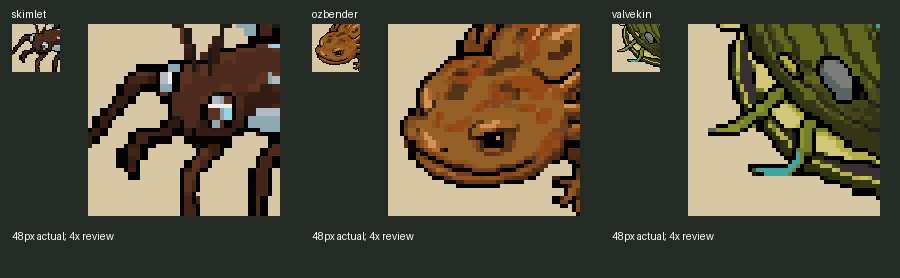

# Recruit portrait fallbacks, October 26, 2026

Task 2 of [the October 22 queue](../../team/CODEX_TASKS_2026-10-22.md) is installed and checked. Skimlet, Ozbender and Valvekin now have reproducible 48x48 arena `portrait.png` files, cropped from their current southwest stills with nearest sampling. No new images were generated. The existing source colours and pixels are preserved; the crops remain visual proposals for Preston.

## Current game behaviour

The task's empty-box diagnosis predates Claude's October 23 UI changes. All three creatures already have 40px dialogue faces, which the current `UI.portrait_3x` prioritizes. Those existing faces remain the normal Team and dungeon headshots. The new files complete the requested fallback art, used if a dialogue face is unavailable. This pass does not override Claude's newer face layout or claim a change to the normal Team strip.

The default builder crop missed Ozbender's face and Valvekin's mantle. Three `HEAD` entries now select each southwest face: Skimlet `(0.29, 0.16, 0.44)`, Ozbender `(0.19, 0.28, 0.44)`, Valvekin `(0.23, 0.39, 0.60)`. These identify head centre, top and side relative to the opaque bounds. Valvekin is a mussel; the crop shows its mantle and siphons beneath the shell. [Exact boxes and colour counts](crop-facts.json).

Only `tools/arena/build_portraits.py` and the three new portraits change production content. The builder's existing CLI rebuilds every form, so the reproduction scripts call `portrait(form)` only for the selected forms. A before/after comparison confirms all other 48 builder outputs are identical; no other portraits were rewritten. The new files reproduce exactly with the updated builder. Gruntle, Mirekit and Whinet are untouched.

## Verification

- [Native Godot log](native.log): **32/32**, clean runtime log. Imported textures match the prepared RGBA pixels exactly. The actual dungeon resolver and Team cards retain all three existing dialogue-face crops. When only the private process's dialogue icon cache is set to missing, the same production methods use each new portrait exactly. The test restores that cache before exit and never renames a resource or edits game code.
- Native screenshots: [normal Skimlet](native/team-skimlet.png), [normal Ozbender](native/team-ozbender.png), [normal Valvekin](native/team-valvekin.png); [fallback Skimlet](native/fallback-team-skimlet.png), [fallback Ozbender](native/fallback-team-ozbender.png), [fallback Valvekin](native/fallback-team-valvekin.png). Source sprites, candidate contact and normal/fallback native captures were inspected by Codex. Preston's crop approval is pending.
- [Existing face-crop regression](faces.log): **5/5**, 49 dialogue faces covered, zero failures, clean log.
- [Protected-file and builder receipt](verification.json): 3,483 of 3,484 baseline files exact before documentation publication. The sole existing production change is three crop entries in the builder; Claude's uncommitted source work is exact. Documentation publication separately adds the bottom-of-queue handoff and a collaboration entry; [publication receipt](publication.json).
- [Native command](native-command.json) uses Compatibility rendering, fixed 30fps, Dummy audio, separate APPDATA/LOCALAPPDATA and a private TeamState save path. No real save is read or written. This is a staged Team UI check, not a natural recruitment playthrough.

## Source issues for Claude

1. Task 2 and ART-10's empty-box diagnosis is stale: current dialogue portraits already supply all three headshots. Keep the dialogue-first preference; the new PNGs are fallbacks. Pass 6 section 9 item 18 swaps the ART-03/ART-10 descriptions relative to section 5. Refer to task names and paths when choosing work.
2. The headless editor import completes with exit 0 and imports the new PNGs, but still reports the previously recorded Dialogue Manager `theme_values.gd:51` Nil-to-int editor theme errors. [Import log](import.log) is not a clean pass. No addon fix is attempted. Native imports are independently compared to the exact PNG pixels, and runtime checks are clean.
3. The first native fixture incorrectly expected fallback portraits to override the newer dialogue-face priority. It correctly failed 10/19; [original failed log](native-first-assumption.log) is retained. The final fixture measures both current primary behaviour and the missing-dialogue fallback, 32/32. No production behaviour was changed to satisfy the fixture.

## Reproduction and originals

[Original builder and stills](originals/), [baseline hashes](protected-before.json), [installed hashes](installed-files.json), [prepared files](prepared/), [source review](sources-large.png), [default-crop diagnostic](default-crops.png). `prepare.py` preserves the original live inputs; `crop_candidates.py` runs the selected builder crops; `install.py` checks all protected hashes before scoped installation; `native_check.gd` checks the real UI; `run_engine.py` records the commands and logs; `verify.py` compares all builder outputs and protected files. Original documentation snapshots are also retained. Machine-specific reproduction paths are recorded in the scripts and command receipts.

No game scripts, creature rules, saves, layouts, materials, other PNGs, paid generation, external messages or commits were changed by this pass. Next slice: task 3 as refined by pass 6 **C2**, title Options/How to play/Quit panel bounds and the three failing `ui_fit` title assertions. Further tasks added in sections 5 through 9 remain pending.
