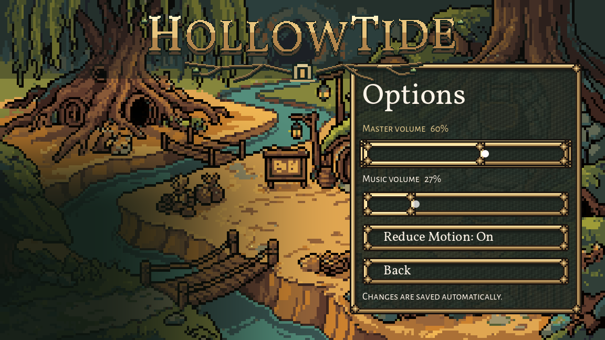

# Title preference preservation and safe replacement, October 26, 2026

C1 and the **title portion of original task 4** are installed and checked. The title now loads its current ConfigFile before updating its five settings, writes a whole `.tmp` file, and only then renames it over the final file. A failed write/rename keeps the dirty flag and shows the existing error; a successful retry clears the error. Successful saves invalidate UI's preference cache, so Reduce Motion is immediately consistent across menus.

Only `scripts/main_menu.gd` changes production behaviour. Its earlier y120 Options placement is retained. The current split between menu_preferences.cfg and game_prefs.cfg is preserved. No game-save format, input bindings, font/layout, art or rules change.

## Verification

**28/28 installed native assertions:** [16 save/integration checks](after.log), [4 checks in a fresh engine process](restart.log), [8 write/rename failure and retry checks](failures.log). Real title slider and Reduce Motion signals exercise the production save path. A pause-menu instance calls its current `_save` path to check interoperability. Private fixtures verify:

- Existing unknown keys survive the title save, and the separate game preferences file stays byte-identical at that save boundary.
- Female courier, all three sound values, Reduce Motion, text speed, screen preference and custom bindings survive title/pause saves and a fresh launch.
- A leftover incomplete `.tmp` does not override the final file on restart. A later real save replaces it.
- A blocked temporary path leaves the prior final settings byte-identical and retains a visible error/retry flag.
- A blocked rename destination leaves a complete pending file, reports failure, then retries successfully after the private obstruction is removed.
- Both retry paths clear the stale error text; normal saves consume their temporary files.

The normal and fresh-launch native logs are clean. Failure injection produces exactly the two expected menu warnings, archived in its log. Native captures inspected: [normal save](native/after-title-settings.png), [fresh process](native/restart-title-settings.png), [visible write failure](native/failed-temp-write.png). The screenshot's five-percent slider steps are the existing behaviour.

[Official check runner](runner-result.md): `run_checks.py rebind --jobs 1` reports **PASS**, exit0, 26 assertions; [raw log](runner/rebind_check.log). The runner excludes its existing 14-instance/5-resource exit warnings as known noise; that headless log is not claimed clean. No full-suite claim. Tests use Compatibility rendering, Dummy audio, fixed30, isolated APPDATA/LOCALAPPDATA and a private TeamState path. Settings are test-created; no real player settings or team saves are accessed. The restart uses the same private settings in a separate process. This models interruption before rename; it is not a physical power-cut or storage-durability test.

The [baseline](before.log) reproduces unknown-key loss and stale cached motion. Its existing incomplete temp also remains until the old pause helper saves, unlike the new title path. Earlier fixture attempts are retained: `seed` collided with a GDScript global, then a trial expected31 rather than the slider's actual30; both corrected in the final fixture. Production code was not changed to accommodate those fixture mistakes.

## Remaining source issue for Claude: shared pause helper

**Original task 4 is not claimed fully closed across every settings writer.** Claude's active pass 7 UI lane owns `scripts/ui/ui_style.gd` and `game_pause_menu.gd`; neither was edited. The pause menu already delegates to UI.save_pref/write_prefs, and its normal writes/interoperability pass above. However, `write_prefs` first renames the current file to `.bak`, then renames `.tmp` to the final name. Its readers only load the final file. If execution stops between the two renames, the valid settings remain in the backup but the next read returns defaults.

[Private interruption-state diagnostic](pause-gap.log) reproduces this with the current shared reader: backup Reduce Motion=true, main missing, UI.reduce_motion returns false. [Exact diagnostic source](pause_gap.gd). It creates the on-disk state between those two statements; it does not kill a running save process or modify the live helper. The proposed follow-up is to **copy** the old final file to the backup while keeping the final in place, check that copy's error, then replace the final with the complete temporary file; alternatively every reader must reliably recover the backup. Do not promote the current ordinary pause-save tests into proof of recovery from that interruption.

The title's new direct temp-to-final rename keeps its old final file in place until replacement and avoids that separate backup-move gap. A concrete [three-line follow-up diff](proposal/shared-pause-save.diff) is prepared for Claude, **not installed**. [Candidate-only checks](proposal.log) pass **8/8**, including controlled interruption after the backup, reading old settings at that point, successful final replacement and refusing a failed backup copy without altering the final. These run copies under `proposal/`; failure injections emit their expected copy error/warnings. The real shared helper remains untouched. The candidate source hash is in [source.json](proposal/source.json); rebase the small diff against current work before integration. This issue is recorded at the bottom of the requested queue and in the handoff; no message was sent to another chat.

## Scope and evidence

[Original current sources](originals/), [installed menu](prepared/scripts/main_menu.gd), [exact owned diff](source.diff), [baseline hashes](protected-before.json), [installed hashes](installed-files.json), [concurrency/publication receipt](publication.json). The receipt records Claude's concurrent source changes separately and archives their finish-time bytes. The owned menu is hash-guarded against concurrent edits; existing documentation bodies are preserved when adding this result.

`prepare.py` snapshots and prepares the small patch; `install.py` guards the owned menu and records unrelated concurrent changes; `settings_check.gd` drives the actual menu and its failure paths; `run.py` launches the three installed phases; `pause_gap.gd` and `run_gap.py` reproduce the separate shared-helper issue; `publish.py` archives evidence and adds the handoff. Exact engine/profile arguments are in the `*-command.json` files; [official runner command](runner-command.json). Original newline style retained; scoped `git diff --check` passes.

No new generation, paid calls, external messages, real user files, game-rule changes or commits. Shared pause-helper recovery remains a Claude follow-up. The next independent Codex-owned factory slice is C3, title/prologue type roles and shared button styles, with current pass 7 notes re-read first.
