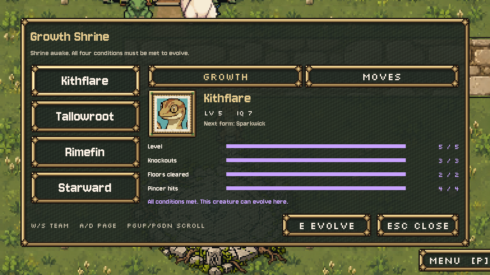
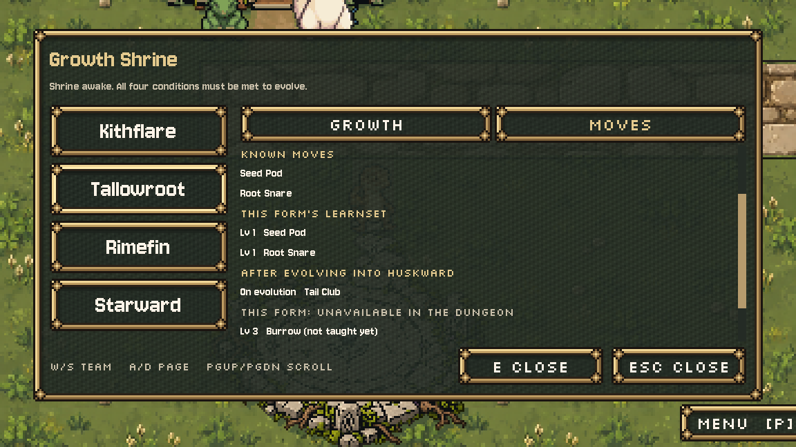

# Growth Shrine information screen, October 11, 2026

Installed handoff job 4: a browsable travelling-team screen in the existing moss/brass pixel frames. Existing portraits retain the shared creature finish and clip inside their own frames. The Growth page shows level, IQ, next form and all four current evolution conditions with individual purple progress bars. Four conditions fit without scrolling. The Moves page shows the actual known kit, current and next-form learnsets, moves not yet taught because their dungeon effects are unavailable, and move choices queued for the next run. Longer lists scroll. No generated art or source PNG edits.

## Play

Run `scenes/hub_town.tscn` or reach Highbank through the opening. E at the existing Shrine activation tile (7,12) opens the screen. W/S or Up/Down selects a teammate; A/D or Left/Right switches Growth/Moves. Click the team rows or tabs, and use the mouse wheel or PgUp/PgDn to scroll. E uses the named action; Esc closes. The original pond-stone gate remains: dormant shows information, carried offers stone installation, installed offers evolution only for a creature passing `Evolution.ready`. The original default ready creature remains the first offered; selecting another creature updates that confirmation target. Cutscenes retain input priority.

The exterior, stone installation, evolution animation and results remain the existing ones. Their temporary text/animation view replaces the information screen while playing. No rule, threshold, level, IQ, move learning, body gate, save/state or story changes. Numeric data is read from the live `EVO`, `EVO_LEVEL`, `LEARN`, `WAITING` and carried record; `moves_for` supplies the normal fallback kit. Unfinished single-form lines say later forms/conditions are not defined, rather than claiming a final stage.

## Scope and evidence

Only new `scripts/ui/shrine_info.gd` plus three tiny hooks in `scripts/town/hub_town.gd`: attach, modal input routing and HUD presentation. Current live sources were re-read and guarded before installation; reversing the hooks restores the exact source text. No staging script was blanket-copied into the live project. Current original bytes and exact hook diff are in `originals/` and `presentation.diff`.

Native Godot 4.7.2/OpenGL verification: 26/26 staging checks; final live 27/27, including the added cutscene-priority check. Real keyboard selection/page/scroll/close and real mouse selection/tabs pass. Four-member, empty-record, all current forms, final-stage and unfinished-line states pass. The existing stone animation and evolution complete; a full kit preserves its queued Cinder Claw for the next run. Creature portrait shader/frame clipping and visible panel bounds pass. Current town checks pass all 13 routes, all 12 services, walking/following and actual Hollow entry. Existing evolution and field-menu checks pass, including real bag turn cost and the next run's queued-move prompt.

Fixtures use private profiles and hidden native processes. Existing check copies change only capture paths and persistent Music cleanup; production tests remain untouched. Staging-only root-certificate and Dialogue Manager UID warnings also occur in the original capture; final live runs have neither. No live editor or Claude process was stopped. No commit, reset, stash or revert.

`before.png` is the original ready response. `ready.png`, `dark.png`, `stone.png`, `final.png`, `moves.png`, `moves_bottom.png` and `pending.png` are native captures. `check.gd` and `run.py` reproduce the new checks; `live-*.log` contains live results. The final audit compares protected source/art hashes and records any concurrent external changes rather than overwriting them. This is an implemented visual proposal for Preston's review. Codex is out of the shared town file.

