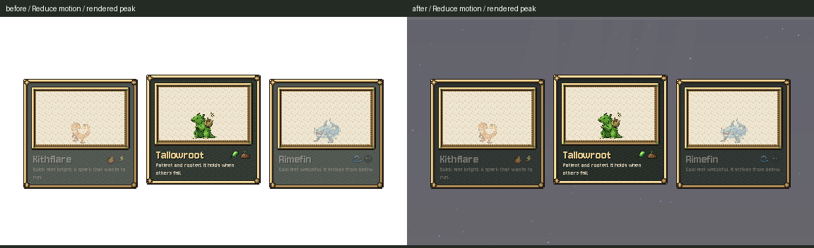

# Reduced-motion soul flash

October 26, 2026. **A2 / ACC-14: installed and checked.**

The soul's arrival flash now starts at **0.4 under Reduce motion**. Normal mode stays at 1.6. The scene reads the saved shared preference as well as the title/Storm handoff, and passes that effective setting onward. The existing decay, 0.9-second flight, 0.7-second handoff wait, creature/partner selection, art, words and controls are preserved.

The flash belongs to the low-resolution void layer; the cards sit above it. The native quiet-corner sample changes from white (255,255,255) to approximately (99,99,109). No image asset was edited.

| Check | Result | Evidence |
|---|---|---|
| Native baseline | 6/6; clean; reduced flag still gave 1.6 and white | [log](before.log), [result](before-result.json), [command](before-command.json) |
| Native installed | 87/87; clean | [log](after.log), [result](after-result.json), [frame samples](after-frames.json), [command](after-command.json) |
| Official soul_prologue and opening_flow | 2 PASS; exit0 | [results](runner-result.md), [command](official-command.json), [raw logs](runner) |
| Scope and preservation | Checked | [diff](source.diff), [verification](verification.json), [publication receipt](publication.json) |

The nine installed cases cover all three creatures with normal, forwarded-only and saved-only settings. Each uses the actual `advance()` gate from the last after-choice line, then the real flight/flash/handoff code. Checks cover the target position/scale before the flash, monotonic decay, unchanged handoff delay, hero/partner/chosen flag, forwarded preference and unchanged private save bytes. Reduced cases peak at0.4 and clear by sampled frame40; handoff remains frame48, 22 frames after flash onset. Normal peak stays1.6 and white. Peak images are selected by rendered brightness among the first three flash samples, since the async flight can set `_flash` after a frame's void draw.

The private scene is not made `current_scene`, so the existing production check hook exposes the next node for inspection and cleanup. It does not override production methods. The official opening-flow check covers actual scene transitions, and soul_prologue runs the full story/choice and verifies waking dialogue. Native Compatibility, fixed-fps30, Dummy audio, private APPDATA/LOCALAPPDATA and TeamState save path. No personal save or preferences included. Native screenshots were inspected; headless checks are logic proof only.

Final native logs are clean. Official raw logs retain their known ObjectDB/resource exit warnings. An initial screenshot diagnostic captured state before the void drew the flash; its passing output/unlit image is retained under [attempts](attempts). One intermediate baseline emitted2 ObjectDB/1 resource exit diagnostics; a verbose baseline rerun and the installed nine-case run exit clean. No production change was made for that intermittent teardown diagnostic.

Only `scripts/soul_prologue.gd` was edited in production: effective preference initialization and the conditional starting strength. [Originals](originals), [installed source](prepared) and the [private driver](native_check.gd) are archived. All other soul source is byte-for-byte equivalent after removing those two edits. Shared preference helper bodies match the tested original snapshot. Concurrent Claude/Grok changes, if any, are listed and preserved in the publication receipt.

**Source issues for Claude:** no new issue in ACC-14. The broader white-out transition, Storm/soul input, starter-card and light-shaft requests remain A3. C6 stays off pending Preston's wording; the new town/exterior art hold remains in force. Claude's shared preference recovery work was left intact. No cross-chat message, generation, paid call, creature rule, Route1 edit or commit.
