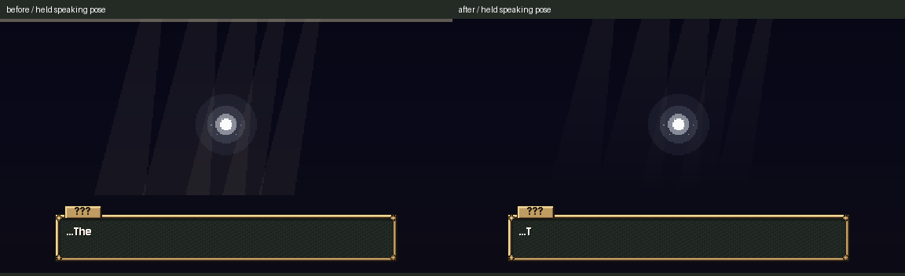
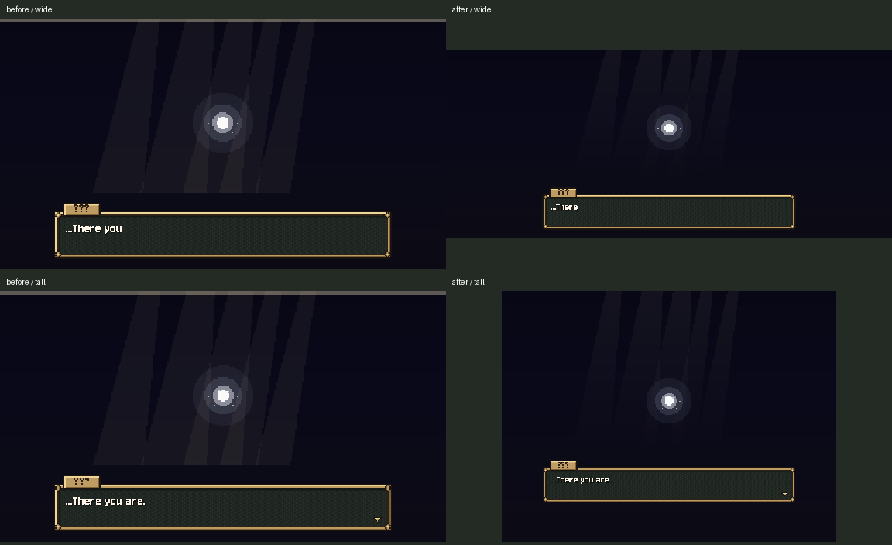

# Soul backdrop and light shafts

October 26, 2026. **C9 / A3 bar, band and shaft slice complete, installed and checked.**

Removed the full-width speaking strip. At the scene's3x scale, that3px strip produced the roughly9px grey band at the top. The native384x216 backdrop was already filled at16:9; the strip was the baseline cause, not a missing row. Light shafts now interpolate from their upper alpha to zero at both lower vertices, removing the hard horizontal end at native y150 / view y450. Their brightness still follows the voice.

The backdrop now also fills expanded window shapes. The native viewport is sized upward to whole art pixels, with the authored world and1152x648 UI centered together. Background and flash cover the whole expanded area. The scene remembers the incoming stretch policy, restores it on exit, and leaves a destination's newly chosen policy alone. Base card geometry, fonts, creature scales and dialogue placement are unchanged at16:9.

## Checks

| Check | Result | Evidence |
|---|---|---|
| Native baseline | 3/3; clean | [log](before.log), [metrics](before-result.json), [command](before-command.json) |
| Native installed | 20/20; clean | [log](after.log), [checks and dimensions](after-result.json), [command](after-command.json), [driver](native_check.gd) |
| Official soul_prologue and opening_flow | 2 PASS; exit0 | [results](runner-result.md), [command](official-command.json), [raw logs](runner) |
| Preservation | Checked | [diff](source.diff), [verification](verification.json), [publication receipt](publication.json) |

The pixel probe holds a deterministic pose with motes disabled, then compares silent and speaking native images. Added RGB brightness at a strip sample drops from0.302 to0. At a shaft's bottom it drops from0.0405 to0; the midpoint remains visible at0.0131. Native corners contain indigo instead of a clear/letterbox band at1152x648,1536x648 and960x720. Tests also cover expanded flash extent, whole-pixel centering, actual mouse selection in the wide view, saved journey hashes and stretch restoration for both caller policies plus queued deletion after a destination changes policy. [Baseline captures](before), [installed captures](after).

Compatibility renderer, fixed-fps30, Dummy audio; private APPDATA/LOCALAPPDATA and TeamState save path only. No personal preferences/saves included. Final baseline/native logs are clean. Official scripts retain known ObjectDB/resource exit warnings and are not claimed clean. Native screenshots were visually inspected; headless checks are logic regressions. Earlier17- and19-check native passes are archived under [earlier-native](earlier-native); the final20 adds the destination-policy lifecycle check and guard.

Only `scripts/soul_prologue.gd` changed in production. [Originals](originals) and [installed source](prepared) retained. Story constants, input/advance, card art/geometry/scales, animation, flash timing and the prior through-black transition methods are exact. No shared UI, town/exterior, asset, generation, paid call, save format, creature rule, Route1, cross-chat message or commit. Concurrent Claude/Grok paths are preserved and listed in the receipt.

**Source issues for Claude:** no new C9 issue. The top grey band was the scaled speaking strip; no asset recut was needed. The new expansion is scene-local and preserves a destination's stretch choice. C7's neutral-motion/public-check follow-ups remain in its handoff. C8 starter choice safety, card art/sounds/hint contrast and Storm's pixel soul light remain pending. C6 stays OFF awaiting Preston's words, and town/exterior art remains on HOLD until the slot queue is ready.

Next: C8 starter-card choice protection and presentation, one checked slice.
