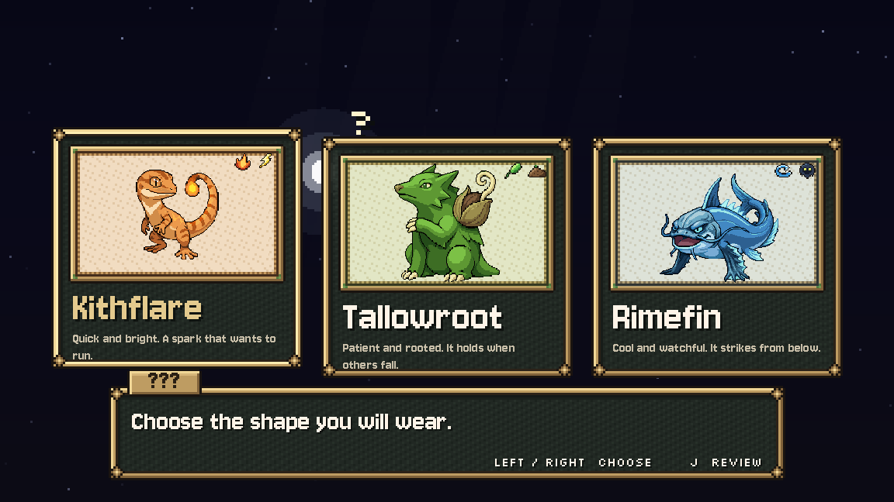
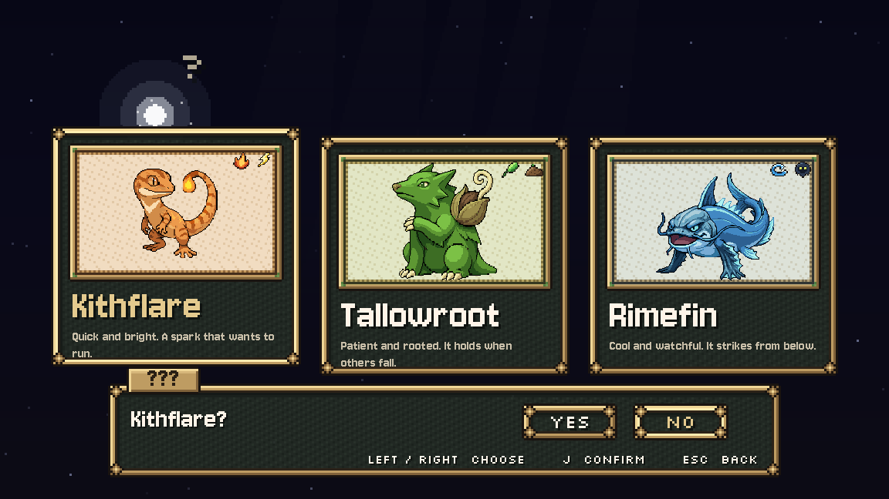

# Starter cards and confirmation, October 26, 2026

C8 COMPLETE/INSTALLED. The reading press can no longer choose Kithflare. Cards reject accept for the first 0.4 seconds and require release before a fresh press, including an early press held past the guard. Reviewing a card asks `<Name>?` with Yes / No, initially on No. No or Cancel returns to the same creature; Yes commits once. Keyboard, pad, rebound keys and mouse use the same choice state.

## Presentation

The existing `CreatureIdle` full-body front idles now share **1x source-pixel scale**, centred by their union across all frames. Their actual relative sizes remain intact. Names use the title role; the portrait interiors carry the main essence's existing dungeon-palette tint. Essence icons sit clear of the name. The original `Choose the shape you will wear.` prompt is drawn immediately in the ??? box, independent of the last story page. Hints use full UI.TEXT contrast and live UI.binding_text labels. Card/answer movement uses cursor, committing uses confirm plus presence_swell.wav on the UI bus, returning uses cancel.

The latest section 11 item 2 of the October 22 queue says **one whole scale**. This supersedes the older 3x wording. These detailed source unions are over 100 pixels tall; at 3x the larger starters exceed 450 pixels high inside a 180-pixel portrait frame. No replacement art, body cropping or per-creature rescaling was used. The existing eight-frame idles remain the source.

The `review`, `confirm` and `back` hint labels are proposed UI copy for Preston. `<Name>? Yes / No` was requested in the queue. All LINES, AFTER, FEEL, names, forms and essences are exact. This selection prompt is separate from C6's New Game replacement prompt, which remains OFF.

## Verification

- [Native fixture](native_check.gd): **47/47**, Compatibility, Dummy audio, fixed 30 fps, clean log. Actual Input.parse_input_event presses, releases, duplicate downs and echoes; opening guard; Yes for all three; No/Cancel; no repeated commit/after-line advance; pad A/B and stick centre/repress; Q rebind; mouse at 1152x648, 1536x648 and 960x720; audio players; all-frame body bounds; private save SHA unchanged. [Log](after.log), [results](after-result.json), [command/profile paths](after-command.json).
- [Real native opening flow](real_flow.py): **87/87**, three clean runs, title button through two-press Storm skip, soul dialogue, starter review/Yes, flood narration, other-two partner choice, playable riverbank and correct team. Kithflare/partner0, Tallowroot/partner1, Rimefin/partner0 with reduced motion. [Aggregate](real-flow-result.json), [Kithflare](hero0/checks.json), [Tallowroot](hero1/checks.json), [Rimefin](hero2/checks.json). Commands and full logs accompany each case. Private APPDATA and LOCALAPPDATA only.
- Maintained `opening_flow` and `soul_prologue`: **2 PASS**, exit0, rerun after final fix. [Runner result](runner-result.md); [opening raw log](runner/opening_flow_check.log), [auto soul raw log](runner/soul_prologue_check.log). These headless checks retain the known raw exit warnings; the native assertions above have clean logs. Headless is not visual proof.
- Fresh pre-change native baseline: **2/2**, [before image](before/cards.png), [log](before.log), [results](before-result.json). Final native captures reviewed for base, wide and tall layouts, both confirmation answers, all three creatures and the real flow.
- [Verification](verification.json): eight methods exact, including the recent black handoff, C9 backdrop/shafts and flash. Two installed files hash-guarded. Claude's existing 12-frame partner-answer gate retained in the regression. Concurrent `mouth_escape.gd` and `road_check.gd` preserved and archived separately.

Initial fixture failures are documented and [the first attempt retained](first-attempt/after.log). The reading-press fixture had to let the shared typewriter see the prepared line before finishing it. Tall-window injected clicks need the root stretch transform in addition to the UI transform; production GUI coordinates were already correct. Source review also found and fixed an early-press edge case: a rejected down must consume its release latch. The final 47 assertions include held keyboard and mouse presses starting inside the guard. No failed assertion is counted in the final totals.

## Owned changes and handoff

Only `scripts/soul_prologue.gd` and `tools/debug/opening_flow_check.gd` were installed. [Diff](source.diff), [originals](originals/), [installed hashes](installed-files.json), [full pre-edit protected hashes](protected-before.json), [handoff](HANDOFF.md). The public flow driver now tests first-press arming/second-press Storm skip and starter confirmation; this closes C7's formerly staged driver follow-up without removing Claude's partner check. The old auto soul check still walks confirmation and reaches waking as Tallowroot.

No new source issue for Claude. The prior shared UI.pressed neutral-motion follow-up remains in its existing handoff; owned scene handlers already feed neutral motion to the tracker. Next opening slice: Storm pixel soul light, then C5 splash/return visit work. C6 stays OFF. Town/exterior art remains on HOLD pending its named slot queue. No real save, asset generation, paid call, creature rule, Route 1, cross-chat message or commit.
