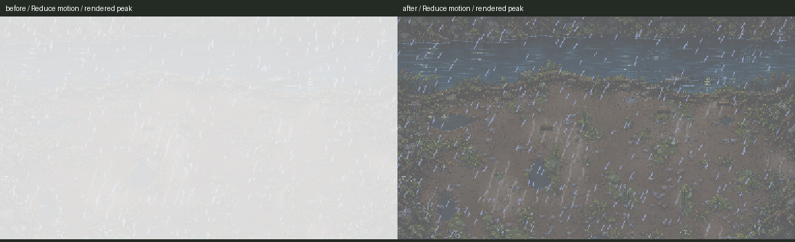

# Reduced-motion lightning

October 26, 2026. **ACC-10, item A1 of the new October 26 Codex queue: installed and checked.**

Reduce motion now gives each lightning strike one soft pulse, initialized at **0.4** and fading to zero over **0.35 seconds**. The 1.4 / 1.9 / 1.2 second waits before strikes are no longer compressed. The scene respects both the title's forwarded setting and the shared saved preference when opened directly. Normal mode keeps its existing double pulse and 0.85 peak. Thunder stays once per strike on the SFX bus.

These are native shader-peak captures. The previous reduced setting washed out most of the scene at 0.85; the installed setting's first sampled rendered peak is about 0.362, already one tween step below its configured 0.4 start. The rain positions differ; no art was edited.

## Checks

| Check | Result | Evidence |
|---|---|---|
| Native reduced baseline | 6/6; clean; six pulses across three strikes | [log](before.log), [results](before-result.json), [frame samples](before-frames.json), [command](before-command.json) |
| Native installed | 33/33; clean | [log](after.log), [results](after-result.json), [frame samples](after-frames.json), [command](after-command.json) |
| Official storm_open and opening_flow | 2 PASS; exit0 | [results](runner-result.md), [command](official-command.json), [raw logs](runner) |
| Source preservation | Checked | [diff](source.diff), [verification](verification.json), [publication receipt](publication.json) |

Native tests play all three strikes and the later sequence for three cases: normal; Reduce motion forwarded from the title with the saved setting off; and the saved setting on with no forwarded flag. The reduced cases each have three monotonic pulses, a state and shader peak below 0.4, about 0.333 seconds of sampled nonzero flash for the configured 0.35-second tween, and full gaps of about 1.93 / 1.23 seconds between the later flashes. Normal retains six pulses at 0.85. All cases check three thunder sounds, frozen/grey rain, the soul landing, automatic handoff to the existing soul scene, and unchanged private save bytes.

The private scene isn't made `current_scene`: it uses the production `_next` check hook to record its destination after instantiating/freeing the next scene. The official opening-flow regression covers actual scene transitions. The private driver does not override production methods. Native Compatibility renderer, fixed-fps30, Dummy audio, isolated APPDATA/LOCALAPPDATA and TeamState save path. No personal save/preferences are included.

Native logs are clean. Official raw logs retain runner-exempt ObjectDB/resource exit warnings and are not claimed clean. Headless checks are logic regressions; the native screenshots were visually inspected. An initial baseline capture sampled the state before that value reached the shader, producing an unlit screenshot. That passing diagnostic run is retained under [attempts](attempts); the final baseline and installed driver capture on the actual shader maximum.

Claude updated the shared preference reader/recovery and removed HEAD while this slice was running. Final native33 and both official regressions were rerun successfully against those updates. [Tested shared snapshots](tested-shared) are archived; the current preference-helper bodies were checked against that snapshot. Earlier passing runs are retained under [before-shared-recheck](before-shared-recheck).

## Scope and source issues for Claude

Only `scripts/storm_open.gd` changed: shared UI preload, effective saved/forwarded preference, uncompressed strike waits, and the reduced-only pulse branch. The normal double-flash body and shared 0.35-second fade, wind/thunder tail, rain/soul art and animation, input, destination and save behavior are otherwise exact. [Originals](originals), [installed source](prepared) and [driver](native_check.gd) are archived. Concurrent Claude/Grok source paths are listed and preserved in the receipt.

- No new issue found in the lightning path. The remaining soul flash and full white-outs are **not** fixed by this slice; next is A2 / ACC-14.
- Pass8 plan L04 proposes enabling C6, while the dedicated October26 queue explicitly keeps it off until Preston chooses words. This slice leaves the flag off. Claude's C1 shared preference copy/backup-reader changes landed concurrently and were preserved; their broader recovery validation stays with his pass8 lane.
- No cross-chat message was sent. No art generation, paid call, creature rules, Route1 edit, real save, settings format or commit.

Town/building/sign/lettering art remains on the new queue's hold until Claude's slots exist.
