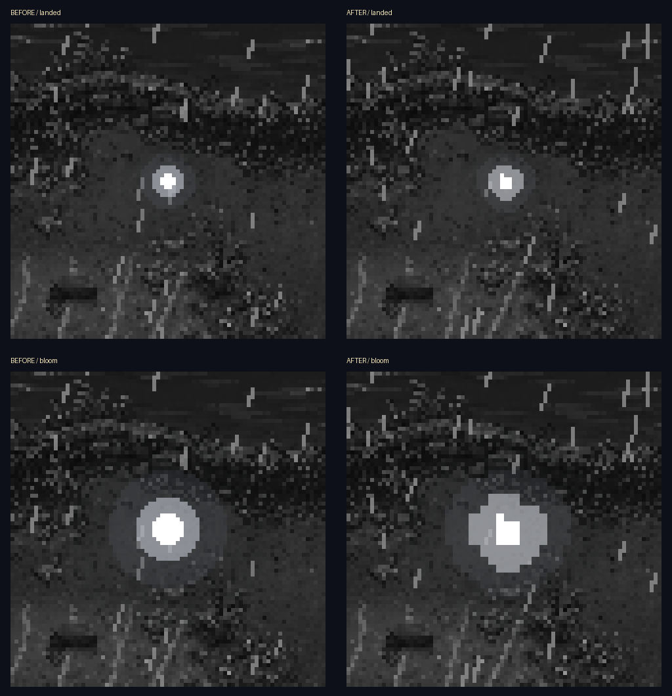

# Storm pixel soul, October 26, 2026

C20's remaining pixel-light item is COMPLETE/INSTALLED in `scripts/storm_open.gd` only. Four vector circle calls are replaced by an authored25x25 pixel cluster with a white core, stepped blue-white light and a faint uneven halo. Horizontal runs draw as whole-pixel rectangles on the existing384x216 transparent light layer, enlarged nearest-neighbour3x. Bloom rounds both rectangle edges so expanding light stays on that grid. No asset generator or new image asset is involved.

[Actual descent](normal/3b-descending-pixels.png) and [landing](normal/3c-landed-pixels.png) in the natural opening. [Reduced-motion landing](reduced/3c-landed-pixels.png).

The four light values use the old blue-white palette; mid/bright alpha approximates the old overlapping rings. The existing soul_glow opacity and growth drive the new shape; outer growth retains the old12 + big*14 reach. State, bobbing, descent destination, timings, rain/world shader, sounds, reduced-motion caps, skip hint/input and black handoff are exact. The original full-screen white draw is exact. This changes the soul's pixel silhouette, not its timeline. No wording change or visual approval from Preston is claimed.

## Checked

- [Native visual fixture](native_check.gd): **21/21**, clean log. Hidden, quarter-opacity appearance, landing, bloom, peak,0.4 reduced white and1.0 normal white. Transparent native viewport, nearest filtering, opaque core/stepped corner/faint halo,25x25 extent, original waking coordinate, expanding bounds,3x block alignment in actual rendered screenshots and unchanged private save SHA. [Results](after-result.json), [log](after.log), [command/profile paths](after-command.json), [captures](after/).
- Fresh original native baseline: **15/15**, clean final log, [results](before-result.json), [log](before.log), [captures](before/). Before and after use identical controlled light states. The storm's random rain differs between runs; the comparison sheet focuses on the light.
- [Natural opening driver](natural_flow_check.gd), derived from the maintained opening check: **68/68 native assertions**, normal34 and reduced34, clean verbose logs after explicit fixture teardown. Both start with the real title button and wait for natural Storm completion. They capture actual descent/landing, enter the real soul scene, confirm the starter, choose the partner and reach the playable riverbank with the expected team. [Normal results](normal/checks.json), [reduced results](reduced/checks.json), [aggregate](real-flow-result.json), [normal log](normal.log), [reduced log](reduced.log). Private APPDATA/LOCALAPPDATA only. The only driver additions are natural-descent/landing observations/captures and established shared-blip teardown; no game input/timing shortcut.
- Maintained `storm_open` and `opening_flow`: **2 PASS**, exit0. [Runner result](runner-result.md), [raw Storm log](runner/storm_open_check.log), [raw opening log](runner/opening_flow_check.log). Their known raw exit-resource warnings remain; headless results are not visual proof.
- [Source verification](verification.json), [diff](source.diff), [originals](originals/), [installed hash](installed-files.json): all other original Storm methods and fields exact, including the complete animation, reduced lightning, audio, input and handoff. Other work preserved; any concurrent paths are listed/archived separately.

The [first static baseline](first-baseline/before.log) is retained: its test pause also froze the initial black veil, so full-screen images were unsuitable. Hiding that veil only in the controlled fixture fixed captures. Resuming its coroutine to the existing leaving check fixed that fixture's exit warning. The [first natural run](first-flow/normal.log) passed34 assertions but retained2 exit objects. Explicitly freeing the shared test blip and allowing teardown6 frames, as in earlier private fixtures, produced clean verbose normal/reduced reruns. No production teardown fix is claimed.

## Handoff

Only the Storm soul drawing and its local pixel-mask constants/helper changed. C7 input, A1/A2 reduced-motion caps, through-black transitions, C8 confirmation/cards and C9 backdrop remain installed. The public opening driver is untouched this turn. Source issues for Claude: none new; shared UI.pressed neutral-motion follow-up remains documented, with owned handlers already feeding neutral events.

A3's tracked opening pieces are now complete: shared advance/stick/rebinds, released two-press skip and live hint, white-outs through black, C8 cards/confirmation/audio, C9 strip/shaft/backdrop and this pixel soul. Next ordered slice is **A4/C5 return-visit skip and splash auto-dismiss/key wording**. C6 New Game replacement prompt remains OFF; town/exterior art remains HOLD until its named slot queue. No real saves, new assets/generation, paid calls, creature rules, Route1, cross-chat message or commit. [Team handoff](../../team/CODEX_HANDOFF_2026-10-26_storm_pixels.md).
