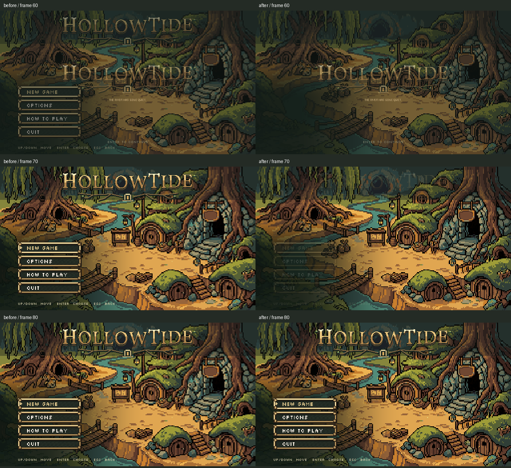

# Title logo handoff

October 26, 2026. **L7-20, section 10 item 4: installed and checked.** Claude's newly published pass 7 queue puts this ahead of the remaining Storm/soul work. Section 10 items 1-3 are closed by the existing C2-C4 results and the current passing UI-fit check.

The centered launch logo, tagline and continue caption now clear before the upper menu wordmark appears. The village is revealed first; the wordmark, menu and key hint then fade in together. Reduce motion swaps directly to the menu. Initial focus is silent, and skip presses during either fade are consumed before they can choose New Game.

[Sampled transition animation](transition.webp). This animation joins seven native captures for comparison; the full per-frame opacity logs below are the timing proof.

## Results

| Check | Result | Evidence |
|---|---|---|
| Native baseline, six campaign cases | 36/36; clean; 14 overlap frames in each normal case | [log](before.log), [metrics](before-result.json), [600 frame samples](before-frames.json) |
| Native installed, same six cases | 66/66; clean; zero overlap | [log](after.log), [metrics](after-result.json), [600 frame samples](after-frames.json), [command](after-command.json) |
| Native legacy opening, normal/reduced | 20/20; zero overlap | [log](after-legacy.log), [metrics](after-legacy-result.json), [command](after-legacy-command.json) |
| Official opening_flow and ui_fit | 2 PASS; exit0 | [results](runner-result.md), [command](official-command.json), [raw logs](runner) |
| Scope/source preservation | One method, one production file | [diff](source.diff), [verification](verification.json), [publication receipt](publication.json) |

The campaign cases cover automatic entry, early Enter/A/mouse skip plus repeated skip presses during the fade, and both automatic and keyboard reduced-motion entry. Each checks final page/focus, no accidental launch, Reduce motion, completion idempotence and live Options. Installed checks additionally require the old card hidden at alpha zero, full final opacity, zero simultaneous logo frames, initial focus silence, and a normal fade versus an instant reduced swap. Samples are recorded after native `frame_post_draw` in Compatibility at fixed 30 fps. Matched PNGs were inspected.

Normal automatic timing, zero-based frames: the launch last has nonzero opacity at 67; the menu first has nonzero opacity at 70 and is ready at 77. Before: the menu appeared at 54 while the launch remained visible through 67. The new 0.25 s menu fade adds about 8 frames after the existing 0.5 s launch fade. Reduced automatic timing stays at frame 5, with no animated fade.

Native campaign logs are clean. The legacy smoke retains its known 101-instance ObjectDB exit warning despite waiting for its existing background load; that issue is not claimed fixed. Official raw logs retain their runner-exempt exit warnings. Headless regression results are not shader proof. Private APPDATA, LOCALAPPDATA and save paths only; no personal save/preferences included.

The first baseline fixture accidentally sent more Enter presses after the reduced-motion menu was ready, starting New Game; that fixture's failed output is retained under [attempts](attempts). The corrected fixture sends repeats only while the prelude is active. The corrected 36/36 baseline and installed 66/66 use the same driver. No production change was made in response to that fixture mistake.

## Scope and remaining work

Only `opening_flow.gd::_finish_boot` changed. [Originals](originals), [installed source](prepared) and [native fixture](native_check.gd) are archived. Existing art, carved lettering, text, fonts, title settings, Continue, C6 prompt gate, campaign entry, Storm/soul code and Claude's shared sources are exact against the fresh baseline. No asset generation, paid calls, creature rules, Route 1, real save, cross-chat message or commit.

This closes the initial focus tick part of LV-24 and the old prelude's visibility once the menu opens. C5 return-visit skipping and the auto-dismiss versus named key mismatch are still pending; this slice preserves their current behavior. C6's confirmation stays off awaiting Preston's wording. The shared preference recovery gap from C1 remains open with its tested candidate staged only in [earlier evidence](../settings-save-2026-10-26/proposal/shared-pause-save.diff).

Next by the newest queue: section 10 item 5, **ACC-10 reduced-motion lightning**, then item 6, **ACC-14 reduced soul flash**. The broader Storm advance/skip/pixel-light and soul C7-C9/white-out work follows in item 7. Storm was inspected this turn and left unchanged after the new queue was discovered.
