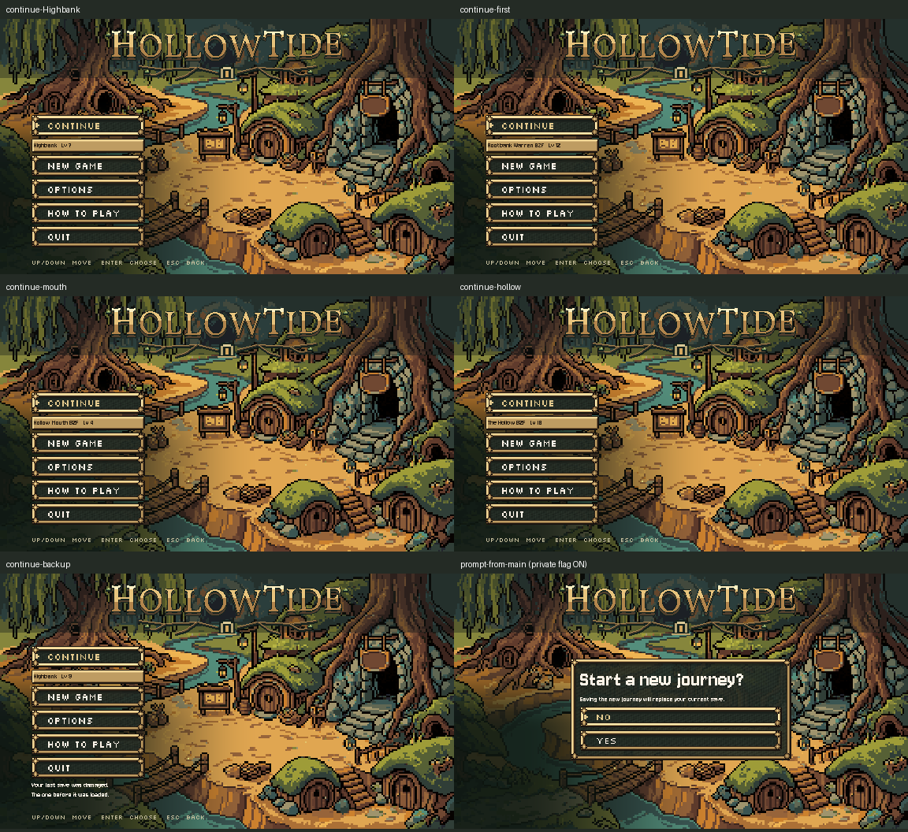

# Continue details and proposed New Game confirmation

October 26, 2026. C6 / L6-08 / LO6-11 from the current task queue.

**Installed:** Continue shows the saved resume place and leader level directly underneath its button. **Implemented and tested, but OFF:** both New Game entry points share a framed No/Yes confirmation. The queue explicitly keeps this flag off until Preston chooses the words. Screenshots of the prompt come from private instances with the flag enabled, not the normal game default.

## What works

- Continue reads the validated save or its existing backup without loading it into the running team or writing either file. It shows Highbank for the normal resume path, or Rootbank Warren / Hollow Mouth / The Hollow and the suspended floor. The leader level comes from that saved leader's level row.
- With the proposed prompt enabled and a save present, title New Game and Help's Start New Game open the same panel. No receives initial focus. No, Escape and controller B return to the original page and button without changing the save. Yes enters the existing storm flow once. Without a save, New Game proceeds directly.
- The main menu adjusts upward by the actual summary row height. All checked campaign title menus end by y596, above the key hint; the backup recovery note also fits.
- Normal installed behavior keeps the prompt disabled: `new_game_confirm_enabled = false`, with no scene override.

Proposed title: **Start a new journey?** Proposed body: **Saving the new journey will replace your current save.** The queue's older Highbank timing proposal is inaccurate for a player who suspends in the Mouth before reaching town: `dungeon.suspend()` can autosave earlier. This slice changes no save rules and makes no promise about a particular checkpoint. Starting the storm itself was checked to preserve the previous save.

## Checks

| Check | Result | Evidence |
|---|---|---|
| Native Compatibility, final source | 47/47; clean exit | [log](native.log), [results](native-result.json), [command](native-command.json), [fixture](native_check.gd) |
| Full native UI-fit | 48/48; clean exit | [log](ui_fit.log), [command](ui_fit-command.json), [private copy](ui_fit_private.gd) |
| Official opening_flow, save_check, ui_fit | 3 PASS; exit 0 | [results](runner-result.md), [command](runner-command.json), [raw logs](runner) |
| Source/hash preservation | Checked | [verification](verification.json), [publication receipt](publication.json), [diff](source.diff) |

The native fixture checks all four resume locations, saved leader values, no-save behavior, backup recovery, disk byte preservation, the disabled default, initial No focus, layout, both origins, keyboard/controller cancel, controller confirm, one-use consent, and a real Yes-to-storm transition using the actual scene. The deterministic gate fixture overrides only the final launch; the last smoke uses the real launch. Private APPDATA, LOCALAPPDATA and TeamState save paths were used. Native teardown frees music and the UI blip. No personal save/preferences are included here.

Official raw logs retain the runner's known ObjectDB/resource exit warnings; those logs are not claimed clean. Native UI-fit and the official regressions ran before the final proposal-body/comment correction. That last edit changed no logic; the final 47-check native run compiled, rendered and exercised the corrected source. Headless results do not establish shader appearance; the native screenshots were inspected.

## Scope and handoff

Only `scripts/main_menu.gd` and `scripts/creature_opening.gd` were edited in production. [Originals](originals) and [installed source](prepared) are archived. Title preference load/safe save, Continue dispatch, existing campaign entry, scenery/wordmark drawing and TeamState source were preserved. Other dirty Claude files were not edited. [Verification](verification.json) lists any changes since the fresh baseline. Campaign title layout is the visual scope; the retired opening's separate placement was not redesigned.

The shared game/pause preference backup-rename recovery gap remains open from C1; its tested candidate is still staged only in [the earlier evidence](../settings-save-2026-10-26/proposal/shared-pause-save.diff). No asset generation, paid calls, creature rules, Route 1 edits, cross-chat message or commit.

Next ordered slice: Storm input/skip prompt and pixel soul light (section 9 item 5), followed by white-out transitions. C6's wording decision remains Preston's; the proposed prompt is ready to review and stays off.
