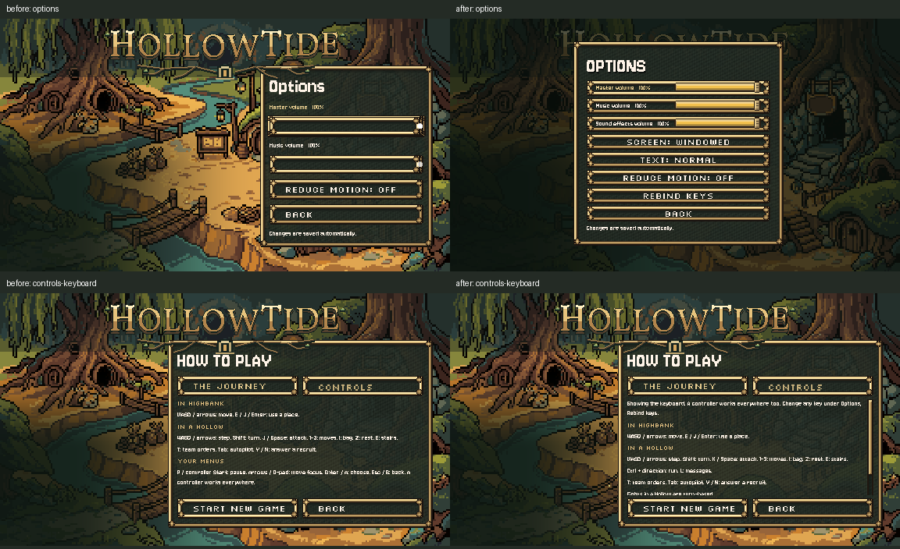

# Title Options and live Controls help, October 26, 2026

**C4 complete and installed.** The title now opens the game's existing Options and Rebind pages: Master, Music, Sound effects, Screen, Text speed, Reduce motion and Rebind keys. The sliders use the exact shared track/fill/knob objects. A small title-only host exposes those pages without pausing the title or offering gameplay pages.

How to play > Controls now uses `ControlsText.groups(UI.last_device())` and `note()`, including run and messages. It refreshes while open when a binding or device changes. The selected tab has the focused frame. A fixed-height scroll area keeps the keyboard/controller text readable while leaving Start New Game and Back onscreen; Page Up/Down, wheel and scrollbar can reach the rest.

## Save and navigation behaviour

Title-owned audio and motion values retain the previously checked C1 writer: load existing keys, save the whole temporary file, rename over the final, retain failures for retry. The host forwards those settings to the existing title method and refreshes its cached fields. Text speed, screen mode and bindings use the same game-pref APIs as the pause menu. Closing Settings returns focus to Options. Esc stops rebinding first, then goes back to Options, then out to the title; the host reuses the pause menu's input rules. It never sets the scene tree to paused.

This uses a new `scripts/ui/title_settings.gd` subclass plus hooks in the two owned menu scripts. Claude's active pause/rebind/preferences sources are unchanged. Previous carved-logo, soul typography, story, New Game, Continue and title-safe-save methods remain exact. Journey help's words are unchanged.

## Checked

- [Native running-title checks](after.log): **30/30**, clean runtime log. Three real sliders apply their buses and save; text speed, motion and both screen modes work; the actual Rebind page saves Attack K while keeping Space, handles Esc correctly and returns focus without pausing. Help updates immediately after a binding save and after an injected controller motion travels through InputPrefs; keyboard Page Down reaches remaining text. Body and action-button bounds checked.
- [Fresh engine process](restart.log): **19/19**, clean. Saved audio, motion, female courier, text speed and the custom Attack binding return. Keyboard/controller Help still uses the current shared source and stays within its frame.
- [Full current native ui_fit](ui_fit.log): **48/48**, clean. Production assertions unchanged, with private output/save paths and music/blip teardown. Title Options ends582, rebind617, both Help topics602, all inside y636.
- [Official runner](runner-result.md): **3 PASS**, exit0: opening_flow (21 checks), rebind (26 assertions) and ui_fit (48). [Opening log](runner/opening_flow_check.log), [rebind log](runner/rebind_check.log), [ui_fit log](runner/ui_fit_check.log). Existing exit-instance/resource diagnostics are retained and classified by the current runner's noise list; those headless logs are not all claimed clean. No full-suite claim.
- [Source verification](verification.json): C1 save/load and New Game/Continue methods, carved wordmark/scenery and Journey wording are exact. Shared settings/input/ControlsText/soul sources were read only by this pass; Claude's concurrent changes are recorded separately in the [publication receipt](publication.json). Scoped `git diff --check` passes.

Native screenshots inspected: [Options](native-after/options.png), [Rebind](native-after/rebind.png), [keyboard Help](native-after/controls-keyboard.png), [keyboard scrolled](native-after/controls-keyboard-bottom.png), [controller Help](native-after/controls-pad.png), [controller scrolled](native-after/controls-pad-bottom.png), [Journey](native-after/help-journey.png). All use fixed30, Compatibility and Dummy audio, isolated APPDATA/LOCALAPPDATA and a private TeamState path. The screen-mode test changes only its own native test window and restores windowed mode. All preferences and bindings are test-created. No real save/settings are read or written.

Claude landed shared UI/chord, Rebind and ui_fit log-clock updates while this evidence was first being archived. The complete 30/30 +19/19 native title checks, current native48/48 ui_fit and official3 PASS were rerun against those updates, with the same results. Previous passing logs are retained under `before-concurrent-recheck/`; final logs and copied ui_fit assertions reflect the newer sources. Claude's updated files were preserved, never replaced by a baseline snapshot.

## Originals, failures and reproduction

[Fresh originals](originals/), [installed source](prepared/), [exact diff](source.diff), [baseline hashes](protected-before.json), [installed hashes](installed-files.json), [before-image provenance](before-image-provenance.json). Before images are reused from the previous checked C3 slice; SHA256 proves both menu originals match that capture's installed sources exactly. An attempted fresh baseline fixture hit parser errors and did not produce valid captures; it is not represented as a passing baseline.

The first fixture needed a named preload type/explicit array annotation. The new tab comparison also needed an explicit boolean annotation; that source error was corrected and the one failed test process was stopped by its exact script path. A later assertion incorrectly expected `K: attack` rather than the correctly preserved `K / Space: attack`; the assertion was corrected. Failed logs are retained. None is relabelled as a successful run. The invalid intermediate source is archived as text, not an executable game script.

`prepare.py` captures/prepares, `install.py` hash-guards the two owned scripts and new host, `repair.py` records the boolean repair, `repair_preferences.py` keeps the safe title writer and final shared input delegation. `native_check.gd` drives real controls and restart state; `run.py` records engine/profile arguments. `prepare_ui_fit.py` keeps the current test assertions with private paths; `verify.py` checks unchanged functions, read-only shared sources and before-image hashes. `publish.py` archives and appends the task handoff. Exact commands are in `*-command.json` and [runner-command.json](runner-command.json).

## Remaining source issues and next work

- The previously demonstrated backup-rename gap in Claude's shared game/pause preference helper remains **OPEN**. This pass leaves that active helper untouched and keeps title audio/motion on C1's safe direct replacement path. Screen/text-speed/binding saves still use the existing shared APIs. The tested8/8 candidate fix remains staged in `docs/ui/settings-save-2026-10-26/proposal/shared-pause-save.diff` for Claude; it is not installed here. Ordinary saves/restarts are not proof of recovery across that separate interruption window.
- Standalone `--check-only` parses the new host and main menu, but creature_opening's existing transitive autoload references (DialogueManager/PlayerParty) are unavailable in that mode. Its raw diagnostic is retained; real project-native and official opening checks prove the installed scene compiles/loads with its autoloads. No addon/autoload change was made.
- Main title hints and soul input migration remain C7/other opening work. C4's Controls help is live; this pass does not claim all launch hints are remapped. Existing Journey/proposal words and the disabled New Game wording gate are unchanged.

No generated art, paid calls, new game rules, real user files, Route1 changes, external messages or commits. Next ordered factory slice: **C6, New Game save-protection prompt and Continue summary**, keeping its prompt gate off until Preston picks its words as the queue requires.
