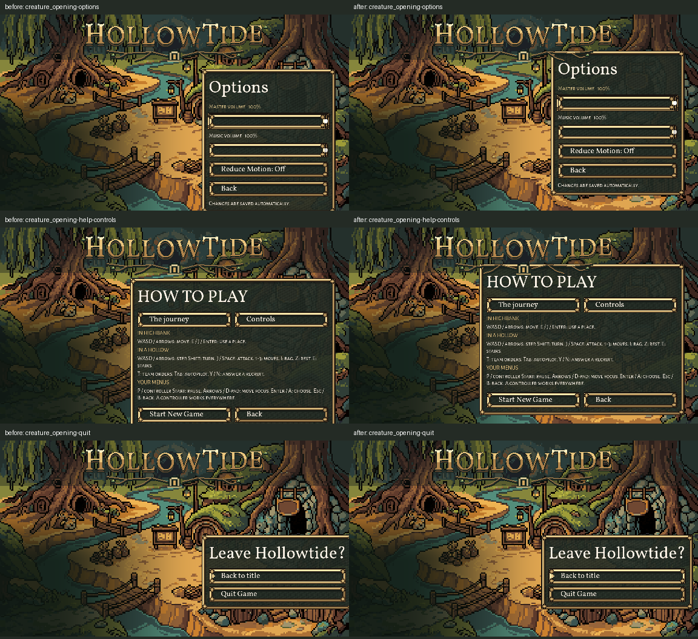

# Title panel bounds, October 26, 2026

Original task 3 and the latest factory pass 6 C2 are complete. Options, both How to play topics and Quit now fit the 1152x648 composition with their full frames. Only four panel placements in two title scripts change. Text, fonts, row spacing, art, input bindings and settings behaviour stay as they were.

| Campaign panel | Before | Installed |
| --- | --- | --- |
| Options | y180–659 | y120–599 |
| How to play: journey | y168–669 | y120–621 |
| How to play: controls | y168–669 | y120–621 |
| Quit | x666–1167 | x635–1136, 16px right margin |

Quit's x position uses its actual combined minimum width rather than assuming the requested width is the final width: the current question expands the panel to 501px. Its position is calculated after setting the requested minimum. The shared base Options panel also starts at y120, so the legacy opening's Options ends at y558 rather than y692. No menu rows or wording are squeezed to make the panels fit.

## Checked

- [Campaign native check](after.log): **12/12**, clean runtime log. Both Help topics, their action buttons, Options focus, the full Quit question and cancel-to-main all measured in the actual scene. All four installed campaign screenshots inspected: [Options](native-after/creature_opening-options.png), [journey](native-after/creature_opening-help-journey.png), [controls](native-after/creature_opening-help-controls.png), [Quit](native-after/creature_opening-quit.png).
- [Full native ui_fit](ui_fit.log): **48/48**, zero failures, clean runtime log. This uses the current repository test's assertions unchanged, with private save/capture paths and cleanup of its persistent music player. Its three title points now pass at 599/621/621. The existing team, town, dialogue, shrine, pause-page and input-hint measurements also pass.
- [Official check runner](runner-result.md): unmodified `tools/debug/run_checks.py ui_fit --jobs 1` reports **PASS**, exit 0. [Raw log](runner/ui_fit_check.log). The unmodified check leaves seven ObjectDB instances and three resources at exit, which the existing runner excludes as known noise; its log is not claimed clean. The private native copy frees persistent music and exits cleanly. This headless run is the official measurement result; the native runs above provide visual proof. The complete 99-check suite was not rerun or claimed green by this small pass.
- [Legacy native check](legacy.log): **6/6** geometry/focus/cancel assertions. It still emits an ObjectDB exit warning (100–101 instances across baseline/installed fixtures). Its runtime log is not claimed clean; the campaign check and full native ui_fit are clean.
- [Protection receipt](publication.json): fresh originals retained; 1,369 of 1,373 protected existing files exact after source and documentation publication. Only the two owned title scripts and the two handoff documents differ. Claude's existing dirty ui_fit and other source changes remain exact. Newline conventions are preserved, and the scoped source diff passes `git diff --check`.

All native runs use Compatibility rendering, fixed 30fps, Dummy audio, private APPDATA/LOCALAPPDATA and a private TeamState save path. No real user save/settings are read or written. The official runner creates its own per-check private APPDATA; its parent LOCALAPPDATA is also private. These checks open panels and cancel; they do not activate Quit Game or Start New Game.

## Originals and reproduction

[Original source and handoff snapshots](originals/), [prepared scripts](prepared/), [protected baseline hashes](protected-before.json), [installed script hashes](installed-files.json), [before measurements](measurements-before.json), [installed campaign measurements](measurements-after.json), [legacy measurements](measurements-legacy.json), [exact source diff](source.diff).

`prepare.py` captures current live files; `install.py` applies exact byte replacements after checking the whole protected baseline. `native_check.gd` drives real scene buttons and records rectangles/screenshots. `run.py` records engine arguments and logs. `prepare_ui_fit.py` copies the current check with all assertions unchanged and only isolates its save/output paths plus music teardown; `ui_fit_private.gd` is the resulting fixture. `publish.py` checks installed/protected hashes, preserves existing documentation, and writes the bottom-of-queue result. All commands are in the JSON receipts and `runner-command.json`.

## Source issues for Claude and next work

- The initial combined fixture ended while the legacy menu's unused `world_journey.tscn` background load was still running. Its archived [first teardown log](before-first-teardown.log) contains cascading resource shutdown errors. Waiting for that existing worker before freeing the scene removed those errors. This was fixture teardown, not a title-placement defect. The legacy-only check still reports the ObjectDB exit warning noted above. Removing the unused route load remains queued C12; no route files were changed here.
- The old task 3 suggestion to reduce row separation from 12 to 10 would still miss the newer y636 target. The current fix preserves spacing and follows pass 6 C2 instead.
- Title font roles, richer Options rows, controller help, caption/skip behaviour and proposed words remain their separate queued slices. This pass retains the current Quit cancel label; C19's wording is still Preston's decision.
- Next original-queue slice: task 4 / C1 settings preservation and crash-safe save. Inspect current preference separation and the latest UI save helper before changing it. Earlier concurrent settings edits were never claimed checked by Codex.

No generation, asset modification, game rules, real saves, addon fix, route change, external messaging or commit.
