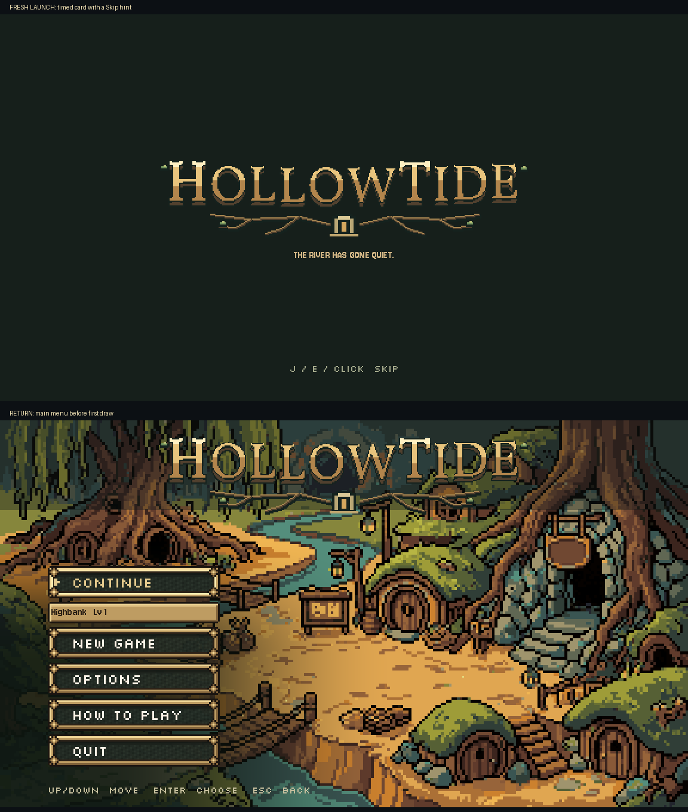

# C5 splash and return to title, October 26, 2026

COMPLETE/INSTALLED. A fresh game process keeps the existing timed launch card. Once the title has finished opening, another title in the same process opens its main menu immediately, with no repeated card or dim hold. The launch hint says **Skip**, using current shared action bindings and click, rather than implying a key is required for an automatically advancing card. The prelude and its caption labels are explicitly hidden at zero alpha before the menu appears.

[Actual pause-menu return](after/actual-pause-return.png). The campaign baseline waited **77 frames** to open the menu again; the installed return is ready inside `_ready`, **0 waiting frames**, with menu/wordmark alpha1. Existing shared fades still cover the real pause-menu scene change. The first launch still takes its existing1.8s card plus sequential0.5s/0.25s reveals, or the existing0.2s and instant swap under Reduce motion. No persisted return flag, preference key or team-save change was added. A new process starts with the card again.

## Scope

`scripts/opening_flow.gd` owns the process-local seen flag, immediate return branch, shared skip label and caption cleanup. `scripts/creature_opening.gd` changes exactly one hint assignment to use that shared label. All other creature methods, including C6/Continue/New Game, are exact. `main_menu.gd`, `ui_style.gd`, `title_settings.gd`, project settings and the opening gameplay scenes were untouched. Existing C2-C4 type/bounds/settings, logo sequencing, C7 inputs, C8/C9 and Storm work remain installed.

LV-24's sound pieces were **already correct** in the fresh baseline: first focus silent, Options one confirm, initial shared focus quiet. They needed no production change. Final native checks activate Options through actual keyboard, pad, mouse and rebound Q events; a real Enter press confirms the real pause Return to title. This is distinct from merely calling page methods.

`Skip` reuses the opening's existing instruction word; the tagline/narration remain exact. Visuals reviewed by Codex; Preston approval not claimed.

## Evidence

- Campaign native: **105/105**, clean log, Compatibility/Dummy/fixed30. Six first-launch cases: automatic, Enter, pad A, mouse, reduced automatic and rebound Q. Each checks first focus, no overlapping logos, safe skip, captions, Options sound counts, immediate return, full opacity and preservation of both preference files on return. Actual pause confirmation returns to the campaign title; private team-save SHA exact. [Fixture](native_check.gd), [results and frame metrics](after-result.json), [log](after.log), [command](after-command.json), [captures](after/).
- Legacy native: **35/35**, first normal/reduced cards and immediate returns. Known raw exit warning remains:102 ObjectDB instances, versus101 in the earlier logo evidence. This is not a clean-exit claim and no legacy resource fix is included. [Results](after-legacy-result.json), [log](after-legacy.log), [command](after-legacy-command.json).
- Original native baseline: **11/11**, clean final log. First/menu sequence76 zero-based completion frame, return77 wait frames; old `Enter to continue` hint; correct sound counts. [Results](before-result.json), [log](before.log), [captures](before/). The baseline's return screenshot is after the wait; it is not presented as the initial return frame.
- Maintained `opening_flow` and `ui_fit`: **2 PASS**, exit0. [Runner result](runner-result.md), [raw logs](runner/). Known headless shader/exit diagnostics remain in raw logs. Native screenshots above establish the visible result.
- [Diff](source.diff), [originals](originals/), [installed hashes](installed-files.json), [preservation report](verification.json), [protected pre-edit hashes](protected-before.json). No main-menu/shared helper edit. The creature diff is exactly one line. The opening's input handler, close handler and journey dispatch are exact. C6 remains OFF. Concurrent Claude source/check edits preserved and archived separately.

Fixture corrections are retained in the baseline attempt logs and [first installed attempt](first-installed-attempt/after.log). Loading the opening as a compile-time constant in a standalone `--script` check ran ahead of PlayerParty autoloads, so the check uses deferred runtime loading. Unknown non-title prefs are intentionally migrated to game_prefs.cfg by existing UI code; preservation checks cover both files after that initialization. The reduced completion frame is zero-based4, not at least5. These were fixture corrections; production C5 code did not need a repair.

The pause-return check uses the actual GamePauseMenu on a disposable Node2D host. It exercises confirmation, shared fade, scene replacement and title focus; it does not test a world's autosave or dungeon suspension.

## Handoff

Source issues for Claude: none new. The known legacy exit-resource warning remains documented; the prior shared UI.pressed neutral-motion follow-up remains, with owned handlers already feeding neutral events. The LV-24 launch-wordmark overlap and focus/Options sounds are now verified closed alongside return skip and honest auto-splash wording.

Next ordered slice **A5/LF7-15 Continue loading**: start its sound/fade first, thread Highbank beneath black, and inspect the unused world_journey preload without modifying Route1. C6 stays OFF pending Preston's words. Town/exterior HOLD pending its named slot queue. No real save, art/generation, paid call, rules, Route1 change, message or commit. [Team handoff](../../team/CODEX_HANDOFF_2026-10-26_title_return.md).
