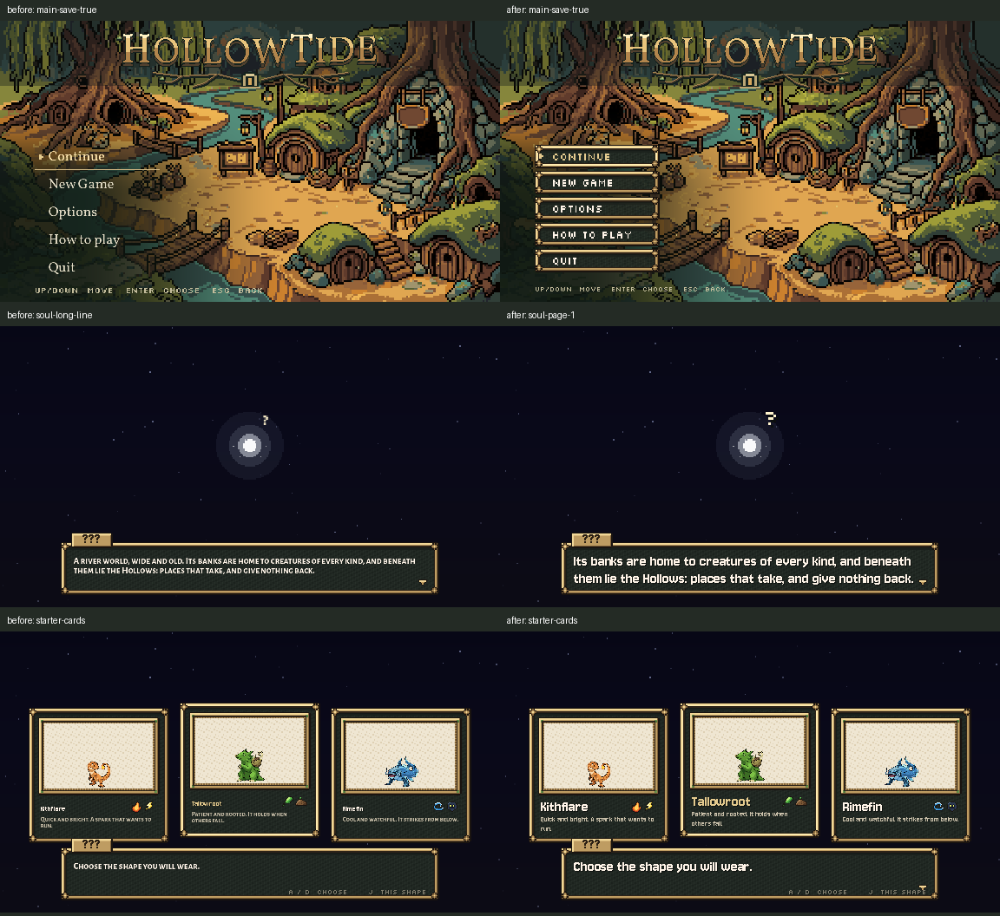

# Shared title and soul typography, October 26, 2026

**C3 complete and installed.** The title menu and its panels now use the same pixel type roles and framed buttons as the game. Removed the creature title's Vollkorn/Alegreya and direct hint-font overrides; buttons use `UI.style_button`, normal/focus frames come from `UI.frame`. The carved HOLLOWTIDE wordmark remains pixel-for-pixel identical.

The soul scene now uses the shared `story` role through `UI.dialogue`, with two-row pages and page-aware advancement. Its old prose font would not fit the new story size on long lines; pagination lets every word be read before the next story line. Removed its duplicate typing blip while retaining the choice blip and existing presence animation timing. Starter names use the `name` role, descriptions `body`, and the question/hints `label`.

The roles reference today's `UI.TYPE`: Jersey for prose, names and headings; Silkscreen for buttons and small labels. Pixelify remains unused, consistent with Preston's existing font selection and the latest integrator note. No new fonts or role definitions were added.

## Verified

- [Native title/story check](after.log): **45/45**, clean runtime log. Actual visible button fonts and whole-pixel role sizes, frames, text widths, panel bounds, focus/cancel and Help prose checked with and without Continue. Main menu ends590 without a save and596 with Continue; Options ends586, both Help topics602, Quit right1108. All remain inside the bounds fixed by C2.
- The [rendered original wordmark](wordmark-before.png) and [installed wordmark](wordmark-after.png) match exact RGBA. Its script builder and all font/menu art assets remain unchanged.
- Long soul dialogue registers its complete text in the shared reader, completes and turns each page without skipping the story, then advances only after the last page. Every LINES/AFTER row fits the story width; two rows stay inside the frame. All three starter names/descriptions fit. The native story reaches the Tallowroot handoff with the selected hero intact.
- [Current full native ui_fit](ui_fit.log): **48/48**, clean runtime log, including all title points and existing town/dungeon/dialogue/pause checks. Only private output/save paths and music/blip teardown differ from the current repository test; assertions are unchanged.
- [Official runner](runner-result.md): **3 PASS**, exit0: opening_flow (21 checks), soul_prologue and ui_fit. [Opening log](runner/opening_flow_check.log), [soul log](runner/soul_prologue_check.log), [ui_fit log](runner/ui_fit_check.log). Its known exit-instance/resource warnings are retained; those headless logs are not all claimed clean. No full-suite claim.
- [Source verification](verification.json): input handlers, starter card geometry/scale, choice and flight methods, all LINES/AFTER text and prior title settings preservation/save methods remain exact. `MENU_FACE`, `COPY_FACE` and `HINT_FACE` are removed from creature_opening; soul_prologue has no `UI.HEAD` uses. Scoped `git diff --check` passes.

Inspected native captures: [main with Continue](native-after/main-save-true.png), [main without a save](native-after/main-save-false.png), [Options](native-after/options-save-false.png), [Help journey](native-after/help-journey.png), [Help Controls](native-after/help-controls.png), [Quit](native-after/quit.png), [soul page1](native-after/soul-page-0.png), [soul page2](native-after/soul-page-1.png), [starter cards](native-after/starter-cards.png). The stopped capture needs a redraw after completing the instant choice prompt; the final fixture does this to match the real scene's continuous redraw.

All native checks use Compatibility rendering, Dummy audio, fixed30, separate APPDATA/LOCALAPPDATA and a private TeamState save path. Continue is created using a test team/save. It is deleted after testing. No real player save/preferences are read or written. The handoff check is a private staged scene transition, not a natural playthrough.

## Scope and concurrency

Exactly three owned production scripts changed: `main_menu.gd`, `creature_opening.gd`, `soul_prologue.gd`. [Fresh originals](originals/), [installed scripts](prepared/), [exact source diff](source.diff), [baseline hashes](protected-before.json), [installed hashes](installed-files.json), [concurrent-file receipt](publication.json). Claude continued editing dungeon/story files while this ran; those were preserved and their finish-time bytes archived separately. Current collaboration and task-file bodies are retained when adding the result.

`prepare.py` captures and prepares the scoped edits; `install.py` guards owned files against concurrent changes; `native_check.gd` checks real UI instances and shared dialogue pages; `run.py` records native commands/profiles. `prepare_ui_fit.py` copies the current assertions to task-private paths, `verify.py` checks unchanged source functions, and `publish.py` archives evidence and appends the handoff. The [official command](runner-command.json) and individual `*-command.json` files record exact executions. Original file newline conventions are preserved.

## Source issues for Claude and remaining queue

- C3 also completes C7's shared-dialogue/font portion because the larger `story` type needs paging. **C7 as a whole remains pending:** the soul's input handler and main_menu `_ensure_menu_inputs` are unchanged. The only remaining `UI.HEAD` mention under scripts is a historical comment in party_screen; the shared constant was not deleted from Claude's active UI file. Remove it in your lane when ready; no cross-chat message was sent.
- C4 still owns the full Options rows, filled sliders and live device-aware Controls content. These controls retain their existing content and behaviour in this pass. C8 still owns larger showcase cards/essence backdrops; card geometry and creature scale are exact here. C9's shaft/top-strip changes and other opening work remain pending.
- The separate pause-helper save gap from the previous handoff remains open. Its tested candidate is in `docs/ui/settings-save-2026-10-26/proposal/shared-pause-save.diff`; this pass does not touch Claude's active helper.
- The baseline check found the old Continue menu's actual bottom at616 even though its estimated height suggested596. Shared button font sizing now makes the real native bottom596; both no-save and Continue cases are directly measured rather than inferred from `menu_top` alone.

No art modification/generation, paid call, creature rules, new wording, real user files, Route1 changes, external messages or commit. Next independent Codex slice: **C4, title Options parity and live Controls help**. Re-read the current pass7 notes and file ownership first.
