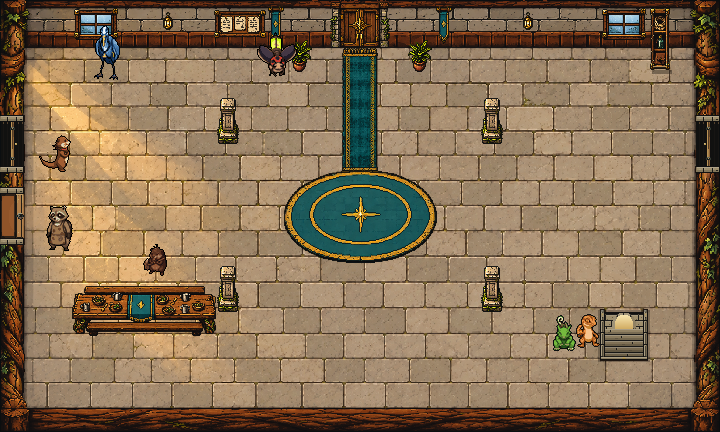

# Hall fixture finish — October 11, 2026

Task 3 of Claude's current master queue is installed. This finishes the **current** corrected fixtures in `room_painter._fixtures`, preserving Claude's placements, perspectives, solids and links. Visual proposal for Preston's review.

## Installed art

- Side openings stay overhead gaps with five-pixel edge-on timber leaves. Native grain, iron hinges, brass handles and limestone jambs replace the plain blocks. West/east handle orientation is preserved.
- Kitchen hatch retains its firelit gap, narrow counter edge, overhead pot and existing spill light. Added timber grain, fasteners, iron pot lip and short handles.
- Keepsake, ledger and supply cases retain the existing shortened 20×62 crops at x26/x362/x650, y8, ending on row 2. Added etched frame rails, brass fasteners and a worn base; contents remain in their original positions. No tall case returned to a side wall.
- The downstairs well stays dark with an arch at its far end. The upstairs arch stays lit, with brighter treads toward the upper floor. Warm cut limestone, staggered mortar/tread joints, worn arrises, low rails and brass landing marks match the Hall palette.
- Runners' two pegs remain empty hooks seen from above, with small brass necks and shaded tips.

One new native GDScript helper, `scripts/town/hall_fixtures_art.gd`; one paint hook in `room_painter.gd` and two bounded mask hooks in `hall_floors_art.gd`. The existing shared 0.75 shader finish is reused. All source PNGs, room definitions, game/state/story code, settings, source backups and previous archives are preserved. No new raster generation or paid calls; this pass is Codex-authored procedural pixel art over the existing fixtures. No commit, reset, stash or revert.

## Verification

Native Godot 4.7.2 with OpenGL Compatibility, staging and live: **36/36 art checks and all 13 current Hall-floor route/interaction assertions** (49/49 each).

- Every map remains opaque, at its current native canvas size. Raw image changes are confined to the exact fixture regions; detail-mask additions also stay inside those regions.
- All unselected floor pixels are byte-exact through the shader. Other room art is GPU-exact outside the one-pixel shader sampling halo.
- All 30 wired Hall services have reachable approaches. Current stair transitions, chamber doors, runners' story gate, bunk interaction and Starward's talk/solid check pass.
- Original Guildmaster desk position/depth/finish and cleared counter mask remain exact. Chamber's south threshold is byte-exact.
- Unknown rooms and wrong-size canvases pass through unchanged. If a case source is absent, the native finish leaves Claude's existing upright fallback alone.
- Original owned sources matched live snapshots immediately before guarded installation. `hooks.patch` records the complete presentation changes. Of 30,715 protected files, 30,712 are byte-exact. Three concurrent Claude changes add flood music, the crew cheer and runners' fanfare; preserved without edits, with baseline-matched before sources and exact after snapshots/diffs in `concurrent/`. `audit.json` records all hashes and the exact installed sources. The final live checks ran with these audio hooks present.

| Room | Changed raw pixels | Fixture shader pixels | Reachable services |
| --- | ---: | ---: | ---: |
| Upper Hall | 2,304 | 1,278 | 9 |
| Lower Hall | 5,630 | 4,215 | 10 |
| Chamber | 144 | 1,586 | 5 |
| Runners | 1,448 | 1,119 | 6 |

[All nine fixture comparisons, native before/after](review/fixture_comparison.png). `review/before` captures Claude's current fixtures before this pass; `review/staging-after` and `review/after` contain staging and final live raw, mask, GPU and room images. `review/routes` contains the transition/talk captures. The current production route assertions are unchanged; the private driver only redirects output and frees the persistent Music singleton before quitting. Staging's Dialogue Manager UID/certificate warnings were pre-existing; both final live runs exited cleanly.

## Reproduce / next work

Private workspace: `D:/dev/hollowtide-hall-fixtures-20261011`. Python/Godot paths are in `drivers/run.py`. Run `python run.py check --live` and `python run.py hall_floors --live` from the private workspace; isolated APPDATA/LOCALAPPDATA, hidden process and private output. The archived drivers retain their private workspace paths; copy them back there if reproducing later. Read current dependencies before running because Claude is working concurrently.

Task 4 is next: six crew dialogue portraits using current chosen fronts and townsfolk framing. Task 2's idle assets are installed; Claude's production standing-south swap remains pending as of this handoff. Existing crew posts/facings, walks and gear rules are unchanged. Codex is out of the two shared room-art files for this slice.
