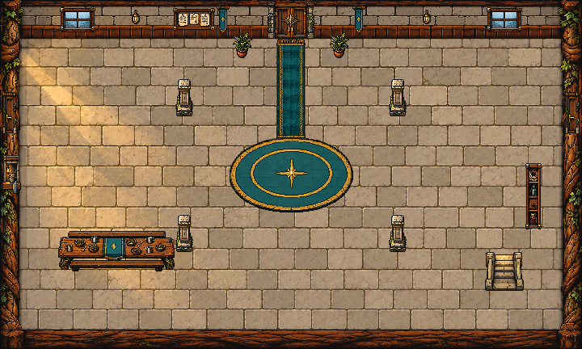
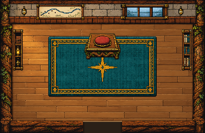
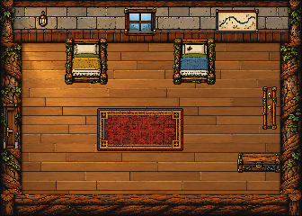

# Wayline Hall interior finish, 2026-10-11

Preston requested detail and sel-out on Claude's rebuilt Hall wiring. Installed the lower Hall, Guildmaster's chamber, runners' room and the upper work floor's new stairwell. Visual proposal for Preston's review.

Separate native fixtures match the existing Hall's rooted timber, limestone, teal cloth, brass fittings and top-left light. Every new fixture uses the shared non-destructive material rim (`scripts/art/selout.gd`) and the existing masked detail shader. Floor pixels outside the fixture/wall masks remain exact in native GPU rendering. Pillars and ferns reuse the finished original Hall PNGs without editing them. Quiet stone/plank shells are assembled from five native crops per room. The runners' peg source was corrected to TWO EMPTY hooks to match its existing interaction text.

Only two presentation lines each were added to `room_painter.gd` and `town_room.gd`, plus the new `hall_floors_art.gd` and 39 sibling PNGs in `assets/sprites/world/hall_floors_2026_10_11/`. The original code painters remain whole as fallbacks. No original art source, backup, creature, palette, shared shader, team/save, story flag or service rule was changed.

Claude changed the chamber during this pass. Both owned scripts were rebased before installation, with guarded source hashes. The live chamber is now **17x11 tiles, 408x264**; rug216x120, window96x32, east shelf on tile15, south door three tiles wide. Dais/cushion remain on tiles7..9; tile8 is the room's center. Other rooms: upper528x336, lower720x432, runners336x240. All final furniture positions and blockers follow the latest code. The new stair finish is applied AFTER the Guildmaster desk so its cleared old-counter mask stays clear. The desk remains192x52 at168,70, depth116 and detail ink0.55.

## Verification

Native Godot4.7.2/OpenGL compatibility checks, isolated test profile, no user editor/game process touched:

- Artwork checks: staging24/24; live23/23 (staging-only missing-file check excluded live). Exact dimensions/opacity, real selected GPU ink, zero unselected-floor changes, all service approaches reachable, original Home byte-exact, upper Hall changes confined to48x48 staircase, Guildmaster desk placement/finish intact, south chamber threshold byte-exact, fixture source alpha/material interiors preserved. Temporarily holding only the owned staging peg PNG restores the entire original runners painter byte-exact, then the crop is restored.
- Current four-room Hall wiring: all13 assertions pass, including both stair directions, both chamber directions, nonoverlapping landings, roll-call E, locked and unlocked runners' door, bunk E, room exit and Starward's solid/talk behavior.
- Existing Home/Hall walking and services pass. Private test destination uses11,5, the existing desk's open approach; the old11,4 destination is blocked by the original desk. Production debug test untouched.
- Existing guild story check passes:12 trial lines, no handed-over parcel after the revised theft opening, Starward back at11,2, no repeated scene; recovered parcel plays7 lines, runner=true, parcel=delivered. No story edits.
- Private Hall capture driver frees the previous room before recording runners, preventing two CanvasLayer HUDs in the still. Assertions and runtime room logic unchanged. Private drivers free the persistent Music singleton on exit.

Before screenshots, source snapshots, current concurrent snapshots, exact two-hook diff, installed hashes and protected-file audit are alongside this note. `finished_*.png` are full native GPU maps; numbered stills show the actual scene with creatures. `runtime_*.png` are the unshaded map textures, `mask_*.png` show shader coverage. No commits, reset, stash or revert.

## Generation and native preparation

Built-in **imagegen**, five calls: empty lower-shell style generation, empty wood-shell style generation, sixteen isolated Hall fixtures, eight runners/cloth/light fixtures, and a targeted peg edit removing the satchel. Original Hall/Home art and Claude's code-layout stills were references. No external paid generator/API calls. Native crop and nearest preparation only; generated bitmap sources were not painted over or destructively edited. Original default outputs retained.

Exact final prompt set: `lower-prompt.txt`, `chamber-prompt.txt`, `fixtures-prompt.txt`, `runners-prompt.txt`, `pegs-prompt.txt`. Unmodified outputs: `generation/`; peg edit target: `pegs-source.png`; exact crops/native sizes: `native-preparation.json`.

The upper Hall and Home PNGs, Guildmaster desk PNG/source renderer, waking painting, all installed creature refinements, Starward portraits/fringe, seven-form refinements and darker jade Oxbowarchon are preserved. Claude retains ownership of Hall rules/story/system wiring. Codex is out of the two shared room files after this pass. Growth Shrine remains a separate pending visual task; Preston redirected this slice to Wayline Hall.

